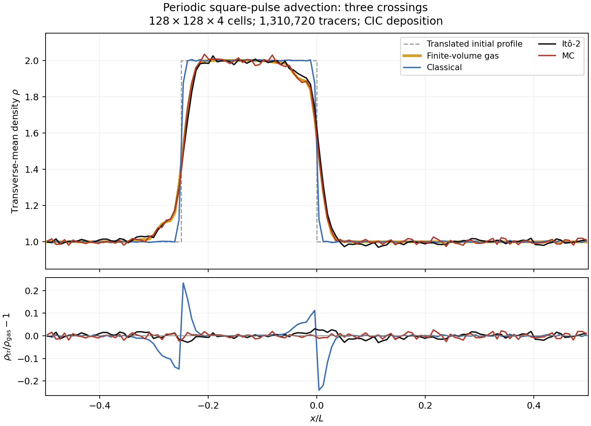
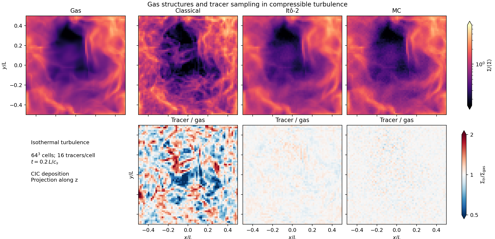
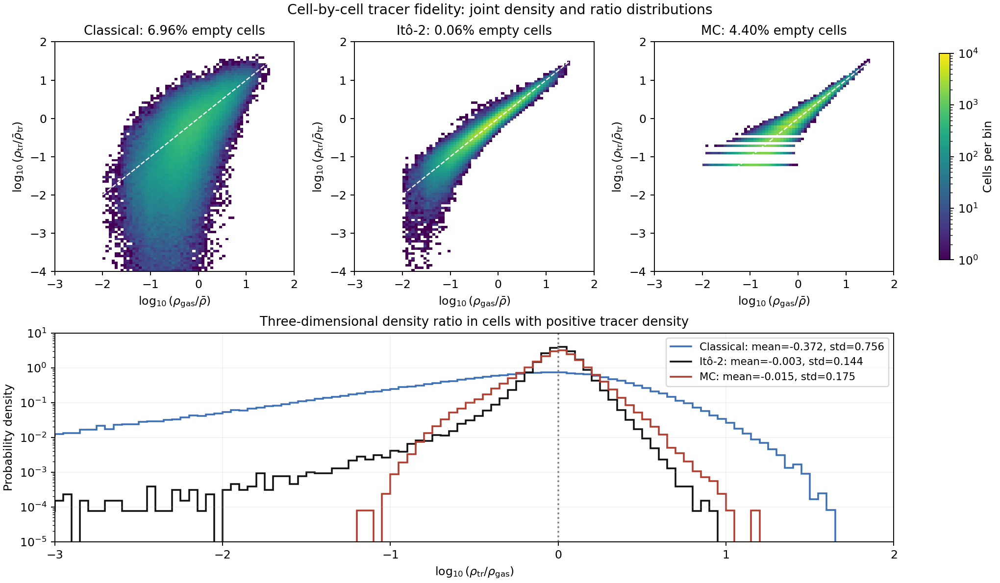
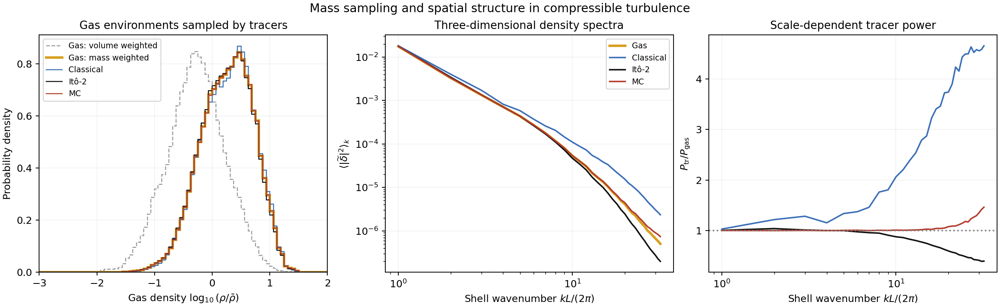
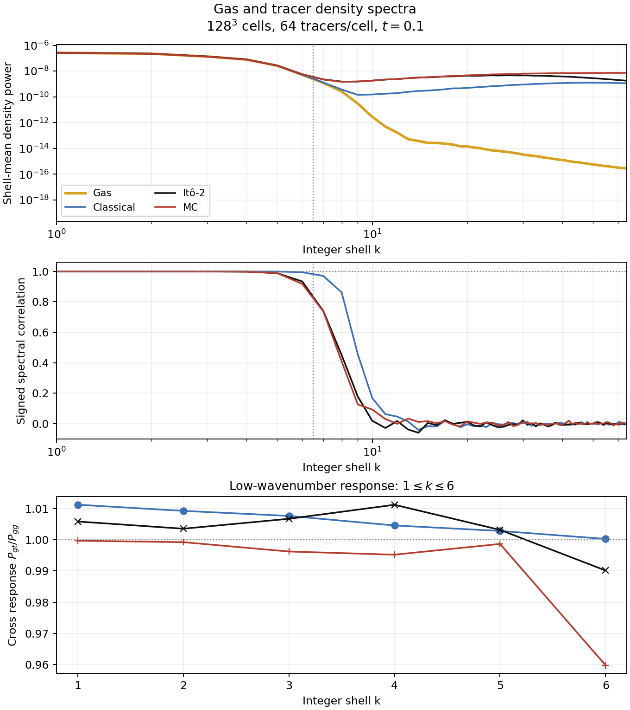
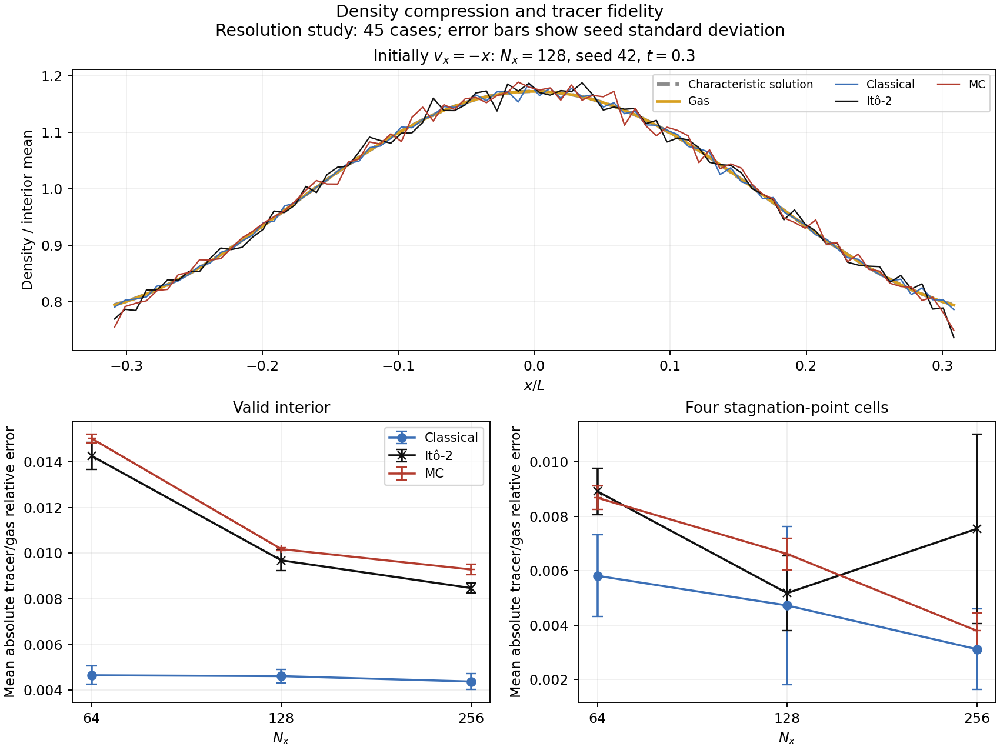
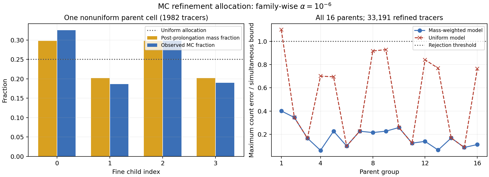
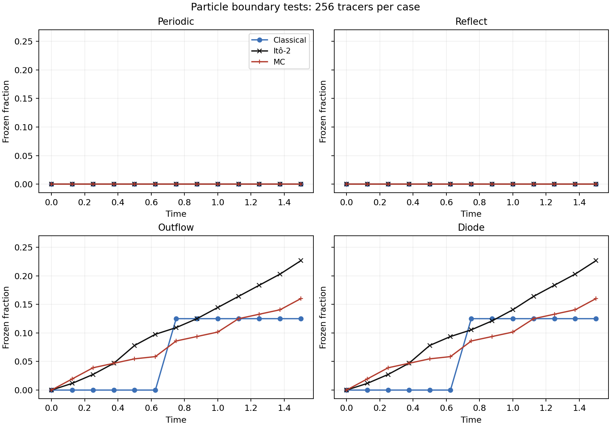
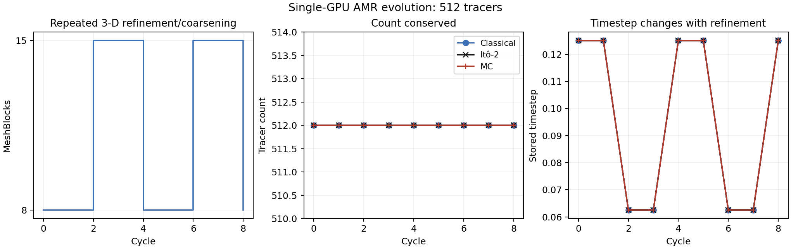

# Lagrangian tracers: physical validation

Do tracer particles sample the gas mass that the finite-volume solver actually
transports? We test this with a translating density pulse, compressible turbulence
and converging flow, using three update rules:

| Tracer | Motion | Quantity it follows |
| --- | --- | --- |
| Classical | Continuous displacement from CIC-interpolated velocity | The interpolated velocity field |
| Monte Carlo (MC) | Random jumps between cell centers | Finite-volume mass exchange, in expectation |
| Itô-2 | Continuous drift plus a random displacement | First two marginal moments of the flux-derived MC displacement |

For equal-mass tracers, the target occupation of cell `i` is

$$\mathbb E[N_i]=N_{\rm tot}\frac{\rho_i V_i}{M_{\rm tot}}.$$

Thus uniform particle *mass* sampling generally produces a nonuniform spatial
distribution. With $s=\log_{10}(\rho/\bar\rho)$, the mass-weighted gas-density PDF is
$p_M(s)=10^s p_V(s)$, where $p_V$ is the volume-weighted PDF. A histogram of gas
density sampled by equal-mass tracers should approach $p_M$. This test complements
spatial maps: a correct one-point PDF alone can conceal misplaced tracers.

For outgoing flux fractions $p_+$ and $p_-$ in one direction, the implemented
Itô displacement uses

$$C_-=p_+-p_-,\qquad V=p_++p_--C_-^2,\qquad
\Delta x=\Delta x_{\rm cell}(C_-+\sqrt{\max(V,0)}\,\xi),$$

with zero-mean, unit-variance uniform $\xi$ and CIC-interpolated moments.
Moment matching leaves finite-step differences between MC and Itô-2. MC cell
centering is intentional; classical and Itô trajectories retain subcell positions.
For independent mass sampling, integer counts have approximately Poisson scatter
$\sigma_N\simeq\sqrt{\mathbb E[N]}$. CIC deposition produces weighted, correlated
counts, so this expression is a noise scale rather than a confidence interval
for the CIC figures below.

## Relation to published tests

[Moseley, Teyssier & Abel (2026)](https://arxiv.org/html/2604.23041v1) compare
square-pulse profiles (Figure 3), turbulent column maps (Figure 7), joint density
histograms (Figure 8), density-ratio PDFs (Figure 9) and density spectra
(Figure 10). The following AthenaK figures reproduce those diagnostic questions
with the archived setups listed below. The paper uses a `128³`, one-crossing
pulse and `64³` decaying turbulence initialized at RMS Mach 15, with HLLC/MonCen.
Our pulse geometry, reconstruction and duration differ; our turbulence is
briefly driven with HLLE/PLM. These differences matter for numerical diffusion
and tracer statistics. The implemented comparison includes classical, MC and
Itô-2; Itô-3 and SGS tracers are outside this implementation.

[Genel et al. (2013)](https://arxiv.org/html/1305.2195v2) motivate the independent
mass-flux, converging-flow and subsonic-turbulence checks. Their Mach-0.3 tests
reach a developed state near `t=25`; our high-particle-density snapshot at
`t=0.1` probes early evolution.

## 1. Translating square pulse

The periodic unit box contains $\rho=2$ for $-0.25\leq x<0$ and $\rho=1$
elsewhere, advected at $v_x=1$. The continuum solution translates rigidly and
returns to its initial profile after each crossing. The numerical gas broadens
at the interfaces; matching that evolved gas distribution is the tracer test.

The archived run uses `128×128×4` cells, isothermal **kinematic** advection,
PPMX reconstruction, the `advect` flux, RK2, CFL 0.2 and `t=3`. Its 1,310,720
tracers are initially allocated in proportion to gas mass (16 per background
cell and 32 per dense cell on average). The
[Itô input](data/square_hi_ito_2.athinput) and corresponding
[classical](data/square_hi_classical.athinput) and [MC](data/square_hi_lagrangian_mc.athinput)
inputs are included.



The upper panel averages density over both transverse directions; particles
are deposited with periodic, cell-centered CIC and scaled to the gas mean
density. The dashed curve is the translated initial gas profile. The lower
panel compares each tracer profile with the evolved gas. Classical tracers
preserve a sharper pulse and depart from the gas at its edges; both stochastic
methods follow the broadened interfaces.

| Tracer | RMS relative profile error | Maximum relative profile error |
| --- | ---: | ---: |
| Classical | 0.04980 | 0.2408 |
| Itô-2 | 0.01210 | 0.03091 |
| MC | 0.01048 | 0.02649 |

For $e_j=\rho_{{\rm tr},j}/\rho_{{\rm gas},j}-1$, these norms are
$[N_x^{-1}\sum_j e_j^2]^{1/2}$ and $\max_j|e_j|$, respectively. They are
spatial residuals from one realization, not uncertainty estimates.
The [data](data/paper_comparisons.npz) also preserve containing-cell profiles:
their RMS residuals are 0.06047, 0.01380 and 0.01048, respectively. MC's CIC and
containing-cell profiles coincide because its positions are cell-centered.

## 2. Compressible isothermal turbulence

The archived periodic unit box has `64³` cells, $c_s=1$, initially uniform
density and 4,194,304 tracers (16 per cell). Solenoidal forcing acts over
`t=0–0.05`, using modes 1–5, correlation time 0.02 and energy-input parameter
1500; the flow then decays until `t=0.2`. The solver uses HLLE, PLM and RK2.
At the plotted time its volume-weighted RMS Mach number is **3.381**. The
[Itô input](data/turb64_iso_ito_2.athinput),
[classical input](data/turb64_iso_classical.athinput) and
[MC input](data/turb64_iso_lagrangian_mc.athinput) specify the complete setup.
The saved gas-density arrays agree exactly across the three runs: this gas
realization is the reference for tracer comparisons.

### Where do the tracers go?



The upper row shows $\Sigma=\int\rho\,dz$, normalized by its box mean; the
lower row divides normalized tracer columns by normalized gas columns.
Particle density comes from periodic cell-centered CIC, assigning each particle
to its eight neighboring cell centers with trilinear weights. Gas density is
the saved cell average. Color-scale extensions identify values outside the
displayed range. Classical tracers develop strong small-scale excesses and
deficits; the stochastic maps remain close to the gas structures.

### Local density fidelity and sampling noise



The joint histograms count **3-D cells**, with the dashed diagonal indicating
equal normalized densities. The lower panel is the volume-weighted PDF of
$r=\log_{10}(\rho_{\rm tr}/\rho_{\rm gas})$. Both use cells with strictly
positive CIC tracer density; empty-cell fractions are reported separately.
PDFs integrate to unity over these populated cells. Their means and standard
deviations include the full stored range, including tails beyond the displayed
axes. MC's horizontal bands are integer occupation levels, as expected for
cell-centered tracers.

| Tracer | Empty CIC cells | Mean `r`, populated cells | Std. `r`, populated cells | Std. column log-ratio |
| --- | ---: | ---: | ---: | ---: |
| Classical | 6.960% | −0.3722 | 0.7556 | 0.11958 |
| Itô-2 | 0.0580% | −0.00325 | 0.1441 | 0.01793 |
| MC | 4.404% | −0.01454 | 0.1751 | 0.01663 |

Itô-2 has a narrower populated-cell distribution and fewer empty deposited
cells than MC, whereas MC has slightly smaller projected scatter in this run.
Projection averages over 64 cells and changes the noise comparison. The
large classical deviations persist with either diagnostic. These quantities
describe one realization and do not establish a universal ordering of methods.

### Mass sampling and spatial scales



Left: each tracer samples the gas density of its containing cell, and the
histogram counts tracers rather than volume. The reference curves weight the
same gas cells by volume or mass. All three follow the mass-weighted PDF much
more closely than the volume-weighted PDF; the large spatial classical bias
seen above survives despite this agreement. The binned total-variation distances
from the mass-weighted gas PDF are 0.01404 (classical), 0.00945 (Itô-2) and
0.00127 (MC).

Middle/right: for $\delta=\rho/\bar\rho-1$, we plot
$P(k)=\langle|\widetilde\delta(\mathbf k)|^2\rangle_k$ and the tracer/gas ratio.
The discrete Fourier transform is divided by the number of cells; integer
shells have unit width in $kL/(2\pi)$. The figure shows shells through the axial
Nyquist wavenumber 32; all shells and mode counts are bundled. CIC window
deconvolution and shot-noise subtraction are omitted consistently. Classical
tracers have substantial excess small-scale power. MC has a high-wavenumber
noise excess; Itô/CIC power is suppressed on the smallest scales. Consequently,
agreement at large scales is more informative than a demand for unity at every
wavenumber.

## 3. Early subsonic turbulence and converging flow



This `128³`, 64-tracers-per-cell run has measured RMS Mach 0.315 at `t=0.1`.
The signed correlation is $P_{gt}/\sqrt{P_{gg}P_{tt}}$ and the response is
$P_{gt}/P_{gg}$. Mean response/correlation over `k=1–6` is
1.005933/0.998854 (classical), 1.003406/0.986461 (Itô-2) and
0.991450/0.983874 (MC). High-wavenumber density power becomes sampling-noise
dominated. Classical agreement during this early weakly compressible phase
does not resolve the long-time discrepancy tested by Genel et al.
[Spectra](data/mach03_spectra.csv) and [metadata](data/mach03_metadata.json)
contain all 111 shells.



This test studies accumulation near a stagnation point, following the question
posed by Genel et al., Section 3.2 and Figure 7. The initial flow is linear,
$v_x=-a x$ with $a=1$, and the initial density is
$\rho_0(x)=1+0.2\cos(2\pi x/L)$. The archived gas undergoes pressureless
self-advection, whose characteristic solution before $t=1/a$ is

$$x(t)=x_0(1-at),\qquad v_x=-\frac{ax}{1-at},\qquad
\rho(x,t)=\frac{\rho_0[x/(1-at)]}{1-at}.$$

The saved interior velocity slope at `t=0.3` is −1.42852, consistent with
$-1/(1-0.3)$; the gas density agrees with the characteristic solution to
about $5.83\times10^{-5}$ in mean absolute relative error over the plotted
interior. This identifies the
actual archived evolution. The [archived input](data/converging_n128_ito_2_s42.athinput)
omits `problem/user_work_in_loop`, which defaults to false: the pgen's registered
velocity-reset callback is disabled. The `advect` solver transports momentum
without a pressure term, so the isothermal EOS does not supply pressure forces
in this test. The kinematic PPMX/RK2 runs use
`Nx×4×4` cells, open x boundaries and periodic transverse boundaries. We retain
the historical measurement region $|x|\leq0.85(0.5)e^{-0.3}\simeq0.315$.
It lies inside the actual contracted footprint $|x|<0.5(1-0.3)=0.35$,
avoiding boundary-supplied gas without corresponding injected particles.
The upper panel compares the numerical gas, characteristic solution and
containing-cell tracer profiles for `Nx=128`, seed 42; each curve is normalized
by its own mean in that interior.

The lower panels summarize 45 cases (`Nx=64,128,256`, three pushers and five
seeds). Errors use the numerical gas as reference, with independent valid-region
mean normalization for gas and tracers; the central diagnostic uses four cells.
This measures profile shape rather than absolute mass normalization. Error bars
show sample standard deviations across seeds. Central Itô error is nonmonotonic
with resolution, so these results establish no convergence order. This is an
exploratory comparison without a prescribed accuracy tolerance.
These results describe ballistic convergence; the fixed-strain exponential-compression
benchmark remains a separate test.
[Metrics](data/converging_flow_metrics.csv) and
[definitions](data/converging_flow_metadata.json) are included.

## Reproduction and historical source provenance

All nine figures can be regenerated from the bundled numerical data:

```bash
python docs/feature-validation/particles/plot_results.py --check
python docs/feature-validation/particles/plot_results.py
```

Requires Python 3, NumPy and Matplotlib. The check recomputes figure summaries,
normalizations, conservation checks and statistical bounds. The new pulse,
turbulence and converging-profile arrays occupy 139,060 bytes (136 KiB);
[metadata](data/paper_comparisons.json) give snapshot/input/log checksums, run
identifiers, executable hashes and complete measurement summaries.
[The extraction script](extract_paper_data.py) reconstructs those reductions
from the original `revalidation_rk4_20260901` archive using the public binary
reader (NumPy and h5py required). Original native snapshots are larger and are
identified by checksum rather than bundled.

The archived executables used CMake `PROBLEM=built_in_pgens` for the pulse,
`PROBLEM=fluids/turb` for turbulence and `PROBLEM=tests/converging_flow` for
convergence. In particular, the bundled converging input's `pgen_name=none`
relies on that custom compiled problem; it is not a runtime selection for the
default binary. The converging executable hash and execution-log checksum are
included in the metadata.

| Results | Source provenance |
| --- | --- |
| Pulse and compressible turbulence | September revalidation based on `13fa232e6d7177e9e11b6c89529f56b6541ba8df`, including then-uncommitted CIC-moment, RK-flux/donor and timestep repairs; execution binaries pinned in the metadata |
| Low-Mach spectrum and converging flow | Historical post-CIC / post-RK-repair diagnostics, identified by their individual metadata |
| Boundaries, SMR/AMR and restart below | Later particle lifecycle implementation, including `366a172a`; source inventory recorded at `886ab25ae0a58e4cbb12e44158987872eafcdf07` |

The physical comparison snapshots therefore document the historical uniform-grid
implementation; the later refinement/restart coverage is listed independently.
The paper's single-sheet trajectory/diffusion and Itô-3 comparisons have no
corresponding result in this bundle.

## Appendix A. Implementation history and source map

<details>
<summary>Commits, functions and changed locations</summary>

The particle implementation starts from parent `62892d08`:

| Commit | Implementation change |
| --- | --- |
| `96f0e50f` | Storage, pushers, migration, initialization, output and paired restart |
| `69f0ea7d` | Conditional MC face sampling and isothermal particle-output guard |
| `743f3e45` | Shared particle initialization in turbulence |
| `735f7483` | Ito CIC moments, RK-aware saved flux, donor snapshot and timestep estimate |
| `1707b212` | Particle implementation comment cleanup |
| `8445dcc9` | Converging/diverging-flow diagnostic problem |
| `366a172a` | Boundaries, SMR routing, dynamic AMR transfer and checkpoint lifecycle |

[Source manifest](data/source_manifest.json) records full commit IDs, all 34
source/build paths, each changed diff-hunk header and current file SHA256.
Hunk coordinates refer to their individual commits; links below refer to the
documented revision.

| Source | Changed locations and purpose |
| --- | --- |
| [src/CMakeLists.txt](../../../src/CMakeLists.txt#L118) | Registers particle restart/binary output and AMR transfer translation units. |
| [src/athena.hpp](../../../src/athena.hpp#L72) | `ParticlesIndex`: position/velocity slots and last-move/last-level bookkeeping. |
| [src/particles/particles.hpp](../../../src/particles/particles.hpp#L28) | Type/pusher enums, storage/task APIs; `MeshRedistribution` (100) preserves records across topology changes. |
| [src/particles/particles.cpp](../../../src/particles/particles.cpp#L27) | Constructor parses aliases, restrictions, seeds and options; `ReallocateParticles()` (198), `CreateParticleTags()` (209) maintain storage/identity. |
| [src/particles/particles_tasks.cpp](../../../src/particles/particles_tasks.cpp#L28) | `AssembleTasks()` runs particles after fluid stages. `NewGID`, `SendCnt`, `InitRecv`, `SendP`, `RecvP`, `ClearSend`, `ClearRecv` (101–159) order migration. |
| [src/particles/particles_pushers.cpp](../../../src/particles/particles_pushers.cpp#L25) | Stateless RNG/displacement helpers; `Push()` (62), drift compatibility (91), `PushLagrangianTracer()` (133), `PushLagrangianMC()` (251), `PushIto2()` (415), `AdjustMeshRefinement()` (649), `NewTimeStep()` (950). |
| [src/particles/particles_amr.cpp](../../../src/particles/particles_amr.cpp#L30) | `RequireAll()`, `Bounds()` (45), `ChildDraw()` (71), `PrepareMeshRedistribution()` (86), `FinishMeshRedistribution()` (178): complete-record mapping/exchange and mass-weighted MC child selection. |
| [src/bvals/bvals_part.cpp](../../../src/bvals/bvals_part.cpp#L32) | Periodic-coordinate, bounded-neighbor and physical-boundary helpers (32/47/61); `UpdateGID()` (82), dormant deletion helper (105), `SetNewPrtclGID()` (118); count/receive/send/unpack/cleanup methods (441/507/593/683/808/835). |
| [src/hydro/hydro.hpp](../../../src/hydro/hydro.hpp#L110) | Saved density-flux/donor arrays, lazy enabling API and stage task. |
| [src/hydro/hydro.cpp](../../../src/hydro/hydro.cpp#L362) | Constructor state and `SetSaveUFlxIdn()` allocate only for MC/Ito consumers. |
| [src/hydro/hydro_fluxes.cpp](../../../src/hydro/hydro_fluxes.cpp#L247) | `Hydro::SaveFlux()` snapshots initial density and integrates fluxes with actual RK weights. |
| [src/hydro/hydro_tasks.cpp](../../../src/hydro/hydro_tasks.cpp#L61) | Registers the saved-flux task. |
| [src/mhd/mhd.hpp](../../../src/mhd/mhd.hpp#L157) | Corresponding MHD saved arrays/API. |
| [src/mhd/mhd.cpp](../../../src/mhd/mhd.cpp#L489) | Corresponding MHD lazy allocation. |
| [src/mhd/mhd_fluxes.cpp](../../../src/mhd/mhd_fluxes.cpp#L282) | `MHD::SaveFlux()` quadrature and initial donor-density snapshot. |
| [src/mhd/mhd_tasks.cpp](../../../src/mhd/mhd_tasks.cpp#L54) | Registers saved-flux work for particle consumers. |
| [src/pgen/pgen.hpp](../../../src/pgen/pgen.hpp#L41) | Particle restart constructor argument and shared initialization/restoration interfaces. |
| [src/pgen/pgen.cpp](../../../src/pgen/pgen.cpp#L44) | Initialization RNG; paired restart reader (144); `InitializeLagrangianParticles()` (1260), `InitializeParticlesFromRestart()` (1408). |
| [src/pgen/fluids/turb.cpp](../../../src/pgen/fluids/turb.cpp#L234) | Calls shared fresh-run particle initialization. |
| [src/pgen/tests/advection.cpp](../../../src/pgen/tests/advection.cpp#L22) | Opt-in alternating AMR callback; restart-safe enrollment (51), transverse flow and shared initialization (280). |
| [src/pgen/tests/converging_flow.cpp](../../../src/pgen/tests/converging_flow.cpp) | Converging/diverging-flow diagnostic fixture. |
| [src/main.cpp](../../../src/main.cpp#L168) | `-p` companion checkpoint, shared/per-rank naming and reader plumbing (363–393). |
| [src/mesh/mesh.hpp](../../../src/mesh/mesh.hpp#L142) | Particle counts, checkpoint phase, timestep and refinement-age state. |
| [src/mesh/mesh.cpp](../../../src/mesh/mesh.cpp#L727) | `FinalizeParticleDataStructures()` counts/tags; cleanup; `NewTimeStep()` particle constraint (658). |
| [src/mesh/mesh_refinement.cpp](../../../src/mesh/mesh_refinement.cpp#L431) | `RedistAndRefineMeshBlocks()` prepare/finish hooks (516/674); restored refinement ages (87). |
| [src/mesh/build_tree.cpp](../../../src/mesh/build_tree.cpp#L432) | Reads lifecycle metadata and validates restart timestep/refinement state. |
| [src/driver/driver.cpp](../../../src/driver/driver.cpp#L43) | `ReserveOutputCounters()`; initialization (476), execution (558), finalization (695) align paired checkpoints with AMR and next-step state. |
| [src/outputs/outputs.hpp](../../../src/outputs/outputs.hpp#L439) | Particle restart and binary-output classes. |
| [src/outputs/outputs.cpp](../../../src/outputs/outputs.cpp#L164) | Registers/validates `prst`/`pbin`, diagnostic defaults and writer construction (322/327). |
| [src/outputs/basetype_output.cpp](../../../src/outputs/basetype_output.cpp#L167) | Checks particle-variable availability. |
| [src/outputs/bin_prtcl.cpp](../../../src/outputs/bin_prtcl.cpp#L37) | Constructor, variable parsing (51), EOS-safe containing-cell sampling (152), serialization (373). |
| [src/outputs/res_prtcl.cpp](../../../src/outputs/res_prtcl.cpp#L43) | Constructor, data preparation (61), paired shared/per-rank checkpoint writing (99). |
| [src/outputs/checkpoint_metadata.hpp](../../../src/outputs/checkpoint_metadata.hpp#L24) | Version constants and `TopologyHash()` for checkpoint pairing. |
| [src/outputs/restart.cpp](../../../src/outputs/restart.cpp#L162) | Completed-phase guard and lifecycle timestep/refinement-age payload (270). |

</details>

### Transport, refinement and restart semantics

Initialization uses density-times-volume weights by default, or volume with
`uniform_by_volume=true`. Counts are stochastically rounded expectations. MC starts
at cell centers; classical/Ito can start within cells. Classical transport uses
CIC velocity and `x += dt*v`, not the finite-volume mass transfer.

MC divides saved face transfer (`flux*dt/dx`) by initial donor density and uses
sequential conditional face draws. The rejected-face transfer is subtracted from
the remaining donor budget. Tiny transfers below `1e-12` times donor density are
suppressed; budget saturation is a safeguard, not exact sampling in that regime.
Ito derives `cminus=p_right-p_left`, `variance=max(p_right+p_left-cminus^2,0)` and
CIC-interpolates these moments. The displacement is `dx*(cminus+sqrt(variance)*xi)`
with independent zero-mean, unit-variance uniform draws. Large-moment subdraws are
summed without intermediate migration. The optional timestep estimate is lagged.

SMR correction handles physical crossings of existing interfaces; dynamic AMR
handles changed topology. Classical/Ito coordinates stay fixed during AMR. MC
coarsens to the parent center and refines to child centers with probabilities
proportional to post-prolongation child mass. Complete records are exchanged;
particles are neither split nor duplicated. GPU density is packed contiguously
before host-staged redistribution.

Periodic positions wrap; reflecting positions mirror. Open exits are retained
as frozen records, not deleted or replaced by inflow injection. Paired checkpoints
are written after topology redistribution and next-step selection. Version/time/
cycle/topology metadata reject mismatches. `PLASTLEVEL` is reconstructed at reload
rather than serialized; MC remains cell-centered, classical/Ito continuous.

## Appendix B. Mesh, boundary and restart tests

[Test results](data/acceptance.json) cover particle transport, boundaries, AMR
and checkpoints, with code revisions and result hashes.

| Revision/backend | Particle validation |
| --- | --- |
| Patch on `4baec90d`; CPU, single-host/two-node MPI-CPU and GPU | Uniform transport/restart regression and 20 particle-specific functional groups passed on each backend. |
| Patch on `0ad57060`, committed as `366a172a`; two-node MPI-GPU | 57 boundary cases, diode AMR, paired-checkpoint checks and MC mass-allocation tests passed. |

| Functional groups | What is tested |
| --- | --- |
| `regular3d`, `terminal` | Repeated topology changes; regular/terminal split, reload and resume |
| `outflow`, `reflecting`, `diode`, `mixed_x3` | Retained/frozen exits, valid active ownership and continuation |
| `mhd3level` | Three-level MHD hierarchy, including balance-induced refinement |
| `empty`, `cooldown`, `per_rank` | Zero global particles, refinement ages, rank-local files |
| `ito_high_cfl`, `mc_mass` | Larger tested Ito CFL; MC count/tag/centering and child-mass allocation |
| `uniform_x1`, `uniform_negative_x2`, `uniform_negative_x3` | Signed physical-boundary transport for all three pushers |
| `smr_positive_2d`, `smr_positive_3d`, `smr_negative`, `smr_zero` | Oblique, signed and zero transport across existing coarse/fine interfaces |
| `checkpoint_format` | Mismatched/malformed pairs, legacy reads, tighter timestep limits and output counters |

The [portable regression](../../../tst/test_suite/imported_features/scenarios.py#L179)
checks count/tags, finite/in-domain positions, classical translation, stochastic
mean displacement within 0.025, MC center phase within 1e-12 and exact sorted
MC/Ito restart arrays on a uniform mesh; the larger AMR campaign is recorded
separately above. [Checkpoint tests](data/checkpoint_contracts.json) reject
incorrect versions/topology and truncated headers. A tighter CFL reduces the
saved timestep from 0.15625 to 0.0625. Legacy-file tests cover reading; exact
continuation from these files remains untested.

Twelve positive-oblique SMR reload cases reconstruct `PLASTLEVEL` with a
one-level difference. Position, owner/tag/status and subsequent evolution
pass their checks; [the differences](data/reload_bookkeeping.json) are recorded
for each case.

### MC AMR child-mass allocation



This test checks whether refinement assigns tracers in proportion to child-cell
mass. The [data](data/mc_child_allocation.json) cover 33,191 refined tracers,
16 parent cells and 64 child comparisons. For `n` tracers in a parent, the
simultaneous count bound is `sqrt(0.5*n*log(2*64/alpha))`, with `alpha=1e-6`.
All mass-weighted residuals lie within this bound; equal child probabilities
fail it. Reference masses are computed independently from child geometry and
post-prolongation density.

### Physical-boundary behavior



The [12 boundary tests](data/boundary_snapshots.json) check record conservation
and particle ownership. All retain 256 records with valid active owners.
Periodic and reflecting cases have no frozen exits. Final outflow/diode frozen
counts are 32 classical, 41 MC and 58 Ito, reflecting the different trajectories
of the three pushers.

### Dynamic AMR and restart



The [data](data/amr_restart.json) compare uninterrupted, split, reloaded and
resumed runs. The plotted uninterrupted evolution preserves 512 tracers through
repeated changes between 8 and 15 MeshBlocks; restart continuation checks also
pass. Comparisons account for whether a snapshot was written before or after
refinement, since the mesh can change at the same simulation time.

## Scope and limitations

Corrected defects include the isothermal particle-output read, MC conditional
sampling, RK-dependent saved-flux/donor normalization, invalid SMR neighbor
selection, topology-invalidated records, noncontiguous GPU AMR density staging
and incomplete checkpoint phase ordering. The tests above exercise these
corrections.

Coverage is limited to the tested 2-D/3-D configurations. Further validation is
needed for 1-D execution, automatic injection/deletion, arbitrary-distance
migration, repeated box wrapping, general shear remapping, single-precision
and cross-endian checkpoints, exact legacy AMR restart, multidimensional
statistics when transition probabilities saturate, arbitrary density-source
operators and bitwise reproducibility across hardware or mesh decompositions.
