# Ohmic resistivity validation

These tests measure magnetic diffusion and the accompanying conversion of
magnetic energy into thermal energy in ideal-gas MHD. Magnetic diffusivity
`eta_ohm` has units of length squared per time. AthenaK uses magnetic energy
density $B^2/2$ and current $\boldsymbol{J}=\nabla\times\boldsymbol{B}$.

The conservative CT treatment and RKL2 integration follow the methods described
by [Stone et al. (2020)](https://doi.org/10.3847/1538-4365/ab929b) and
[Meyer, Balsara & Aslam (2014)](https://doi.org/10.1016/j.jcp.2013.08.021).
Gaussian diffusion and resistive Alfvén waves are also tested by
[Zier, Springel & Mayer (2024)](https://doi.org/10.1093/mnras/stad3200).

## Magnetic decay and Joule heating

In a periodic unit-length domain, initialize

$$
\boldsymbol{B}=(0,A_0\cos kx,A_0\sin kx),\qquad k=2\pi,
$$

with uniform density and gas pressure and zero velocity. The current is
parallel to the field, so the Lorentz force vanishes. For constant diffusivity,

$$
A(t)=A_0\exp(-\eta k^2t),\qquad
e_{\rm th}(t)-e_{\rm th}(0)=\frac{A_0^2}{2}
\left[1-\exp(-2\eta k^2t)\right].
$$

The gas should remain at rest, the total energy should remain constant, and
the lost magnetic energy should appear as heat. This additional analytic
test follows directly from the resistive-MHD equations. It uses
$A_0=0.5$, $\eta=0.25$, $\rho_0=p_0=1$ and $\gamma=5/3$, and advances to
$t=0.1$. The dynamical MHD equations are active throughout the run.

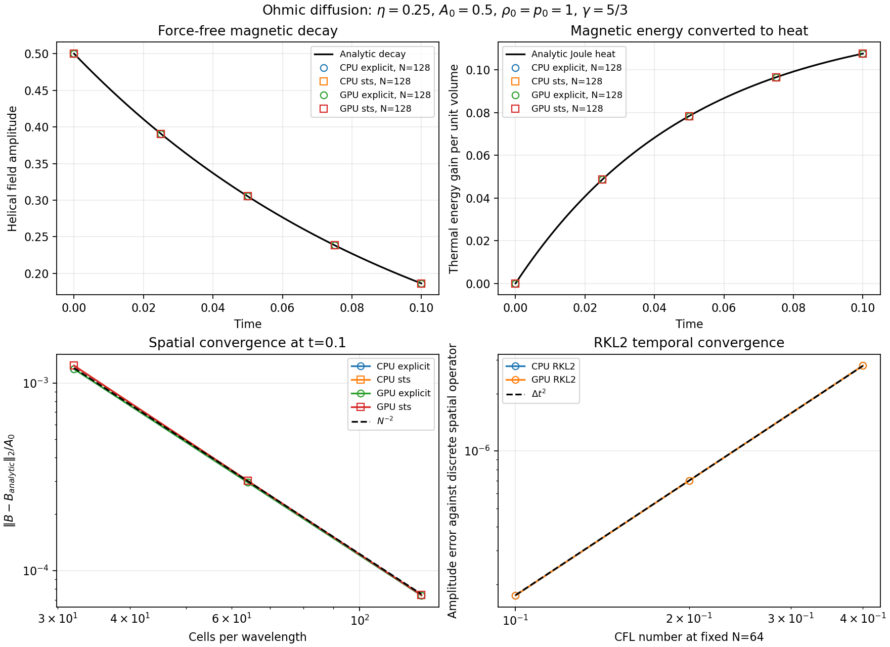

CPU field errors, measured as $\|\boldsymbol{B}-\boldsymbol{B}_{\rm exact}\|_2/A_0$;
GPU results agree to the displayed precision:

| Cells per wavelength | Explicit RK2 | RKL2 STS |
| --- | ---: | ---: |
| 32 | 1.1858e-3 | 1.2361e-3 |
| 64 | 2.9570e-4 | 3.0109e-4 |
| 128 | 7.3879e-5 | 7.4214e-5 |

Doubling resolution reduces the error by approximately four. At 128 cells,
the STS heating error is 5.53e-5 relative to the initial magnetic energy, and
the final relative total-energy error is 4.65e-15.

The lower-right panel isolates time integration error at fixed resolution.
Its reference uses the discrete CT Laplacian eigenvalue,
$-4\eta\sin^2(k\Delta x/2)/\Delta x^2$, so spatial truncation error is removed.
Halving the timestep reduces this error by factors 0.2490 and 0.2495,
consistent with second-order temporal accuracy.

The CPU checks also rotate the field onto the other coordinate axes, compare
16- and 32-cell MeshBlocks, and restart from an intermediate completed cycle.
The restarted and uninterrupted fields agree exactly, as do the two block
decompositions. Single-processor and two-processor runs on one node also
produce identical conserved states and CT fields. Native face-field divergence
and shared-face mismatches are zero in the sampled axis-aligned cases.

The same convergence, heating, CT, restart and block-decomposition checks pass
on GPU. Across all these CPU/GPU comparisons, the largest absolute difference
in conserved variables or CT face fields is 6.69e-14 in code units.
The refinement and temperature-dependent checks below extend this baseline.

## Gaussian diffusion

The existing Gaussian test evolves a weak transverse magnetic pulse in
kinematic MHD. For one varying coordinate,

$$
B_\perp(x,t)=\frac{A_0}{\sqrt{1+4\eta t}}
\exp\left[-\frac{x^2}{1+4\eta t}\right].
$$

Its peak decreases while its width grows. Holding the gas fixed isolates the
induction operator. On CPU, both transverse polarizations pass the existing
N=64/128 regression gates with explicit and STS integration. The high-resolution
RMS L1 errors are 7.61e-11 and 8.11e-11 respectively, for initial amplitude
1e-6; the corresponding refinement error ratios are 0.2471 and 0.2067.

GPU checks spread the Gaussian in each of the xy, yz and zx planes, with the
field perpendicular to that plane. For two varying coordinates the amplitude
factor is $A_0/(1+4\eta t)$. The tests use 64 and 128 cells in each varying
direction. All three rotations give the same errors:

| Integration | Final time | High-resolution RMS L1 error | Error ratio |
| --- | ---: | ---: | ---: |
| Explicit RK2 | 1.0 | 1.591e-11 | 0.2496 |
| RKL2 STS | 0.05 | 2.918e-12 | 0.2523 |

Both integrations satisfy the existing plane-test error thresholds. Their
different final times are retained from the existing GPU argument lists;
the helical tests above compare both integrations at the same final time.

## Temperature-dependent Spitzer resistivity

The collisional Spitzer law gives $\eta_m=\eta_0 T^{-3/2}$, so Ohmic heating
reduces the magnetic diffusivity as the plasma warms. See
[Spitzer & Härm (1953)](https://doi.org/10.1103/PhysRev.89.977).
The code evaluates $T=p/\rho$ from the current stage and averages the cell
diffusivities to CT edges using the arithmetic placement in
[Athena++'s Ohmic EMF implementation](https://github.com/PrincetonUniversity/athena/blob/main/src/field/field_diffusion/diffusivity.cpp).
The induction and Poynting fluxes use the same edge coefficient.

For the force-free helix, energy conservation closes an independent nonlinear
ODE for the field amplitude:

$$
\frac{dA}{dt}=-k^2\eta_0 T(A)^{-3/2}A,\qquad
T(A)=\frac{p_0}{\rho_0}+
\frac{\gamma-1}{2\rho_0}(A_0^2-A^2).
$$

The test uses $A_0=1$, $p_0=0.1$, $\rho_0=1$, and chooses $\eta_0$ so that the
initial diffusivity is 0.25. An independent adaptive ODE integration supplies
the expected amplitude, heating and diffusivity at each output time.

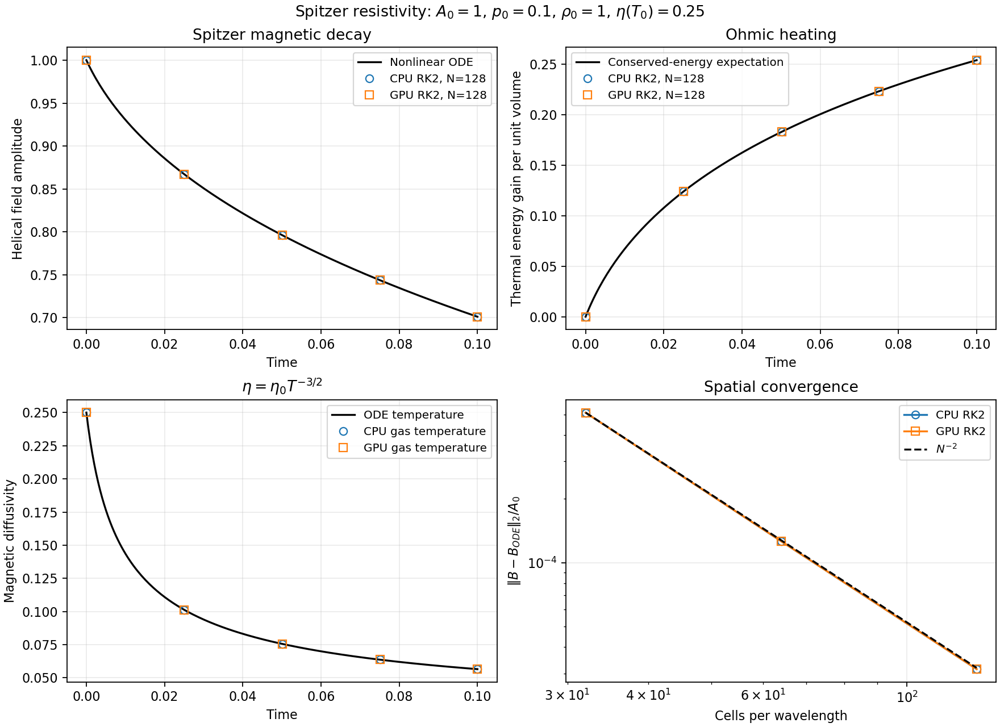

At $t=0.1$, the ODE predicts $A=0.70122257$. The measured amplitude on N=128
is 0.70125402. The field error decreases from 5.10e-4 at N=32 to 1.26e-4 at
N=64 and 3.15e-5 at N=128, relative to the initial field amplitude. CPU and GPU
agree to the displayed precision. Thermal-energy gain agrees with the ODE to
4.42e-5 relative to the initial magnetic energy. Temporal refinement against
the discrete spatial operator gives error ratios 0.2540 and 0.2519.

Two CGS unit systems represent the same physical box and elapsed time. Their
conserved states and CT fields agree with the direct code-unit calculation
within 8.4e-15 in code units. For an input normalization in CGS,

$$
\eta_{0,\mathrm{code}}=
\eta_{0,\mathrm{CGS}}\frac{t_0}{L_0^2 T_0^{3/2}},
$$

where $T_0$ comes from the units module and its mean molecular weight. For a
fully ionized hydrogen plasma, a commonly used parallel-Spitzer normalization
corresponds to $\eta_{0,\mathrm{CGS}}\simeq5.2\times10^{11}\ln\Lambda$ in
$\mathrm{cm^2\,s^{-1}\,K^{3/2}}$; this follows by converting the electrical
resistivity in the [JOREK prescription](https://iterorganization.github.io/JOREK/howto/physics_options/plasma_functions_and_coefficients/spitzer_resistivity.html)
to magnetic diffusivity. Composition and the Coulomb logarithm enter through
the supplied normalization. The verification uses a normalization that makes
diffusion measurable on the numerical grid.

Cycle-boundary restarts reproduce the uninterrupted conserved variables and CT
fields exactly in the single-GPU and two-processor CPU checks. Targeted constant-
Ohmic explicit and STS controls also reproduce their pre-Spitzer endpoints exactly.

The measurements above use explicit RK2. The RKL2 comparisons below use the
same temperature law and conservative energy flux.

## Spitzer resistivity with RKL2

Ohmic heating lowers the Spitzer diffusivity as the magnetic field decays.
Both the induction operator and the energy flux therefore use the current
stage temperature. The RKL2 coefficients and stage-count relation follow
[Meyer, Balsara & Aslam (2014)](https://doi.org/10.1016/j.jcp.2013.08.021).
For $s$ stages, the interval capacity is
$(s^2+s-2)\Delta t_{\mathrm{explicit}}/4$. The implementation checks this
capacity against each raw stage's diffusivity. A failed stage restores the
complete conserved, primitive and CT-field state before retrying a shorter
interval. The fluid CFL bound is refreshed after the first Strang half-step
because resistive heating changes the sound speed.

The warm helical test uses the nonlinear amplitude and heating equations above.
For $N=32,64,128$, RKL2 field errors normalized by the initial amplitude are
1.297e-3, 2.222e-4 and 3.986e-5. At fixed $N=64$, halving the timestep reduces
the error against the discrete-spatial ODE by factors 0.252 and 0.252.
The two-processor CPU restart reproduces the uninterrupted endpoint exactly.

A colder version starts at $p_0=10^{-4}$, with $A_0=\rho_0=1$ and
$\eta(T_0)=0.25$. Its small thermal reservoir makes the temperature law especially
sensitive to intermediate-stage errors. The reference integrates the coupled
induction/energy equations by quadrature, confined to positive temperature.
At $t=0.01$, the CPU RKL2 run gives a heat gain of 0.00273563, versus 0.00274726
from the reference: a 0.423% relative error in the heat gain. Seven trial
rejections exercise recovery. Total energy is conserved to 2.22e-16 relative,
with positive raw thermal energy and zero EOS floors. An independently coded
scalar RKL2 recurrence reproduces the final field amplitude to 2.67e-14.

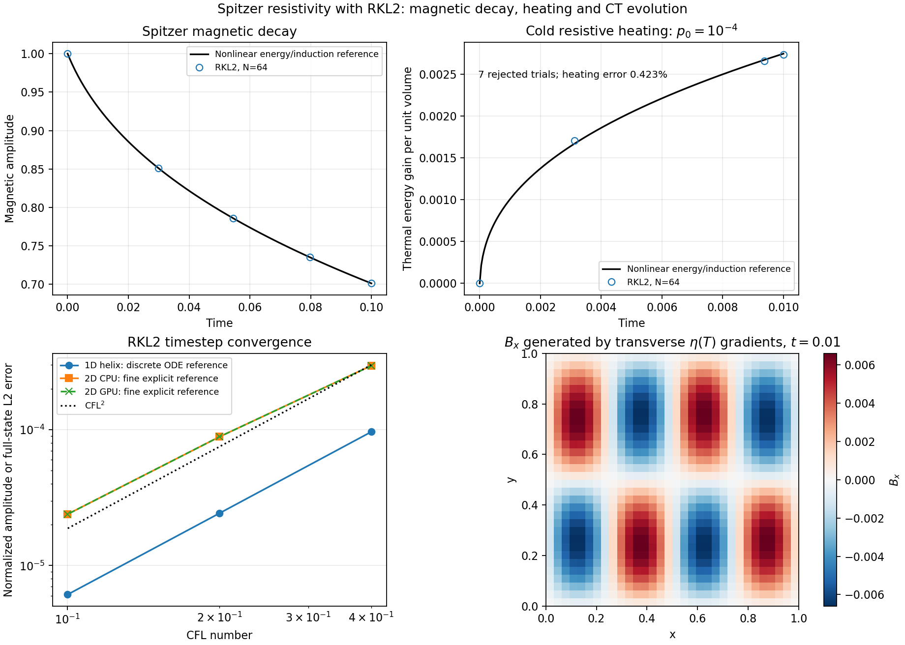

The multidimensional test starts with uniform pressure $p=0.1$,
$\boldsymbol{B}=(0,\cos 2\pi x,\sin 2\pi x)$ and
$\rho=1+0.2\cos 2\pi x\cos 2\pi y$. Its transverse temperature gradients require
the full curl operator to generate $B_x$. Ideal MHD and resistive heating
then evolve together. This tests the finite-volume/CT diffusion equations
described by [Stone et al. (2020)](https://doi.org/10.3847/1538-4365/ab929b).

There is no closed-form nonlinear solution for this density-modulated case.
Two fine explicit RK2 runs establish the same-grid reference and its time
uncertainty. On a $32^2$ mesh at $t=0.01$, that uncertainty is 7.5e-8 in the
normalized full-state L2 norm. The RKL2 errors at CFL 0.4, 0.2 and 0.1 are
2.96e-4, 8.87e-5 and 2.39e-5; CPU and GPU give the same error sequence.
The generated longitudinal field reaches $|B_x|=0.00686$. Both backends
conserve total energy to 1.71e-16 relative, keep CT divergence below 4e-13,
use zero EOS floors, and reproduce their uninterrupted restart endpoints exactly.

The $32^3$ extension uses
$\rho=1+0.2\cos 2\pi x\cos 2\pi y\cos 2\pi z$. On two CPU processors and on
a single GPU, its full-state errors are 1.35e-4, 3.80e-5 and 1.05e-5 as CFL
decreases from 0.4 to 0.2 to 0.1. The fine-explicit reference uncertainty is
3.16e-8. Both backends conserve total energy to 1.71e-16 relative, maintain
positive thermal energy with zero floors, and reproduce restart endpoints exactly.

Joint resistivity, viscosity and nonlinear conduction STS remains a separate
validation step.

## Spatial coefficient gradients and refinement interfaces

An additional initial-residual test uses uniform pressure and a periodic
density modulation. The resulting temperature variation prescribes a spatially
varying diffusivity. Faraday's law requires the full operator
$-\nabla\times(\eta_m\nabla\times\boldsymbol{B})$. In two and three dimensions,
the transverse diffusivity gradients generate $B_x$ from an initially
transverse helix.

Two short steps and Richardson extrapolation measure the initial induction
rate. CPU and GPU agree with an independent discrete curl evaluation to
3.6e-9 relative. Against the continuum derivative, errors decrease by factors
0.2527, 0.2531 and 0.2529 for the 1D, 2D and 3D checks when resolution doubles
from 16 to 32 cells per direction. The generated $B_x$ is nonzero, and native
CT divergence remains below 1.5e-14 in code units.

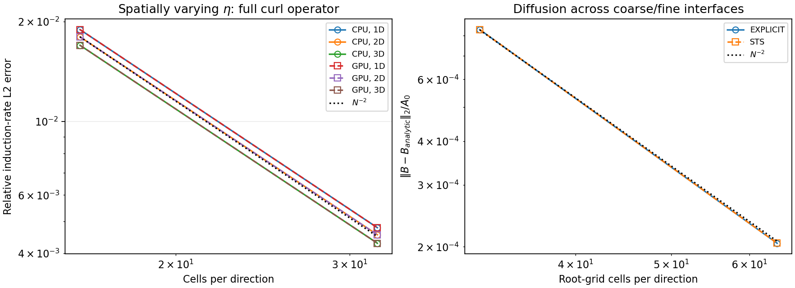

The refinement test diffuses the helix across both boundaries of a slab with
one additional refinement level in a 2D periodic box. It advances ideal-gas
MHD to $t=0.02$ on two CPU processors. The normalized field errors are
8.32e-4 and 2.05e-4 for root resolutions of 32 and 64 cells per direction.
Explicit RK2 and constant-Ohmic RKL2 give error ratios of 0.2461. Both conserve
total energy to roundoff. This checks diffusion across static coarse/fine
interfaces; the adaptive extension below also changes the mesh during evolution.

With Spitzer resistivity, $A_0=1$ and $p_0=0.1$, the same slab test compares
against the nonlinear induction/energy reference. The explicit RK2 field errors
at root resolutions 32 and 64 are 6.88e-4 and 1.68e-4. RKL2 gives 6.91e-4 and
1.68e-4, on both two CPU processors and one GPU. Thus both integrators retain
second-order convergence across the interfaces. Total energy remains at
roundoff, CT divergence is zero for this geometry, and the native thermal energy
stays positive without EOS floors.

The adaptive-mesh extension changes resolution during diffusion. The refinement
case starts with 16 blocks and creates a central refined region, reaching 28.
The coarsening case starts with 40 blocks across a refined slab and returns to
16 root-level blocks. The expected conserved quantities are the volume-integrated
total energy and magnetic divergence constraint; the evolved field is compared
with the same nonlinear amplitude reference. Flux/EMF synchronization follows the
finite-volume/CT framework described by
[Stone et al. (2020)](https://doi.org/10.3847/1538-4365/ab929b).

For root resolutions 32 and 64, refinement gives normalized field errors of
7.75e-4 and 1.77e-4, a ratio of 0.229. Coarsening gives 4.79e-4 and 1.23e-4,
a ratio of 0.257. Two CPU processors and one GPU reproduce these convergence
rates. Total energy remains at roundoff, native thermal energy stays positive,
and CT divergence stays below 4.5e-12. Restarts from an evolved checkpoint
before the topology change reproduce the final active conserved variables and
CT faces bit for bit on each backend, including the topology-change count.

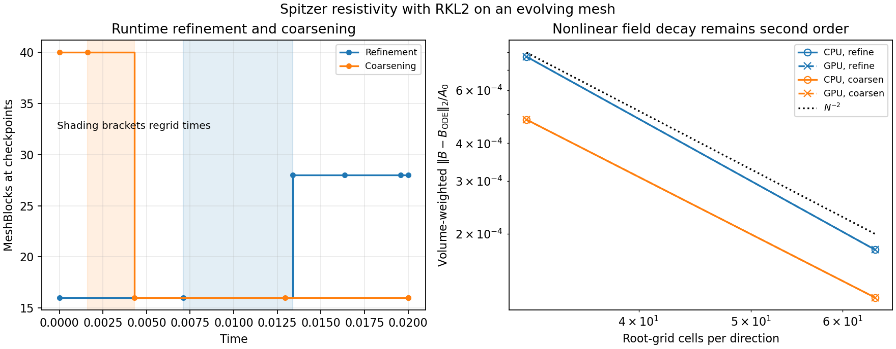

## Resistive Alfvén waves

Magnetic diffusion damps an Alfvén wave and changes its phase speed. This
coupled velocity/field test follows the dispersion relation used by
[Zier, Springel & Mayer (2024), section 3.3 and Appendix B3](https://doi.org/10.1093/mnras/stad3200):

$$
s=-\frac{\eta_m k^2}{2}\ \pm\
i\sqrt{k^2 v_A^2-\left(\frac{\eta_m k^2}{2}\right)^2}.
$$

The test uses a periodic, ideal-gas plasma with $\rho_0=B_0=1$,
$p_0=0.3$, $\gamma=5/3$, $\eta_m=0.02$ and perturbation amplitude $10^{-4}$.
For each transverse polarization, the Fourier amplitudes obey
$\dot{\hat v}=ikB_0\hat B/\rho_0$ and
$\dot{\hat B}=ikB_0\hat v-\eta_m k^2\hat B$.
The exact matrix exponential advances the measured initial amplitudes to
$t=0.25$. Projecting the measured modes onto its eigenvectors separately
measures damping and oscillation frequency.

On two CPU processors, explicit RK2 and RKL2 converge at second order over
32, 64 and 128 cells per wavelength. At 128 cells, RKL2's normalized complex-mode
error is 5.79e-5; the damping-rate relative error is 2.00e-4 and the
frequency relative error is 3.72e-5. Doubling $k$ multiplies the measured damping
by four to within 4.1e-6 relative. The weak-wave Spitzer run approaches the
constant-coefficient result with the same initial diffusivity. The single-GPU
RKL2 runs reproduce the CPU mode errors and fitted rates within roundoff.

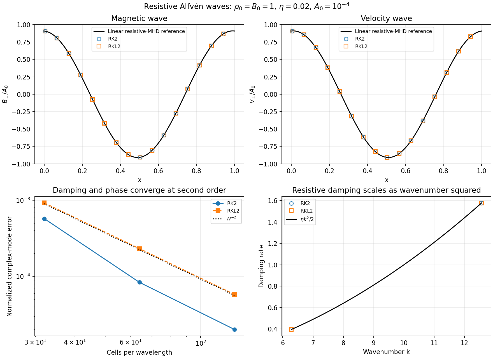

## Physical boundaries

A one-dimensional, finite-amplitude fast magnetosonic wave tests Spitzer diffusion with outflow,
diode and reflecting boundaries. It starts with $\rho_0=1$, $p_0=0.3$,
$\boldsymbol B_0=(0,1,0)$ and perturbation amplitude 0.1. The field is tangential
to the reflecting wall, and reflection enforces zero normal velocity. The
conservative mass and energy fluxes then give a closed mass/energy
budget at those walls; open boundaries permit material and energy to leave.
These are boundary extensions of the conservative diffusion equations in
[Stone et al. (2020)](https://doi.org/10.3847/1538-4365/ab929b).

At $t=0.1$, the outgoing pulse gives matching outflow and diode fields. The
reflecting solution retains its initial mean density and total energy to
roundoff. Two fine explicit RK2 integrations establish the nonlinear reference.
At CFL 0.3, 0.15 and 0.075, RKL2 full-state errors fall from 2.42e-5 to 5.52e-6
to 1.28e-6 for open boundaries, and from 1.90e-5 to 4.82e-6 to 1.17e-6 for
reflecting walls. Reference uncertainties are 5.64e-8 and 7.89e-8 respectively.
All three boundary cases pass on CPU and GPU, retain positive thermal energy
without EOS floors, keep CT divergence zero, and restart to exactly identical
active fields.

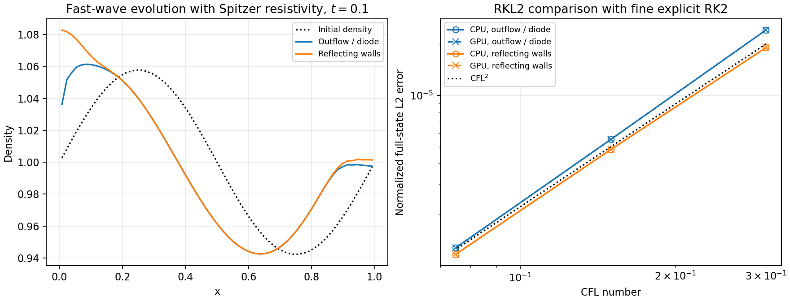

## Joint viscosity and Ohmic heating

Parallel circular transverse velocity and magnetic helices provide a reference
for simultaneous kinetic and magnetic dissipation. Ideal induction and Lorentz
force vanish, so with $\rho=1$ their amplitudes satisfy

$$
\dot V=-k^2\mu_0T^{5/2}V,\quad
\dot A=-k^2\eta_0T^{-3/2}A,\quad
T=T_0+\frac{\gamma-1}{2}(V_0^2-V^2+A_0^2-A^2).
$$

This additional reduction of the conservative transport equations measures
both energy reservoirs and their common thermal gain. Initially $V_0=A_0=0.5$,
$T_0=0.1$, and both kinematic viscosity and magnetic diffusivity equal 0.25.
As the gas heats, viscosity increases and resistivity decreases.

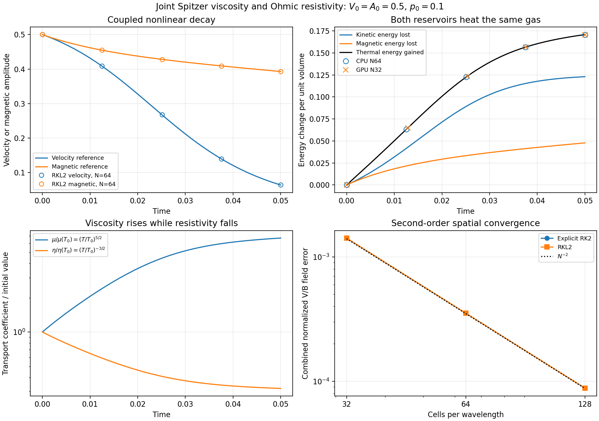

At $t=0.05$, the reference gives $V=0.06373365$, $A=0.39292986$ and thermal
gain 0.17077208. Two-rank CPU calculations with constant and Spitzer coefficients
pass explicit/RKL2 spatial convergence at 32, 64 and 128 cells, with error
ratios 0.249–0.250. The N128 nonlinear RKL2 combined normalized velocity/magnetic
field error is 8.81e-5. CPU/GPU pilots reproduce the nonlinear heating with
positive internal energy, zero EOS floors and zero CT divergence.

For the nonlinear N32 helix, RKL2 timestep refinement gives ratios 0.226 and
0.237 against the discrete coupled ODE. Completed-cycle restarts are exact
on both backends, and rescaled CGS inputs agree within 1.48e-14 absolute.

## Joint transport with spatial coefficient gradients

In 2D and 3D, add the density modulation
$\rho=1+0.2\prod_d\cos(2\pi x_d)$ and uniform bulk velocity
$(0.25,0.75,0.75)$ to the parallel V/B helices. Uniform initial pressure makes
both transport coefficients vary spatially. The initial kinematic viscosity
and magnetic diffusivity are 0.025 at $T=0.1$. Transverse gradients generate
nonzero $B_x$, while viscous and resistive heating change the temperature and
drive MHD motions. An explicit same-grid reference measures the nonlinear
solution through $t=0.02$.

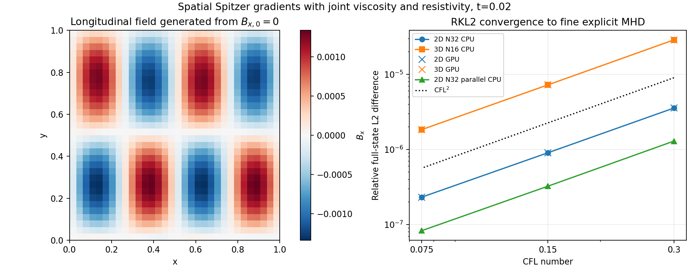

With 32 cells per direction in 2D and 16 in 3D, RKL2 errors decrease at second
order on CPU and GPU. Finest relative full-state errors are 2.31e-7 and
1.83e-6, with reference uncertainties 1.75e-10 and 1.97e-9. CPU/GPU fields
agree within 3.2e-15 relative, and restarts are exact within each backend.
Mass and total energy remain at roundoff, internal energy stays positive,
and EOS floors remain zero. The parallel-viscosity 2D CPU variant gives a
finest error of 8.27e-8 and timestep ratios 0.251/0.256.

The stationary variant retains reference variability near 1e-6. Identical
cycle-zero restarts reproduce its explicit fields exactly on the executable
preserved before joint-STS changes; HLLE and LLF also retain the reference
floor. The advected tests have resolved temporal references. The stationary
case remains an open MHD reference-sensitivity check.

Joint isotropic/parallel Spitzer viscosity and Spitzer resistivity also pass
the finite-amplitude magnetosonic boundary matrix described above, with
periodic, outflow, diode and reflecting boundaries. The 48 CPU cases include
two explicit references, three RKL2 timesteps and a restart for each geometry
and boundary. The 32 matching GPU RKL2/restart cases pass. Finest full-state
errors are 3.36e-7–3.33e-6, timestep ratios remain below 0.289, and restarts
are exact. Closed-domain mass/energy budgets pass with zero EOS floors.

The isotropic joint helix crosses static interfaces and runtime mesh changes
at initial $\nu=\eta=0.025$. Combined velocity/magnetic error ratios are
0.235 across static interfaces, 0.218 during refinement and 0.239 during
coarsening. CPU and GPU runtime-AMR tests conserve mass and energy and restart
to identical active fields and topology histories within each backend. Both
backends reject one trial after refinement tightens the current diffusion
budget; recovered solutions retain the stated convergence and exact restart.

## Heat transport coupled to viscous and Ohmic heating

The density-modulated helix above also tests heat redistribution when all
three coefficients depend on the same evolving temperature:

$$
\mu=\mu_0T^{5/2},\qquad \eta=\eta_0T^{-3/2},\qquad
\boldsymbol q=-\kappa_0T^{5/2}\hat{\boldsymbol b}
(\hat{\boldsymbol b}\cdot\nabla T).
$$

The conductive face coefficients use the harmonic treatment and transverse
limiters of [Sharma & Hammett (2007)](https://doi.org/10.1016/j.jcp.2007.07.026).
The saturated variant applies the flux scale of
[Cowie & McKee (1977)](https://doi.org/10.1086/154911), with
$\phi=10^{-3}$. These coupled-flow tests extend the conservative MHD transport
equations in [Stone et al. (2020)](https://doi.org/10.3847/1538-4365/ab929b)
and the RKL2 integration of
[Meyer, Balsara & Aslam (2014)](https://doi.org/10.1016/j.jcp.2013.08.021).

The 2D setup uses $\nu(T_0)=\eta(T_0)=\kappa(T_0)=0.025$ at
$T_0=0.1$. The 3D setup uses $\kappa(T_0)=0.01$, with the same viscosity
and resistivity. The initial pressure is uniform, while the density modulation
creates a temperature gradient along the magnetic field. Conduction should
redistribute heat, saturation should weaken that redistribution, and viscous
and magnetic losses should supply the net thermal-energy gain. Periodicity
requires total energy and mass to remain constant.

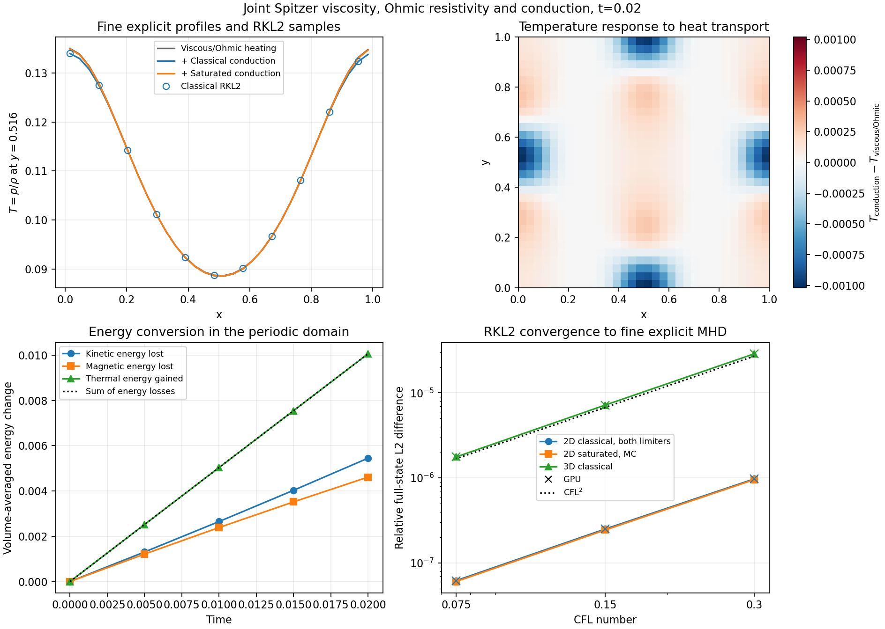

At $t=0.02$, classical conduction changes the 2D temperature field by
$1.968\times10^{-3}$ in relative L2 compared with the viscous/Ohmic calculation.
The saturated and classical temperature fields differ by
$1.877\times10^{-3}$, with the saturated profile approaching the calculation
without conduction. The upper panels show these physical responses. The lower
left compares thermal gain with kinetic and magnetic losses; their sum agrees
to roundoff. Crosses in the convergence panel denote GPU measurements.

There is no closed-form full-MHD solution for this modulated state. Two explicit
RK2 runs at CFL 0.0125 and 0.00625 establish the same-grid temporal reference.
The RKL2 runs use CFL 0.3, 0.15 and 0.075. The reported norm combines conserved
variables and the three native CT face arrays, normalized by their reference
L2 norm. The explicit-reference difference must be below 15% of the smallest
RKL2 error; halving the timestep must reduce the error by a factor below 0.4.

| Configuration | Finest RKL2 relative error | Successive error ratios | Reference uncertainty |
| --- | ---: | ---: | ---: |
| 2D classical, van Leer or MC | 6.23e-8 | 0.258, 0.248 | 1.63e-11 |
| 2D saturated, van Leer or MC | 6.07e-8 | 0.256, 0.248 | 1.55e-11 |
| 3D classical | 1.77e-6 | 0.250, 0.246 | 5.42e-10 |

The 2D classical cases and 3D classical case pass on two CPU ranks and one GPU.
Both saturated limiters also pass on CPU and GPU. Completed-cycle restarts
are exact, raw internal energy
stays positive, EOS floors remain zero, and periodic mass/energy budgets pass.
Simultaneous CGS rescaling of viscosity, resistivity and conductivity changes
the sampled fields by at most 1.56e-14 absolute. Hydro viscosity/conduction
and MHD two-operator subsets pass their independent helical heating controls.

The coupled boundary extension uses a finite-amplitude fast magnetosonic wave
at 32 cells. Isotropic conduction/viscosity with a transverse background field
passes periodic, outflow, diode and reflecting boundaries. Parallel viscosity
and field-aligned conduction use an oblique background
$\boldsymbol B_0=(0.5,1,0)$ for periodic, outflow and diode boundaries. This
gives nonzero $\hat{\boldsymbol b}\cdot\nabla T$ in the 1D wave. The same
two-reference, three-timestep and exact-restart comparisons pass on CPU/GPU:
42 CPU cases and 28 GPU cases, finest full-state errors 3.20e-7–3.21e-6 and
error ratios below 0.284. CPU/GPU field differences are below 3.1e-15 relative.
Closed-domain mass/energy budgets and all raw-state/floor checks pass.

With isotropic Spitzer viscosity, resistivity and conduction enabled, the
helical solution also passes runtime refinement/coarsening and topology
restarts. Doubling the root resolution from 32 to 64 reduces combined V/B
errors by factors 0.224 and 0.240 on both backends. Restarted active fluid and
CT fields and topology histories are identical within each backend. The
underlying continuum helix has uniform temperature; this refinement check
tests mesh-transfer and coupled-operator consistency, while the modulated
tests above establish physical heat redistribution.

The nonuniform-temperature calculation also runs on a fixed composite mesh:
a 32-by-32 root grid with a factor-two refined slab at $0.25<x<0.75$.
It uses the same density modulation and bulk/shear flow, with
$\kappa(T_0)=0.01$, and advances to $t=0.005$. Fine explicit references and
three RKL2 timesteps compare volume-weighted native fluid and CT fields on
that same mesh. CPU/GPU finest errors are 2.32e-8, with timestep ratios
0.252/0.253 and reference uncertainty 2.47e-11. Restarts are exact. The
periodic energy check uses the initial composite cell sum, accounting for
the mesh's quadrature of the bulk/shear kinetic-energy cross term.

Saturated conduction also passes the runtime refine/coarsen and topology-restart
matrix on both backends, with spatial error ratios 0.232/0.246. A separate
rapid-heating viscosity/conduction control raises thermal energy by 0.78259,
compared with the independent viscous-heating reference 0.78355, giving
0.122% relative heating error at 128 cells. Raw thermal energy stays positive,
and EOS floors remain zero.

## Saturated transport timescale and rejected-trial recovery

This 1D MHD test starts in pressure balance with
$\rho=1+0.8\cos(2\pi x)$ and $p=0.1$. A circular velocity/magnetic helix has
amplitudes 0.5. Its initial Lorentz force vanishes, while the density variation
creates a temperature peak. Set isotropic thermal diffusivity $\alpha=10$,
constant $\nu=\eta=10^{-4}$ and saturation parameter $\phi=1$.
All three processes use RKL2, with the STS ratio cap disabled. The run uses
32 cells and ends at $t=0.005$.

The saturated flux follows
[Cowie & McKee (1977)](https://doi.org/10.1086/154911) and the donor-pressure
treatment in Appendix A of
[Mignone et al. (2012)](https://doi.org/10.1088/0067-0049/198/1/7):

$$
F=C\frac{q_s}{q_s+|C|},\qquad
C=-\alpha\rho_f\frac{T_R-T_L}{\Delta x},\qquad
q_s=5\phi\frac{p_{\rm donor}^{3/2}}{\sqrt{\rho_f}}.
$$

Here $\rho_f=(\rho_L+\rho_R)/2$. At fixed classical flux $C$, differentiating
with respect to donor pressure gives the energy-equation response speed

$$
a=\frac32(\gamma-1)\frac{q_s}{p_{\rm donor}}
\left(\frac{|C|}{q_s+|C|}\right)^2.
$$

The independently evaluated donor timestep is
$\Delta t_d=\min_i\Delta x/(a_{i-1/2}+a_{i+1/2})$. It is a transport
timescale that remains in the outer timestep when diffusion is accelerated.
For this initial state, $\Delta t_d=0.00543070791$. The measured outer
timesteps equal CFL times this value to the six-digit diagnostic precision.

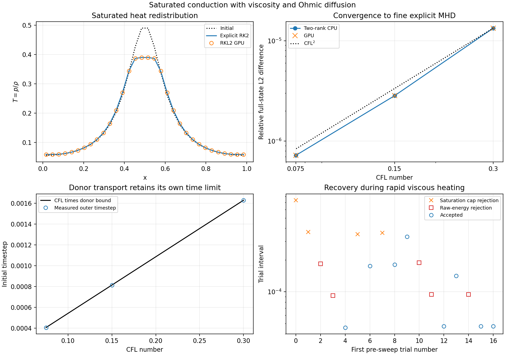

Explicit RK2 references at CFL 0.00625 and 0.003125 agree within 4.61e-13
in the normalized fluid/CT norm. RKL2 at CFL 0.3, 0.15 and 0.075 gives errors
1.34e-5, 2.83e-6 and 7.20e-7, with ratios 0.212/0.254 on CPU and GPU.
The temperature peak falls as heat moves into cooler gas, and the RKL2 profile
agrees with the explicit reference. Periodic mass/energy budgets, raw-state
checks and exact cycle restarts pass.

The rapid-heating recovery case increases the velocity amplitude to 3,
viscosity to 1000 and thermal diffusivity to 100. Viscous relaxation raises
the pressure and changes the donor bound inside a trial. Both CPU and GPU
reject four trials for the updated saturation cap and five for raw thermal
energy, then complete with positive internal energy and zero EOS floors.
The lower-right panel shows interval subdivision in the first pre-sweep.
Completed-cycle restarts reproduce all fluid and CT arrays exactly. This
case measures rejection, state restoration and restart integrity; the
preceding fine-reference calculation measures temporal accuracy.

## Radiatively cooling magnetized mixing layer

The application check uses the TRML production setup with density contrast
100, pressure 1, shear velocity 0.645497, cooling time 0.1 and plasma beta
1000. The initial field lies along x; x/y boundaries are periodic and z
boundaries are outflow. Cooling, forcing, fluid floors, FOFC and the one
million MC tracers retain their production settings. The grid is reduced to
64 by 128 by 128 cells, with four ghost cells, and advances for 40 cycles.

The transport cases use $\mu_0=0.001$, $\eta_0=10^{-6}$ and field-aligned
Spitzer conduction. The isotropic-viscosity case uses $\kappa_0=0.001$;
parallel-viscosity cases use $\kappa_0=0.01$. Hyperviscosity remains enabled
with $\mu_{\rm hyper4}=10^{-5}$. The saturated case adds $\phi=10^{-5}$.
These coefficients are in code units. The viscosity, resistivity and thermal
conductivity vary with the local evolving temperature through their stated laws.

The expected behavior is finite positive gas states while cooling competes
with viscous/Ohmic heating and field-aligned heat redistribution. Evolving
field-aligned temperature gradients and parallel strain establish that the
anisotropic terms are active. Fluid and particle checkpoints must restore
the same evolution, including the forcing state. The physical mixing-layer
setting follows the radiative mixing-layer problem studied by
[Fielding et al. (2020)](https://doi.org/10.3847/2041-8213/ab8d2c);
this test adds the transport operators described above.

| GPU configuration | Endpoint | EOS floors/failures | Largest sampled absolute divB |
| --- | ---: | ---: | ---: |
| Control | 40 cycles | 0 / 0 | 2.24e-14 |
| Isotropic Spitzer viscosity | 40 cycles | 0 / 0 | 4.05e-13 |
| Parallel Spitzer viscosity | 40 cycles | 0 / 0 | 4.03e-13 |
| Parallel viscosity with saturated conduction | 40 cycles | 0 / 0 | 4.34e-13 |

All configured history, volume/slice, fluid/particle checkpoint and particle
binary outputs are readable and finite. The parallel cases have measured
field-aligned temperature gradients above 13 and parallel strain above 0.71
in code units. The parallel case resumes its actual cycle-20 checkpoints:
fluid, internal energy, CT fields and forcing arrays agree exactly at cycle
40, the forcing RNG/update counter is exact, and particle restart checks pass.
This application check establishes short-run integration and restart integrity;
the analytic and fine-reference tests above establish transport accuracy.

## Source changes

| Files | Functions and purpose |
| --- | --- |
| [resistivity.cpp](../../../src/diffusion/resistivity.cpp), [resistivity.hpp](../../../src/diffusion/resistivity.hpp) | `SpitzerCoefficientCode` converts the normalization with Units scales. `SpitzerCellEta` and `SpitzerEdgeEta` evaluate current-stage coefficients and arithmetic edge means. `AddEMFOhmic` and `AddFluxOhmic` apply matching CT and energy fluxes. `NewTimeStep` and `InspectRawState` supply current coefficient bounds and EOS admissibility. |
| [viscosity.cpp](../../../src/diffusion/viscosity.cpp), [viscosity.hpp](../../../src/diffusion/viscosity.hpp) | `SpitzerCoefficientCode` and `SpitzerCellMu` implement dynamic viscosity and CGS conversion. `AddViscousFluxes` and `AddViscousFluxAniso` retain the existing stress/work discretization with arithmetic dynamic face coefficients. `NewTimeStep`, `SpitzerTimeStepBound` and `InspectRawState` cover density-dependent kinematic diffusion and current-stage budgets. |
| [conduction.cpp](../../../src/diffusion/conduction.cpp), [conduction.hpp](../../../src/diffusion/conduction.hpp) | `RawStageTimeStep` reconstructs scratch primitives from raw U/current CT fields, iterating active MeshBlocks. It reuses `SpitzerTimeStep` through a retryable bound check. Existing conductive flux, harmonic coefficient and saturation formulas are retained. |
| [driver.cpp](../../../src/driver/driver.cpp), [driver.hpp](../../../src/driver/driver.hpp) | `DiffusionSnapshot::Save/Restore` generalizes the existing full-state snapshot. `CheckFullStateSTSState` checks raw state and summed inverse diffusion bounds. `ExecuteGuardedSTSSweep` and `ExecutePreSTSSweep` implement collective interval/cycle recovery and refresh the coupled timestep. |
| [hydro.cpp](../../../src/hydro/hydro.cpp), [mhd.cpp](../../../src/mhd/mhd.cpp) | Register temperature-dependent viscosity/resistivity as active diffusion processes and call their state-dependent timestep methods. |
| [hydro_sts.cpp](../../../src/hydro/hydro_sts.cpp), [mhd_sts.cpp](../../../src/mhd/mhd_sts.cpp) | Route current-stage saturation failures through full-state restoration for joint sweeps. Dispatch parallel Spitzer stress in MHD and apply the shared raw-state checks through the STS task pipeline. |
| [hydro_tasks.cpp](../../../src/hydro/hydro_tasks.cpp), [mhd_tasks.cpp](../../../src/mhd/mhd_tasks.cpp) | Coordinate joint raw-state checks with EOS conversion and completed ghost/CT exchanges. |
| [diffusion.cpp](../../../src/pgen/tests/diffusion.cpp) | Add the velocity/magnetic helix, density modulation, bulk flow and event diagnostics used by the nonlinear heating, tensor, refinement and coupled-flow tests. |

The RKL2 recurrence is reused unchanged. The [compact resistivity guide](../../resistivity.md)
lists production inputs, units and supported configurations.

## Reproduction

Build AthenaK with MPI and the built-in problem generators. Run the focused
test in an empty output directory:

```bash
python tst/functional/resistivity.py --binary /absolute/path/to/athena \
  --root /absolute/path/to/new/test-directory --extended --rotations
```

Add `--ranks 2` for a single-node two-processor run. The harness stores every
input, launch command, native checkpoint, analytic measurement and acceptance
gate. Optional source and executable checksum manifests can be supplied with
`--source-manifest` and `--binary-manifest`.

The new initializer is in `src/pgen/tests/diffusion.cpp`, selected with
`problem/resistivity_profile=helix`; the existing Gaussian profile remains
the default. Optional `problem/helix_density_amp` supplies the periodic density
modulation for the initial-residual test.

The other focused harnesses are `tst/functional/resistivity_spitzer.py`,
`resistivity_variable_eta.py` and `resistivity_refinement.py`.
`resistivity_sts.py` checks nonlinear RKL2 convergence, restart and retry recovery
(`--pilot`), with `--cold-scan`, `--units-axes` and `--guards` for focused checks.
`resistivity_evolution.py` compares full MHD with fine explicit references
(`--ndim 2` or `--ndim 3`). `resistivity_spitzer_refinement.py` checks nonlinear
coarse/fine interfaces; `resistivity_alfven.py` measures damping and phase.
`resistivity_amr.py` adds runtime refinement/coarsening and AMR restart checks.
`resistivity_boundaries.py` checks outflow, diode and reflecting walls.
All use the same required `--binary` and `--root` arguments.
For the joint nonuniform-temperature calculation, run:

```bash
python tst/functional/resistivity_viscosity_evolution.py \
  --binary /absolute/path/to/athena --root /absolute/path/to/new/joint-test \
  --ranks 2 --bulk .25 .75 .75 --reference-cfl .0125 .00625 \
  --conduction spitzer --conduction-limiter vanleer
```

Use `--conduction saturated` for the saturated variant and
`--conduction-limiter mc` for MC slopes. For 3D, add
`--ndim 3 --n 16 --conduction-coefficient .01`.
For the composite-grid check, add
`--static-refinement --end-time .005 --conduction-coefficient .01` to the 2D
command. Its norms use the local cell volumes and the same native refinement
topology in the RKL2 and explicit solutions.

The donor-bound accuracy test and rapid-heating recovery test use separate
fresh output directories:

```bash
python tst/functional/joint_saturation.py --binary /absolute/path/to/athena \
  --root /absolute/path/to/new/donor-test --ranks 2
python tst/functional/joint_saturation.py --binary /absolute/path/to/athena \
  --root /absolute/path/to/new/recovery-test --ranks 2 \
  --recovery --alpha 100 --viscosity 1000 --amplitude 3
```

The Spitzer closure is contained in
`src/diffusion/resistivity.cpp` and `.hpp`; `src/mhd/mhd.cpp` registers it with
the existing diffusion timestep budget. Set `mhd/eta_spitzer=true` and exactly
one of `mhd/spitzer_eta0_code` or `mhd/spitzer_eta0_cgs`. CGS input requires an
explicit units block. The constant-Ohmic arithmetic and RKL2 recurrence are
preserved.
