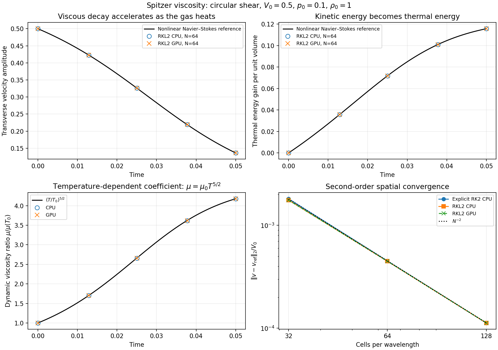
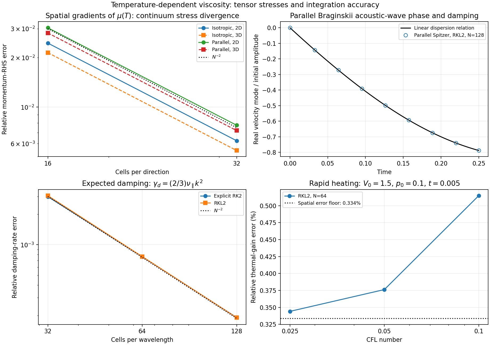
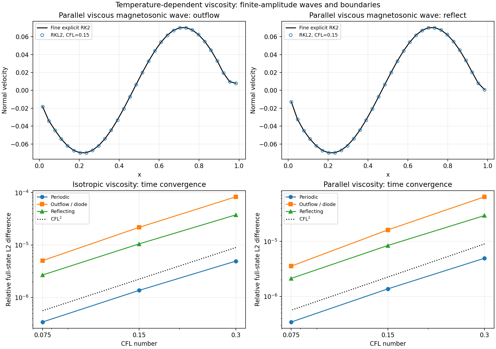
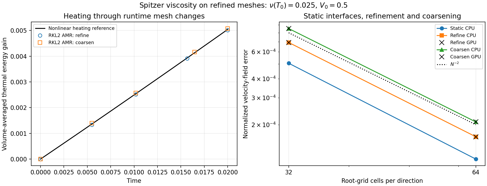

# Temperature-dependent viscosity validation

These tests measure momentum diffusion and conversion of kinetic energy to
heat for dynamic viscosity $\mu=\mu_0 T^{5/2}$, with kinematic viscosity
$\nu=\mu/\rho$. The gas is Newtonian and ideal, with $\gamma=5/3$ and code
temperature $T=p/\rho$. Both isotropic Navier–Stokes and parallel Braginskii
stresses use the existing conservative face-stress and energy-work operators.

The temperature dependence follows classical ion viscosity, summarized in
[FLASH's Spitzer prescription](https://flash.rochester.edu/site/flashcode/user_support/flash_ug_devel/node147.html).
The parallel stress and wave-damping references are described by
[Braginskii (1965)](https://www.hao.ucar.edu/people/phil-judge/PHSX515/fall2012/Braginskii1965.pdf)
and [Berlok, Pakmor & Pfrommer (2020)](https://doi.org/10.1093/mnras/stz3115).
RKL2 super-time-stepping follows
[Meyer, Balsara & Aslam (2014)](https://doi.org/10.1016/j.jcp.2013.08.021).
Conservative diffusion and CT are discussed by
[Stone et al. (2020)](https://doi.org/10.3847/1538-4365/ab929b).

## Circular shear: nonlinear decay and viscous heating

In a periodic unit-length box, initialize $\rho=1$, $p_0=0.1$ and

$$
\boldsymbol v=(0,V_0\cos kx,V_0\sin kx),\quad V_0=0.5,\quad k=2\pi.
$$

This transverse flow has no advective acceleration. In MHD, a uniform field
perpendicular to x remains passive. The shear decays and heats the gas
uniformly. Conservation of total energy reduces the Navier–Stokes equations to

$$
\frac{dV}{dt}=-k^2\mu_0T^{5/2}V,\qquad
T=T_0+\frac{\gamma-1}{2}(V_0^2-V^2),\qquad
\Delta e_{\rm th}=\frac{V_0^2-V^2}{2}.
$$

The initial kinematic coefficient is 0.25. An independent quadrature gives the
reference solution through $t=0.05$; a separate adaptive ODE calculation agrees
within 6e-13 relative. This additional analytic test follows directly from
the conservative viscous equations. It measures the accelerating decay rate,
heating and feedback of temperature on the coefficient.

At the final time, the velocity is 0.1361302622 and the thermal gain is
0.1157342759. The coefficient grows by a factor of approximately 4.18. MHD
velocity-field errors, normalized by $V_0$, are:

| Cells per wavelength | Explicit RK2 | RKL2 |
| --- | ---: | ---: |
| 32 | 1.815e-3 | 1.758e-3 |
| 64 | 4.515e-4 | 4.479e-4 |
| 128 | 1.127e-4 | 1.125e-4 |

Hydro and MHD exhibit second-order spatial and temporal convergence. The time
reference uses the discrete Laplacian eigenvalue
$-4\sin^2(k\Delta x/2)/\Delta x^2$ to isolate integration error. CPU and GPU
RKL2 results agree to the displayed precision. Sampled total-energy errors
are at roundoff, the passive field is unchanged, and no EOS floors are used.
The same test passes with the shear rotated into y and z on two CPU ranks and
with RKL2 on one GPU.

## Variable coefficients and the full stress tensor

To exercise spatial coefficient gradients, modulate the density by
$\rho=1+0.2\prod_d\cos(2\pi x_d)$ while keeping pressure uniform. Use the
circular velocity above and uniform $\boldsymbol B=(1,2,3)/\sqrt{14}$.
Temperature, dynamic viscosity and acceleration then vary across the mesh.

The measured initial viscous momentum derivative is compared with
$\nabla\cdot\boldsymbol\tau$, and the conservative energy derivative with
$\nabla\cdot(\boldsymbol v\cdot\boldsymbol\tau)$. An inviscid control removes
the ideal-MHD residual; two short steps extrapolate to the initial derivative.
An independent tensor-form face-flux evaluation checks the discretization,
while analytic continuum derivatives check spatial convergence. The dynamic
coefficient uses arithmetic face averaging, as in the centered branch of
[IDEFIX's Braginskii operator](https://github.com/idefix-code/idefix/blob/aee4e07775be9061ce6d48f169e9a1b248e9a949/src/fluid/braginskii/bragViscosity.hpp).

For isotropic and parallel stresses in 2D and 3D, CPU/GPU momentum and energy-work
residual errors are below 1.02e-9 relative/scaled. Doubling resolution from 16 to
32 cells reduces continuum momentum errors by factors 0.254–0.256.

## Parallel acoustic-wave damping

For a uniform field along x and a small longitudinal acoustic perturbation,
the parallel stress gives an effective longitudinal kinematic viscosity
$4\nu_\parallel/3$. Linearized density, velocity and pressure obey

$$
\partial_t\begin{pmatrix}\delta\rho\\v_x\\\delta p\end{pmatrix}
=\begin{pmatrix}
0&-ik\rho_0&0\\
0&-4\nu_\parallel k^2/3&-ik/\rho_0\\
0&-ik\gamma p_0&0
\end{pmatrix}
\begin{pmatrix}\delta\rho\\v_x\\\delta p\end{pmatrix}.
$$

Thus the propagating modes have damping rate
$\gamma_d=2\nu_\parallel k^2/3$ and frequency
$\omega=\sqrt{c_s^2 k^2-\gamma_d^2}$. This is the field-aligned acoustic limit
of Braginskii wave damping studied by Berlok et al. The test uses
$p_0=0.3$, $\rho_0=B_x=1$, $\nu_\parallel(T_0)=0.02$, perturbation amplitude
$10^{-4}$ and $t=0.25$. A matrix exponential evolves the measured initial
Fourier mode, including phase and mode mixing.

Explicit and RKL2 calculations converge at second order. The N128 RKL2 damping
rate error is 1.906e-4 relative, with matching CPU/GPU results. In the weak-wave
limit, temperature-dependent and constant coefficients agree within 9.2e-10
in the normalized complex mode when their timestep caps are matched.

## Finite-amplitude waves at physical boundaries

A compressive fast magnetosonic perturbation of amplitude 0.1 starts at
$\rho_0=1$, $p_0=0.3$, $\boldsymbol B=(0,1,0)$ on 32 cells. Compression and
heating change the coefficient; the final spatial contrast is approximately
1.21. Tangential B satisfies the reflecting-wall parity. These additional
boundary tests exercise isotropic and parallel viscosity with the full MHD
update through $t=0.025$.

RKL2 runs at CFL 0.3, 0.15 and 0.075 are compared with fine same-grid explicit
references at 0.0125 and 0.00625. All periodic, outflow, diode and reflecting
CPU cases pass. Timestep-error ratios are 0.219–0.286; the finest full-state
relative differences are 3.43e-7–5.07e-6. Reference uncertainty is independently
below 15% of each finest RKL2 error. Periodic and reflecting cases conserve
mass and total energy at roundoff. Sampled CT divergence is zero, thermal
energy stays positive and EOS floor counts are zero. All eight restarted
isotropic/parallel boundary calculations reproduce their uninterrupted fields
exactly. The 32 GPU RKL2 boundary/restart cases also pass against those fine
explicit references. Their full states agree with CPU within 7.4e-16 relative,
and within-backend restarts match exactly.

## Isotropic viscosity on refined meshes

The circular shear also crosses static coarse/fine interfaces and runtime
refinement/coarsening in a periodic 2D MHD domain. The initial kinematic
coefficient is 0.025. Static refinement covers the slab $0.25<x<0.75$;
adaptive refinement selects a central region during evolution, and a separate
run coarsens an initially refined slab. Root grids have 32 or 64 cells per
direction, with a factor of two refinement.

Static-interface explicit/RKL2 error ratios are 0.236. Runtime refinement and
coarsening ratios are 0.241 and 0.245 on both CPU and GPU. Integrated mass and
total energy remain at roundoff, raw density/internal energy stay positive and
EOS floors remain zero. Restarts preceding the first topology change reproduce
the final active conserved fields, CT faces and topology history exactly within
each backend. These checks extend the conservative-diffusion/refinement tests
described by Stone et al. to the temperature-dependent coefficient.

## Rapid heating, units and compatibility

Increasing the circular-shear amplitude to 1.5 at $p_0=0.1$ tests rapid
coefficient growth. At $t=0.005$, the analytic velocity is 0.8263778404 and the
thermal gain is 0.7835498325. At N64, CFL 0.1/0.05/0.025 gives heating errors
0.515%/0.376%/0.344%, approaching the 0.334% spatial error floor. N128 at
CFL 0.2 gives 0.126%. Coarser timesteps conserve energy and stay positive but
fail the velocity-accuracy checks, including N64 at CFL 0.15 and CFL 0.4 runs.
Stage-state rejection
controls admissibility and the current diffusion budget; timestep refinement
is still required to establish accuracy.

Code-unit and CGS inputs agree within 6.22e-15 absolute in conserved fields.
The conversion is $\mu_{0,\rm code}=\mu_{0,\rm cgs}T_0^{5/2}t_0/(\rho_0L_0^2)$.
For fully ionized H at $T=10^6$ K, $\ln\Lambda=30$ and
$\rho=10^{-27}$ g cm$^{-3}$, the FLASH normalization gives
$\mu=0.07367$ g cm$^{-1}$ s$^{-1}$ and $\nu=7.367\times10^{25}$ cm$^2$ s$^{-1}$.
Completed-cycle restarts match exactly. Disabled-law constant-viscosity and
constant-resistivity controls match the preserved executable exactly on both
CPU and GPU; warm/cold nonlinear-resistivity controls also pass.

## Reproduction

The portable tests are in `tst/functional/viscosity_spitzer*.py`. Each accepts
`--binary`, a fresh `--root` and optional `--ranks`; outputs include inputs,
commands, native checkpoints and JSON measurements. The main helix runner's
`--extended` option adds timestep, CGS and restart checks. Separate runners
cover tensor residuals, parallel waves, rotations and physical boundaries.
