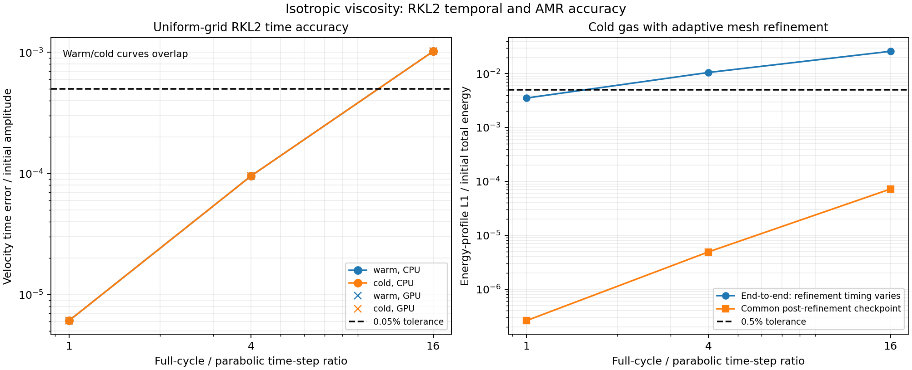

# Viscosity validation

These tests ask three physical questions: does viscosity remove the correct
velocity gradients, does the lost kinetic energy become heat in the correct
places, and does accelerated time integration preserve that evolution?
They cover Newtonian shear viscosity, parallel Braginskii viscosity and
ideal-gas fourth-order hyperviscosity. See the
[configuration guide](../../viscosity.md) for inputs and supported combinations.

All quantities below use code units. Unless a dimensional scale is stated,
the periodic wavelength is $L=1$, $k=2\pi m/L$ for harmonic number $m$, and
$t$ is code time. A mode proportional to $\exp[(-\Gamma+i\omega)t]$
has **amplitude** decay rate $\Gamma$; its quadratic energy decays at
$2\Gamma$. In the heating figures, $u$ denotes **internal-energy density**,
not velocity. For finite-volume comparisons, the reference conserved fields
are cell-averaged before reconstructing $u=\bar E-|\overline{\rho v}|^2/(2\bar\rho)
-|\bar B|^2/2$; this is not the cell average of pointwise internal energy.

The figures show archived AthenaK measurements and independent references.
[Source versions](#source-versions), complete result bundles and the
[implementation trace](#changed-files-and-functions) follow the physical tests.

## 1. Isotropic viscosity: shear decay and conversion to heat

### Physical experiment and reference solution

A transverse shear $v_z(x,0)=A\cos(kx)$ in constant-density gas isolates
momentum diffusion. With kinematic viscosity $\nu$, the Newtonian stress is

$$
S_{ij}=\tfrac12(\partial_jv_i+\partial_iv_j)
       -\tfrac13\delta_{ij}\nabla\cdot v,\qquad
\tau_{ij}=2\rho\nu S_{ij}.
$$

When only the viscous operator is evolved,
$v_z=Ae^{-\nu k^2t}\cos(kx)$ and the volume-averaged kinetic energy is
$\langle K\rangle=\rho A^2e^{-2\nu k^2t}/4$.
Conservative stress work requires
$\langle u(t)-u(0)\rangle=\langle K(0)-K(t)\rangle$.
This is our analytic Fourier-mode test of the published Newtonian operator,
also implemented in
[Athena-C's viscosity module](https://princetonuniversity.github.io/Athena-Cversion/AthenaDocsUGViscosity.html).
[Meyer, Balsara & Aslam (2014)](https://doi.org/10.1016/j.jcp.2013.08.021)
provides the diffusion/viscous verification context for RKL integration;
the particular sinusoid and parameters here are our test choices.
It is not an assumption that a compressible gas with nonuniform heating would
retain this profile if its pressure forces were also evolved.

The plotted isolated-RK2 run uses $N=32$, $\rho=1$, $A=0.3$,
$\nu=0.1$, initial $u=10^{-8}$ and final $t=0.0762355$.
The velocity decreases without changing its sinusoidal shape, while the
measured energy history transfers kinetic energy to thermal energy.


*Left: native final cell velocities, the initial profile and the continuum
diffusion solution. Right: measured volume-averaged kinetic energy and generated
heat, normalized by initial kinetic energy; the dashed curve is the continuum
kinetic-energy prediction. Time is in code units.*

The measured amplitude-decay rate is $3.9351527$, versus the continuum
$\nu k^2=3.9478418$ (0.3214% difference). The centered spatial stencil instead
predicts $\Gamma_h=4\nu\sin^2(k\Delta x/2)/\Delta x^2=3.9351746$.
Using the actual RK2 step sequence gives a modal-amplitude error of
$1.76\times10^{-15}$. Thus the continuum discrepancy is primarily spatial,
not an incorrect diffusion coefficient. The global kinetic-loss/heat-gain
mismatch is $1.73\times10^{-18}$, with zero measured total-energy drift.

A separate, fully coupled acoustic test checks longitudinal viscosity:
$\Gamma_{\rm sound}=2\nu k^2/3$ and
$\omega^2=c_s^2k^2-\Gamma_{\rm sound}^2$.
For $N=32$, $\rho=1$, $p=0.6$, $\gamma=5/3$, $\nu=0.01$,
perturbation amplitude $10^{-6}$ and $t=0.25$, the measured eigenvalue is
$-0.2626891-6.2807430i$, compared with
$-0.2631895-6.2776707i$. This coupled-wave damping is distinct from
the isolated shear rate $\nu k^2$.

### Does RKL2 preserve diffusion and heating?

RKL2 advances the same spatial operator with a stabilized second-order
Legendre polynomial; see [Meyer, Balsara & Aslam (2014)](https://doi.org/10.1016/j.jcp.2013.08.021).
For a spatial eigenmode with decay rate $\Gamma_h$, one sweep should multiply
its amplitude by $R_s(-\Gamma_h\Delta t)$, where

$$
R_s(z)=1-b_s+b_sP_s(1+w_sz),\quad
b_s=\frac{s^2+s-2}{2s(s+1)},\quad
w_s=\frac4{s^2+s-2}.
$$

Here $s$ is the Legendre degree/stage count, $P_s$ the Legendre polynomial and
$\Delta t$ the sweep interval. A stable large step is not necessarily accurate.

The uniform-grid comparison uses $v_z=0.3\cos[2\pi(x+y)]$ on $16^2$ cells,
$\rho=1$, $\nu=0.1$, $t=0.1$ and initial $u=1$ or $10^{-8}$.
Two half-sweeps surround fluid evolution. Comparison with the exact
time-dependent solution of the discrete diffusion operator separates temporal
error from spatial error. At full-cycle/parabolic-step ratio cap 16, velocity
error is 0.102019%, above the 0.05% criterion; caps 1 and 4 satisfy it.
The cap-16 generated-heat error is 0.981688%, below its 1% criterion.



The second panel tests cold, density-contrast-four gas on an adaptive mesh
with $32^2$ base and $64^2$ fine resolution, $\nu=0.1$, initial $u=10^{-8}$
and $t=0.02$. Its volume-weighted energy-profile error is divided by initial
**total** energy, not by the tiny initial thermal energy:

| Ratio cap | Full evolving-mesh error | Common post-remap restart error |
| --- | ---: | ---: |
| 16 | 2.598% | 0.007236% |
| 4 | 1.050% | 0.0004921% |
| 1 | 0.352% | 0.00002602% |

Only cap 1 meets the 0.5% end-to-end criterion. All common-checkpoint controls
meet it: changing the full timestep also changes when remapping occurs.
[The physical-viscosity result bundle](data/viscosity_sts_results.json)
retains these distinct comparisons.

## 2. Braginskii viscosity: field-directed stress and local heating

### Closure and literature relationship

For unit magnetic direction $b=B/|B|$ and parallel kinematic coefficient
$\nu_\parallel$, define

$$
D=b_ib_j\partial_jv_i-\tfrac13\nabla\cdot v,\qquad
\Delta p=3\rho\nu_\parallel D,\qquad
\tau_{ij}=\Delta p(b_ib_j-\delta_{ij}/3).
$$

Here $\Delta p=p_\perp-p_\parallel$ and the continuum viscous heating is
$Q=3\rho\nu_\parallel D^2$. Stress is not simply diffusion of each velocity
component along $B$: oblique fields couple components.

[Parrish et al. (2012), Appendix A](https://arxiv.org/html/1201.0754#A1)
provides the Athena-C method/verification context. The centered, unlimited
Cartesian derivatives used here follow
[Kempf, Rincon & Clerc, Appendix B](https://arxiv.org/html/2306.12460v2#A2).
The shear-layer and wave comparisons below use analytical solutions from
[Berlok, Pakmor & Pfrommer (2020), §§2.2, 4.1–4.3 and Appendix C](https://arxiv.org/html/1911.05694).
Their moving-mesh discretization is not substituted for AthenaK's Cartesian
finite-volume/CT geometry.

### Oblique-field shear layer: velocity and heating profiles

Following Berlok et al. §4.2, start with $v_x=v_z=0$ and

$$
v_y(x,0)=\frac32-\frac12\left[
 {\rm erf}\!\left(\frac{x-1/4}{1/20}\right)
-{\rm erf}\!\left(\frac{x+1/4}{1/20}\right)\right],
\quad -\tfrac12\le x<\tfrac12 .
$$

Here $c$ is the velocity normalization, $L=\rho=c=1$,
$b=(1,1,0)/\sqrt2$, $\nu_\parallel=10^{-3}$ and $t=25L/c$.
Initial pointwise internal-energy density is 1 and $\gamma=5/3$.
The isolated production viscous operator is advanced with RK2;
the ideal-MHD flux update is disabled and the magnetic direction is fixed.
The thin 2D mesh has $N$ cells in $x$ and four identical rows.

The initial Fourier coefficients are
$a_n=-2\sin(3\pi n/2)e^{-n^2\pi^2/400}/(n\pi)$,
$k_n=2\pi n/L$ and $\Gamma_n=5\nu_\parallel k_n^2/6$.
The reference predicts

$$
v_x=-\frac3{10}\sum_{n\ge1}a_n(1-e^{-\Gamma_nt})\cos(k_nx),\qquad
v_y=2+\frac1{10}\sum_{n\ge1}a_n(1+9e^{-\Gamma_nt})\cos(k_nx).
$$

Integrating $Q$ gives the reference thermal gain. AthenaK reproduces the
generation of $v_x$, smoothing of $v_y$ and localized heat at the shear
interfaces:


*Markers are native N32/N64 measurements; lines are the cell-averaged
Fourier-series solution evaluated at N128. Velocities are in units of $c$;
$\Delta u$ is resolved internal-energy-density gain in code units.*

| Cells across layer domain | Relative velocity L1 error | Relative thermal-gain L1 error |
| --- | ---: | ---: |
| 32 | 0.1721% | 1.4430% |
| 64 | 0.04298% | 0.3602% |
| 128 | 0.01074% | 0.09235% |

Oblique sinusoidal damped/null controls test the tensor independently.
For Fourier wavevector $k$, let $a=(b\cdot k)b-k/3$.
The isolated velocity generator is $-3\nu_\parallel aa^\mathsf{T}$:
velocity parallel to $a$ damps, while velocity perpendicular to $a$ is a
continuum null mode. These tests use $k=2\pi(1,1/1.3,0)$,
$b\propto(1,0.7,-0.3)$, $\nu_\parallel=0.07$, amplitude 0.2 and $t=0.12$.
Together with the layer, N32/N64/N128 sequences give velocity orders
1.9929–2.0013 and thermal orders 1.9635–2.0023; CPU energy-budget error
is at most $5.10\times10^{-16}$. Null-mode heat errors are normalized by
initial kinetic energy, since the expected generated heat is zero.

### Coupled MHD waves and RKL2

The full MHD test evolves density, velocity, pressure and CT magnetic field.
Its reference is an eigenmode of the complete linearized MHD system with
viscous velocity block $-3\nu_\parallel aa^\mathsf{T}$, not a scalar
diffusion exponential. Fast/slow modes damp; the linear Alfvén polarization
is a Braginskii null mode. The rotated 2D cases use $\rho=1$, $p=0.6$,
$\gamma=5/3$, perturbation amplitude $10^{-6}$ and $t=0.2$,
with one wavelength along each side of a square of length $\sqrt2$.


Relative field L2 errors, normalized by the initial perturbation, fall from
N32 to N64 as follows: fast 1.59256%→0.365469%, slow
0.455698%→0.0890848%, Alfvén 1.14720%→0.351774%.
An overdamped fast mode gives 4.0943% error at N32, above its 3% criterion.
Halving the timestep leaves 4.0944%; N64/N128 reduce it to 0.9536%/0.2311%,
identifying a spatial-resolution limitation.

Mixed isotropic/parallel runs with $\nu_{\rm iso}=0.02$,
$\nu_\parallel=0.05$, N64 and amplitude $10^{-4}$ give RKL2 temporal
self-orders 1.9910 (fast) and 1.9800 (Alfvén).
The [Braginskii bundle](data/braginskii_results.json) also records field
rotation/sign controls, restarts, block layouts and invalid inputs.
The isolated layer tests establish local RK2 heating accuracy; they do not
establish general coupled-MHD STS thermal positivity or reproduce the
nonlinear firehose/Kelvin–Helmholtz examples in Berlok et al.

## 3. Hyperviscosity: short-wave damping and ideal-gas heating

### What fourth-order stress is being tested?

For constant dynamic coefficient $\mu_4$ and the strain $S_{ij}$ defined
above, the implemented continuum model is

$$
\tau^{(4)}_{ij}=-2\mu_4\nabla^2S_{ij},\quad
H_{ijk}=2\mu_4\partial_kS_{ij},\quad
J_j=H_{abj}S_{ab}=\mu_4\partial_j(S:S),
$$

$$
F_{\rho v_i,j}=-\tau^{(4)}_{ij},\qquad
F_{E,j}=-v_i\tau^{(4)}_{ij}-J_j,\qquad
Q_4=2\mu_4\sum_{ijk}(\partial_kS_{ij})^2 .
$$

$\mu_4$ has units density × length⁴/time; $\nu_4=\mu_4/\rho$ is the local
kinematic coefficient. The higher-stress work flux $J$ determines where
kinetic energy becomes heat, even when a periodic box conserves total energy.

General-order conservative hyperstress is described by
[Haugen & Brandenburg (2004), equations 2–5](https://arxiv.org/html/astro-ph/0402301v2#S2)
and [Lyra et al. (2017), Appendix](https://arxiv.org/html/1708.05057v1#A0.SS1.SSS1).
Those finite-difference/isothermal implementations are not ideal-gas
finite-volume heating benchmarks. Higher-stress mechanical work has a
continuum thermodynamic precedent in
[Nečas, Novotný & Šilhavý (1989), equation 2.12 and Example 2.21](https://dml.cz/bitstream/handle/10338.dmlcz/106776/CommentatMathUnivCarol_030-1989-3_14.pdf).
The following are derived tests of the stated fourth-order model, not
reproductions of published turbulent spectra.

### Coupled-wave dispersion and the $k^4$ damping law

For constant density, isolated transverse/longitudinal velocity amplitudes
decay at $\nu_4k^4$ and $4\nu_4k^4/3$, respectively. Propagating waves couple
that dissipation to pressure or magnetic restoring forces. Their eigenvalues
satisfy

$$
\lambda_{\rm sound}^2+\tfrac43\nu_4k^4\lambda_{\rm sound}+c_s^2k^2=0,
\qquad
\lambda_{\rm A}^2+\nu_4k^4\lambda_{\rm A}+v_A^2k^2=0.
$$

For the underdamped cases here,
$\Gamma_{\rm sound}=2\nu_4k^4/3$ and $\Gamma_{\rm A}=\nu_4k^4/2$.
Fast/slow modes use the full coupled matrix. These amplitude rates differ
from both isolated viscous relaxation and quadratic-energy decay.

The runs use $\rho=p=1$, $\gamma=5/3$, $\mu_4=10^{-4}$,
perturbation amplitude $10^{-5}$, $t=0.1$ and N32/N64.
Alfvén waves use $B=(1,0,0)$; fast/slow waves use $B=(1,0.5,0.25)$.
Conserved initial fields are cell averages of the eigenmode, with CT-compatible
face fields. Harmonic-2 and reversed-propagation controls supplement the
fundamental modes.


*Top left: measured density perturbation and coupled sound solution.
Top right: measured amplitude-decay rates and eigenvalues; the curves are
$\Gamma\propto k^4$, with rates in inverse code time. Lower panels quantify
damping and phase errors after the physical comparison.*

Measured harmonic-2/fundamental decay ratios are 15.9611 for sound and
15.9311 for Alfvén waves, versus the prediction 16.
A separate zero-hyperviscosity run measures the underlying fluid solver's
dissipation; its reference evolves the same initial vector under the full
ideal-system matrix exponential. Baseline-corrected added-damping errors are:

| Wave | N32 | N64 |
| --- | ---: | ---: |
| Sound | 1.52363% | 0.260126% |
| Alfvén | 1.22572% | 0.228819% |
| Fast | 1.06831% | 0.221650% |
| Slow | 0.893695% | 0.188445% |

All 24 coupled-wave cases per backend meet the 3% resolved-signal criterion.
The baseline-corrected rate is a comparison to the matched control; it is
not the rate used for the $k^4$ curves.

### Circular shear: an exact kinetic-to-thermal energy exchange

For $v_y=A\cos(kx)$, $v_z=A\sin(kx)$, constant $\rho$ and zero $v_x$,
the kinetic-energy density is spatially uniform. Thus
$A(t)=A(0)e^{-\nu_4k^4t}$ and

$$
u(t)-u(0)=\tfrac12\rho A(0)^2(1-e^{-2\nu_4k^4t}).
$$

Here $S:S$ is uniform, so $J=0$. The explicit tests use $A=0.1$,
$\rho=p=1$, $\gamma=5/3$, $\mu_4=10^{-4}$, $t=0.02$ and N32/N64.
The MHD counterpart has uniform $B_y=0.3$, which remains unchanged in
this 1D transverse flow. Hydro and MHD recover the same decay and thermal
gain. Mixed-viscosity tests replace the amplitude rate by
$\nu_{\rm iso}k^2+\nu_4k^4$. The lower-left panel below shows the heat-error
convergence using the finite-volume form of this solution.

### Nonuniform strain: does the gas heat in the right places?

A stronger test starts from
$v_y=0.8[\sin(2\pi x)-0.2\sin(4\pi x)]$,
$\rho=p=1$, $\gamma=5/3$, $\mu_4=10^{-4}$ and evolves to $t=0.02$.
Now $J\ne0$. Spatially varying heating creates pressure gradients, density
changes and longitudinal motion, so an isolated-decay solution is insufficient.

The independent reference solves the full coupled continuum equations using
eighth-order spatial differentiation and adaptive BDF integration.
N128/N256/N512 and tighter-tolerance controls comprise ten integrations;
the reference uncertainty is $4.12\times10^{-9}$ of RMS generated heat.
Native conserved fields and the reference are compared after the same
cell averaging and internal-energy reconstruction.


*Top panels: actual N64/N128 velocity and internal-energy-density gain against
the independent continuum reference. The dashed red heat profile is a separate
reference evolution with $J$ omitted. Bottom panels: circular-shear and
nonuniform-strain relative thermal-increment errors.*

The heating-field error decreases from 0.403% at N64 to 0.122% at N128
(order 1.724). Halving CFL at N64 changes the heating signal by only
$7.58\times10^{-9}$ in the same normalization.
Omitting $J$ changes the reference heating by 122.5%, despite conserving
periodic total energy. At N128, the much weaker density and longitudinal
momentum signals have relative errors of 6.12% and 3.50%; these are reported
measurements, not quantities with an assigned acceptance threshold.

### Operator and conservation checks

The [hyperviscosity bundle](data/validation_results.json) additionally contains
seven independent semidiscrete checks of the tensor symbol, 1D/2D/3D
convergence, periodic budgets, heating identity and spectral timestep bound.
A 300-mode search reaches 0.9999997812 of the analytic bound.
Eighteen native positive/zero-coefficient cases and fourteen rejection cases
per backend compare every momentum/energy face and timestep for Hydro/MHD
and constant/variable density; twelve mixed-viscosity kernel cases check
the summed coefficient dependence.

Face errors use $5\times10^{-12}+5\times10^{-10}\max|F_{\rm reference}|$,
finite-volume initialization $2\times10^{-13}$, normalized conservation
$10^{-11}$ and relative timestep error $2\times10^{-12}$.
These algebraic comparisons supplement, rather than replace, the evolving
physical tests above.

## Hyperviscosity RKL2, multidimensional and variable-density validation

| Test family | Coverage and measured outcome |
| --- | --- |
| Circular RKL2 | 24 cases/backend: Hydro/MHD, pure/mixed hyper4, explicit/RKL2, three CFLs; N32 harmonic 2, amplitude 0.8, ratio cap 8. Discrete RK2/Legendre amplification, heat, actual stage counts and split intervals pass. |
| Nonzero-`J` RKL2 | Six original cases plus seven refined-step cases/backend. Coarse ratio 128 fails temporal order; resolved windows recover thermal orders `1.889`/`1.916`, and ratio 8 gives `1.945`. All 13 CPU/GPU pairs agree within `3.684e-13`. |
| Mixed Braginskii/hyper4 | Six fast-wave cases/backend, N64, `nu_aniso=0.05`, `mu4=1e-4`, oblique B, three CFLs. Orders `1.937–2.106`; omission controls distinguish either missing stress. |
| Variable density | Six cases/backend, N64, density contrast 0.5. An independent linear reference distinguishes constant dynamic from constant kinematic viscosity. Field-evolution and current-density timestep comparisons pass. Nonlinear heating and temporal convergence remain unverified. |
| Oblique explicit | 16 cases/backend: 2D N32/N64 and 3D N16/N32 Hydro/MHD, hyper4/off controls. Physical and spatial-accuracy tests pass. Four unshifted 3D CPU/GPU comparisons fail, as described below. |
| Oblique RKL2 | Twelve cases plus two finer cases/backend. Original 3D velocity order `1.111` falls below the required `1.5`; finer windows pass. Maximum normalized CPU/GPU difference `3.392e-14`. |

The coarse nonzero-`J` ratio-128 thermal order is `0.1597`, with negative
velocity order, despite thermal error only `0.05504%` of generated heat.
Smaller steps recover the required order. The criteria are STS/reference error
`<=0.5%`, explicit-control uncertainty `<=0.05%`, and order `>=1.5`.
When both adjacent normalized differences are `<=5e-8`, they are too small
to evaluate the order reliably.


Unshifted oblique 3D MHD has four CPU/GPU pointwise comparisons above the
`5e-12` tolerance, including zero-hyper4 controls. The N16 zero-hyper4 state
difference is `8.49413e-5`, normalized by `max(1,|CPU|,|GPU|)`.
One-step controls reproduce the discrepancy without hyperviscosity;
sign-dependent CT near zero normal mass flux amplifies roundoff differences.
A phase translation of 0.137 removes exact stagnation-plane alignment;
four translated N16/N32 cases/backend agree within `1.235e-14`. The discrepancy
therefore depends on the grid alignment; the four original comparisons still fail.

## Hyperviscosity restarts, invalid states and regression tests

- 2D layout/restart tests: 22 cases, one/four blocks, CPU/GPU/two-rank CPU;
  28 field pairs and six bitwise-exact within-backend U/CT restart pairs.
  Six additional CPU rank-changing/CPU→GPU continuations pass; largest
  CPU→GPU raw-internal-energy difference is `3.309e-14`.
- 3D layout/restart tests: 24 Hydro/MHD N24³ cases, one/eight blocks;
  32 field and 20 full-history comparisons. Four rank-changing restarts
  are bitwise exact; maximum conserved/raw-internal/CT differences are
  `4.042e-14 / 4.153e-14 / 2.132e-14`, budget error `2.472e-15`.
- Built-in-problem integration: 8 Hydro/MHD explicit/RKL2 fresh/restart
  cases and 28 comparisons pass in single CPU, two-rank CPU, single GPU,
  multi-node CPU and multi-node GPU configurations. Field/CT/history tolerance
  is `5e-11`, normalized conservation `1e-11`, and time/timestep tolerance `2e-13`.
- Cold N64 STS: three native raw-state rejections/backend, exactly halved
  retries, positive final raw state and zero EOS repairs. CPU/GPU field gap
  `1.111e-16`; six deliberately corrupted diagnostic records are rejected.
  The rejected states were not saved, leaving the specific failed-state
  condition undetermined.
- Input validation: 38 expected rejections/backend cover invalid
  coefficients, EOS, geometry/refinement, boundaries, relativity, ghost
  width, FOFC and incompatible/inactive STS selection.
- Portable regression: 11/11 CPU and GPU cases pass—three operators,
  four explicit/RKL2 circular evolutions and four rejection cases.
  Discrete amplification/heating uses a `5e-10` relative budget.
  Independent checker faults cover missing hyper4/`J`, wrong density law,
  malformed/nonfinite fields, timing/stages and restart/CT/history damage.

## Physical-viscosity integration and refinement controls

Each CPU, MPI-CPU, GPU and MPI-GPU functional set includes six wave cases,
four cold active-AMR cases, four cold SMR cases, four timestep-hook/restart
cases and three heating/cooling controls. The largest wave STS/explicit
difference is `6.203e-8`, below the `2e-6` criterion. A cooling control
triggers three whole-cycle retries, with energy-replay error `2.66e-15`
and source-budget error `3.58e-17`.

These checks exercise the complete integration path: raw conserved states
are examined before EOS floors; rejected sweeps restore fluid, magnetic and
coarse-grid state before retrying with a smaller interval. Heating can also
require a smaller fluid/source step, in which case the full cycle is restored
without replaying sources twice. For ideal Hydro, admissibility-preserving
conserved prolongation contracts reconstructed siblings toward their parent
without changing their conserved mean. This is tested separately from the
AMR profile-accuracy comparison above; MHD magnetic prolongation is unchanged.

## Supported configurations and remaining tests

Hyperviscosity does not support SMR/AMR, nonperiodic boundaries,
isothermal/relativistic fluids, variable `mu4`, or automatic CGS conversion.
Braginskii supports uniform ideal/isothermal MHD but not refinement,
temperature-dependent coefficients, gyroviscosity or mirror/firehose clipping.
Viscosity STS rejects primitive prolongation, cyclic zoom and incompatible
co-selected processes; user boundaries/timestep callbacks require retry-safe enrollment.
General multidimensional thermal positivity, nonlinear variable-density heating
and the accuracy of larger STS steps need further study. Turbulence spectra from
sixth-order isothermal simulations have not been compared with this
fourth-order ideal-gas implementation.

## Changed files and functions

<details>
<summary>Implementation locations and integration points</summary>

The manifest supplies all hunks; links below identify the changed functions and integration points.

| File / location | Implementation change |
| --- | --- |
| [viscosity.hpp](../../../src/diffusion/viscosity.hpp#L33) | Coefficient/process selection, raw-state API and declarations for the shared ordinary, parallel and hyperviscous operators. |
| [viscosity.cpp: InspectRawState / AddViscousFluxAniso](../../../src/diffusion/viscosity.cpp#L254) | Checks raw density/thermal state before floors; parallel stress (539) uses current CT geometry, conservative work and the summed timestep bound. Ordinary `AddViscousFluxIso` (377) retains the centered Newtonian stencil. |
| [viscosity.cpp: Hyper4Strain](../../../src/diffusion/viscosity.cpp#L53) | Cell/face symmetric trace-free gradients, including centered transverse derivatives. |
| [Viscosity constructor](../../../src/diffusion/viscosity.cpp#L201) | Strict finite/nonnegative coefficient parsing; ideal-gas, Newtonian, periodic, uniform-mesh, two-ghost-cell and `fofc=false` guards; positive hyper4 counts as an active STS process. |
| [AddViscousFluxes / AddViscousFluxHyper4](../../../src/diffusion/viscosity.cpp#L310) | Dispatch; device face loops (324); strain Laplacian (343); momentum and velocity-work fluxes (355); higher-stress work `J` (363). |
| [NewTimeStep](../../../src/diffusion/viscosity.cpp#L606) | Preserves the zero-hyper4 path; current-density reduction (612), summed fourth-order rate (663), representability checks and collective invalid-state decision (670–677). |
| [hydro.cpp: Hydro::Hydro](../../../src/hydro/hydro.cpp#L83) | Constructs and activates viscosity when hyper4 is the only enabled viscous coefficient. |
| [mhd.cpp: MHD::MHD](../../../src/mhd/mhd.cpp#L113) | Matching MHD registration; existing magnetic/Braginskii evolution remains separate. |
| [hyperviscosity_probe.cpp](../../../src/pgen/tests/hyperviscosity_probe.cpp#L26) | New test fixture: `Require`/`Sinc` (26/33), `DumpState` (35), `FinalState` (94), `UserProblem` (97). Provides raw U/CT output, exact FV initial data, loaded-wave checks, circular/two-mode states, and direct production-kernel flux/timestep dumps. Delegated `LinearWave` mode supports layout/restart tests. |
| [hyperviscosity.py](../../../tst/functional/hyperviscosity.py#L1) | New bounded regression: input generation (51), strict metadata/state/CT readers (73–108), independent initialization and flux references (122–155), stage/polynomial/evolution checks (178–191), negative `selfcheck` controls (256), bounded `launch` (294), eleven-case `main` (324). |
| [docs/viscosity.md](../../viscosity.md#fourth-order-stress-and-ideal-gas-energy) | Units/configuration, fourth-order stress and energy work, summed timestep, supported domain, STS accuracy limitations and focused regression usage. |
| [driver.cpp](../../../src/driver/driver.cpp#L544), [driver.hpp](../../../src/driver/driver.hpp) | `ViscositySnapshot::Save/Restore`, `CheckViscositySTSState`, `ExecuteViscositySTSSweep`, `ExecutePreSTSSweep`: complete state rollback, collective rejection and post-heating cycle-bound refresh. |
| [hydro.hpp](../../../src/hydro/hydro.hpp), [hydro_newdt.cpp](../../../src/hydro/hydro_newdt.cpp) | `RecomputeTimeStepFromCurrentState`: refresh fluid bounds without repeating source callbacks. |
| [hydro_sts.cpp](../../../src/hydro/hydro_sts.cpp), [hydro_tasks.cpp](../../../src/hydro/hydro_tasks.cpp) | `STSFluxes/Update/CheckState/RefreshTimeStep`, `ConToPrim`, `Prolongate`: rejection-aware stages and raw-state/ghost-prolongation checks. |
| [mhd.hpp](../../../src/mhd/mhd.hpp), [mhd_newdt.cpp](../../../src/mhd/mhd_newdt.cpp) | Matching current-state timestep API and source-refresh control. |
| [mhd_sts.cpp](../../../src/mhd/mhd_sts.cpp), [mhd_tasks.cpp](../../../src/mhd/mhd_tasks.cpp) | Current-field parallel flux dispatch, rejection-aware U/CT tasks and pre-EOS raw checks; viscosity-only sweeps add no induction flux. |
| [bvals.hpp](../../../src/bvals/bvals.hpp), [bvals/prolongation.cpp](../../../src/bvals/prolongation.cpp) | `ProlongateHydroPositive`: contract inadmissible ideal-Hydro ghost siblings conservatively. |
| [mesh_refinement.cpp](../../../src/mesh/mesh_refinement.cpp), [mesh_refinement.hpp](../../../src/mesh/mesh_refinement.hpp), [prolongation.hpp](../../../src/mesh/prolongation.hpp) | `RefineHydroPositive`, `HydroProlongAdmissible/SiblingsAdmissible/Theta`: the same admissibility contraction during active regridding. |
| [pgen.hpp](../../../src/pgen/pgen.hpp), [diffusion.cpp](../../../src/pgen/tests/diffusion.cpp), [hook_test.cpp](../../../src/pgen/tests/hook_test.cpp) | Retry-safe boundary/timestep callback contracts and enrollment; diffusion restarts rebuild callback parameters before returning without overwriting evolved fields. |
| [viscosity.athinput](../../../inputs/hydro/viscosity.athinput) | Replaces obsolete `viscosity` with the actual kinematic coefficient input `nu_iso`. |

Hyperviscosity reuses the physical-viscosity driver/STS infrastructure without changing the RKL recurrence or restart format.

</details>

## Reproducing the regression and figures

Build a double-precision executable with `PROBLEM=tests/hyperviscosity_probe`:

```sh
python tst/functional/hyperviscosity.py --selfcheck
python tst/functional/hyperviscosity.py --binary /path/to/athena --output /path/to/new-results
python tst/functional/hyperviscosity.py --binary /path/to/gpu/athena --output /path/to/new-gpu-results --gpu
python docs/feature-validation/viscosity/make_figures.py
python docs/feature-validation/viscosity/plot_viscosity_results.py
```

The regression needs NumPy, a new output directory and an available CPU or GPU.
For GPU runs, provide a GPU-built executable and use `--gpu` to label the results.
This runner covers the 11 hyperviscosity regression cases listed above.
The two figure scripts use NumPy, Matplotlib and the bundled result data.
The [physical-profile bundle](data/physical_profiles.json) contains measured
native profiles and time histories, separately labeled analytic/continuum
references, and SHA-256 identifiers for the 26 archived input artifacts.
No simulation, external dataset or private filesystem is needed to regenerate
the seven figures. The profiles are exported measurements, not inferred from
reported error norms.

## Source versions

Physical-viscosity STS was validated at
`31556aa884b1d9ebaac13285a009c21f95c6ee3b`, and Braginskii viscosity at
`02b50eca0bb01364636dcaa36d650175a10db5f5`. The rotated-wave dataset uses
an earlier centered-operator version; the isolated-heating source hashes
match this Braginskii commit. Both versions are identified in the
[Braginskii result bundle](data/braginskii_results.json).
The combined implementation is recorded at
`19355b00cadef598d8ca293f1ab07b83efd9a4fd`.

The [combined source manifest](data/combined_source_manifest.json) lists
26 changed paths relative to `40b40183336ef09c26070084ce6b235cf10b8cb1`;
the [hyperviscosity manifest](data/source_manifest.json) lists its seven changed
files. Both contain hashes from the combined implementation, including the
guide before its subsequent documentation edits.

## References

- [Parrish et al. (2012), Appendix A](https://arxiv.org/html/1201.0754#A1): Athena-C anisotropic-viscosity method and verification.
- [Kempf, Rincon & Clerc, Appendix B](https://arxiv.org/html/2306.12460v2#A2): centered Cartesian Braginskii discretization and IDEFIX operator validation.
- [Berlok, Pakmor & Pfrommer (2020)](https://arxiv.org/abs/1911.05694): Braginskii damping/heating and RKL2 benchmarks on a moving mesh.
- [Meyer, Balsara & Aslam (2014)](https://doi.org/10.1016/j.jcp.2013.08.021): stabilized RKL integration of parabolic and mixed equations.
- [Haugen & Brandenburg (2004), equations 2–5](https://arxiv.org/html/astro-ph/0402301v2#S2): general-order constant-dynamic hyperstress; sixth-order isothermal applications.
- [Lyra et al. (2017), Hyperviscosity appendix](https://arxiv.org/html/1708.05057v1#A0.SS1.SSS1): conservative hyperstress and dynamic versus kinematic coefficients.
- [Nečas, Novotný & Šilhavý (1989), equation 2.12 and Example 2.21](https://dml.cz/bitstream/handle/10338.dmlcz/106776/CommentatMathUnivCarol_030-1989-3_14.pdf): continuum higher-stress mechanical work and ideal-gas thermodynamics.
- [Vaidya et al. (2017)](https://arxiv.org/html/1702.05487v2): RKL2 thermal-diffusion integration.
- [Tan, Aslam & Bertozzi, section 4.2](https://arxiv.org/html/2507.17062v2#S4.SS2): RKL2 fourth-order surface diffusion.
