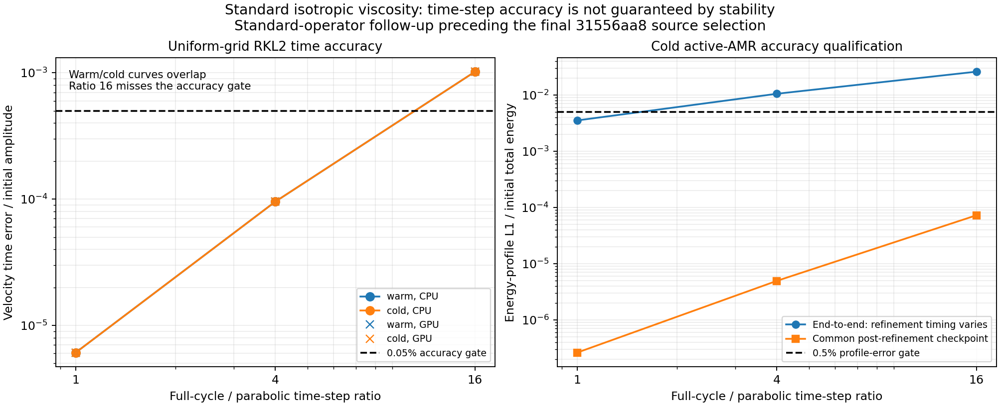
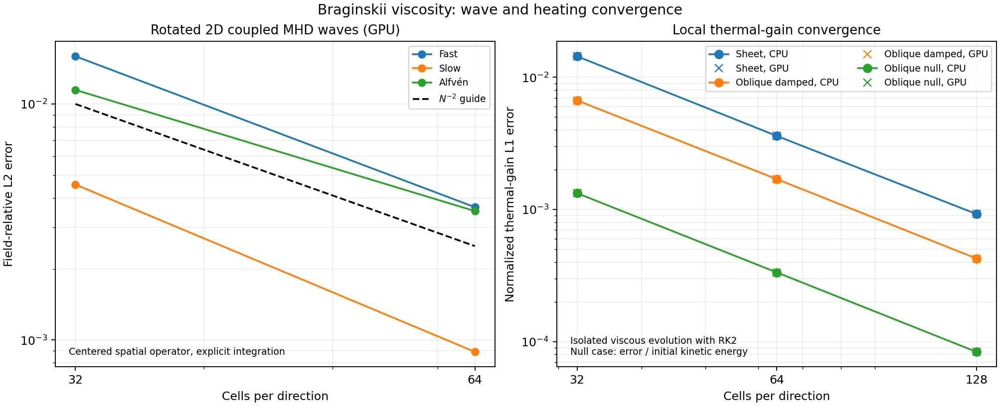
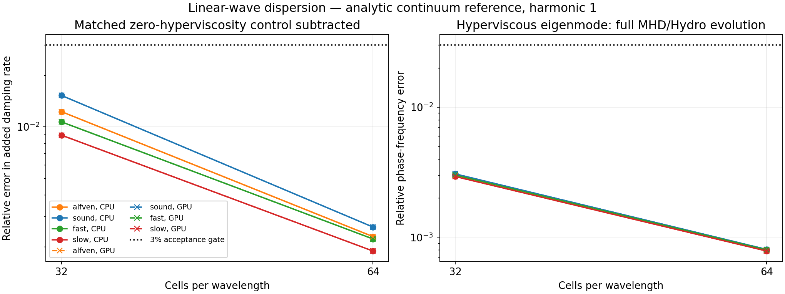
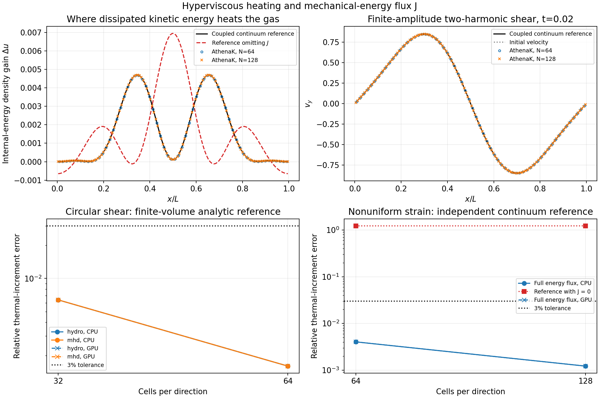
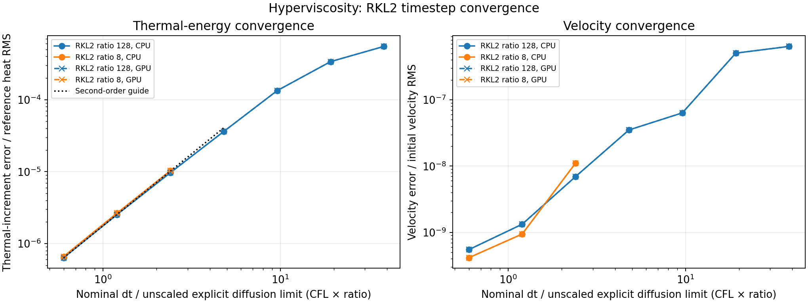

# Viscosity: implementation and validation

Newtonian physical shear viscosity, parallel Braginskii viscosity and ideal-gas
fourth-order hyperviscosity share conservative face-flux and RKL2 integration
infrastructure. Configuration is documented in [Viscosity](../../viscosity.md).
The [combined source manifest](data/combined_source_manifest.json) records all
26 changed paths from baseline `40b40183336ef09c26070084ce6b235cf10b8cb1`.
Implementation milestones are `31556aa884b1d9ebaac13285a009c21f95c6ee3b`
(physical-viscosity STS) and `02b50eca0bb01364636dcaa36d650175a10db5f5` (Braginskii).
The later hyperviscosity changes have a separate [seven-file inventory](data/source_manifest.json).
Both manifests describe the files at `19355b00cadef598d8ca293f1ab07b83efd9a4fd`;
their guide hashes precede the documentation-only embedding of these figures.
These are successive validation epochs, not fresh runs of every experiment against the combined snapshot.

## Physical viscosity and RKL2

The isotropic Newtonian stress is `tau_ij=2*rho*nu_iso*S_ij`, with
`S_ij=(partial_j v_i+partial_i v_j)/2-delta_ij div(v)/3`.
Arithmetic face density, centered derivatives and arithmetic face velocity provide
momentum flux `-tau` and ideal-gas work flux `-v dot tau`.
The existing spatial stencil is retained; STS does not replace it with a
different stress. Its inverse diffusion bound is `2*nu_iso*(sum_d dx_d^-2+max_d(dx_d^-2)/3)` before CFL scaling.

RKL2 half-sweeps surround fluid evolution. Raw-state checks precede EOS floors;
rejected trials restore conserved/primitive, magnetic and coarse-grid state
after completing communications. Collective interval halving retries the sweep.
Viscous heating can tighten fluid/source bounds: the pre-sweep controller then
restores the cycle start and reduces the full cycle without reapplying sources.
For ideal Hydro with conserved prolongation, `HydroProlongTheta` contracts
inadmissible reconstructed siblings toward their parent while preserving their
conserved mean. This applies to ghost interpolation and active refinement,
not MHD magnetic prolongation. Invalid parent states remain errors.

[Physical-viscosity results](data/viscosity_sts_results.json) retain operator,
damping/heating, explicit/RKL2, refinement and restart checks and their gates.
Each CPU/MPI-CPU/GPU/MPI-GPU functional matrix covers six wave cases, four
cold active-AMR cases, four cold SMR cases, four timestep-hook/restart cases
and three heating/cooling controls. Largest wave STS/explicit difference is
`6.203e-8` against `2e-6`; a cooling case triggers three whole-cycle retries,
with energy-replay error `2.66e-15` and source-budget error `3.58e-17`.
Earlier uniform operator tests retain a ratio-16 velocity error of `0.102019%`
above its `0.05%` temporal gate; ratio 1/4 pass. The associated heat error
`0.981688%` passes its separate 1% gate. Positive state is not time accuracy.
The cold active-AMR end-to-end profile comparison has a retained 0.5% gate:
ratio caps 16 and 4 give about 2.598% and 1.050% error, while cap 1 gives
0.352%. These errors are normalized by total energy, not the small heating
increment. Same post-remap-checkpoint temporal controls pass; changing the
adaptive remapping schedule is not a pure time-integrator convergence test.



## Parallel Braginskii viscosity

With `b=B/|B|`, the implemented leading parallel closure is
`D=b_i*b_j*partial_j v_i-div(v)/3`, `Delta_p=3*rho*nu_aniso*D`,
and `tau_ij=Delta_p*(b_i*b_j-delta_ij/3)`.
Here `Delta_p=p_perpendicular-p_parallel`. Momentum and ideal-gas energy
receive `-tau` and `-v_face dot tau`; continuum heating is `3*rho*nu_aniso*D²`.
The centered, unlimited Cartesian gradients follow the IDEFIX approach of
[Kempf, Rincon & Clerc](#references). Face B uses the CT normal component and
averaged transverse fields; face density is arithmetic. Exactly zero face B
disables directional stress, not a physical unmagnetized transition.

[Braginskii results](data/braginskii_results.json) include rotation/field-sign
and null controls, coupled waves, local heating, explicit/RKL2 comparisons,
mixed isotropic/parallel viscosity, backend/layout/restart and rejection checks.
Rotated N32→N64 relative field errors are fast `1.59256%→0.365469%`, slow
`0.455698%→0.0890848%`, and Alfvén `1.14720%→0.351774%`; orders are
`2.1235`, `2.3548` and `1.7054`. Mixed `nu_iso=0.02, nu_aniso=0.05` RKL2
self-orders are `1.9910` (fast) and `1.9800` (Alfvén).
An overdamped fast-wave N32 modal error of `4.0943%` fails the 3% gate;
halving the timestep gives `4.0944%`, whereas N64/N128 give passing
`0.9536%/0.2311%`. This is a spatial-resolution limitation, not repaired by
smaller timesteps. The coarse failure remains recorded.

Isolated native RK2 heating tests at N32/N64/N128 give velocity orders
`1.9929–2.0013`, thermal orders `1.9635–2.0023` and CPU budget error
`<=5.10e-16`; this is not a coupled-MHD or STS heating test. Heating source
hashes match `02b50eca`; rotated waves use an earlier centered-operator snapshot.
The closure/benchmark comparison with [Berlok et al.](#references) does not
copy their moving-mesh reconstruction or establish arbitrary-state positivity.



## Fourth-order hyperviscosity

The [hyperviscosity results](data/validation_results.json) test this specialization (repeated indices summed):

```text
S_ij = (partial_j v_i + partial_i v_j)/2 - delta_ij div(v)/3
tau4_ij = -2 mu4 Laplacian(S_ij)
H_ijk = 2 mu4 partial_k S_ij
J_j = H_abj S_ab
F_momentum(i),j = -tau4_ij
F_energy,j = -v_i tau4_ij - J_j
```

`mu_hyper4` has dimensions density × length⁴/time; its local kinematic
value is `mu_hyper4/rho`. The stress retains three velocity components and
the one-third trace subtraction in 1D/2D. Centered face gradients and a
centered strain Laplacian form a conservative finite-volume operator using
two primitive ghost cells. Arithmetic face velocity supplies ordinary stress
work; the additional face term discretizes `J=mu4 grad(S:S)`.
For constant `mu4`, the continuum heat production is
`Q4=2 mu4 sum_ijk(partial_k S_ij)^2`.

The general-order hyperstress follows [Haugen & Brandenburg](#references)
and [Lyra et al.](#references); the extra mechanical-work flux has an
ideal-gas precedent in [Nečas, Novotný & Šilhavý](#references).
Haugen & Brandenburg's reported turbulence simulations instead use sixth-order,
isothermal finite-difference hyperviscosity. Conservation of
periodic total energy alone does not verify the local heating equation:
omitting `J` conserves that budget but changes the thermal solution.

At uniform density, the Fourier velocity generator is
`L(k)=-(mu4/rho)|k|²[|k|²I+k kᵀ/3]`: transverse velocity decays at
`(mu4/rho)|k|⁴`, and longitudinal velocity at four-thirds that rate.
Sound and MHD waves require the coupled eigenproblem, not the isolated
velocity rate. Tests distinguish its continuum limit from the discrete
modified-wavenumber response.

Explicit and RKL2 integration call the same flux operator. The added inverse
forward-Euler bound is `(32/3)*(mu4/rho_min)*(sum_d dx_d^-2)^2`, using the
current minimum positive active-cell density; other viscous rates are added.
Existing mesh logic applies CFL and the rank minimum. Existing RKL2 machinery
provides split half-sweeps, current-stage primitives, raw-state rejection and
retry. Hyperviscosity introduces neither an induction source nor new restart
state. Stability of an RKL polynomial does not guarantee nonlinear accuracy
or cellwise thermal positivity.

## Changed files and functions

The manifest supplies all hunks; links below identify the changed functions and integration points.

| File / location | Implementation change |
| --- | --- |
| [viscosity.hpp](../../../src/diffusion/viscosity.hpp#L33) | Coefficient/process selection, raw-state API and declarations for the shared ordinary, parallel and hyperviscous operators. |
| [viscosity.cpp: InspectRawState / AddViscousFluxAniso](../../../src/diffusion/viscosity.cpp#L254) | Checks raw density/thermal state before floors; parallel stress (539) uses current CT geometry, conservative work and the summed timestep bound. Ordinary `AddViscousFluxIso` (377) retains the centered Newtonian stencil. |
| [viscosity.cpp: Hyper4Strain](../../../src/diffusion/viscosity.cpp#L53) | Cell/face symmetric trace-free gradients, including centered transverse derivatives. |
| [Viscosity constructor](../../../src/diffusion/viscosity.cpp#L201) | Strict finite/nonnegative coefficient parsing; ideal-gas, Newtonian, periodic, uniform-mesh, two-ghost-cell and `fofc=false` guards; positive hyper4 counts as an active STS process. |
| [AddViscousFluxes / AddViscousFluxHyper4](../../../src/diffusion/viscosity.cpp#L310) | Dispatch; device face loops (324); strain Laplacian (343); momentum and velocity-work fluxes (355); higher-stress work `J` (363). |
| [NewTimeStep](../../../src/diffusion/viscosity.cpp#L606) | Preserves the zero-hyper4 path; current-density reduction (612), summed fourth-order rate (663), representability checks and collective invalid-state decision (670–677). |
| [hydro.cpp: Hydro::Hydro](../../../src/hydro/hydro.cpp#L83) | Constructs and activates viscosity when hyper4 is the only enabled viscous coefficient. |
| [mhd.cpp: MHD::MHD](../../../src/mhd/mhd.cpp#L113) | Matching MHD registration; existing magnetic/Braginskii evolution remains separate. |
| [hyperviscosity_probe.cpp](../../../src/pgen/tests/hyperviscosity_probe.cpp#L26) | New test fixture: `Require`/`Sinc` (26/33), `DumpState` (35), `FinalState` (94), `UserProblem` (97). Provides raw U/CT output, exact FV initial data, loaded-wave checks, circular/two-mode states, and direct production-kernel flux/timestep dumps. Delegated `LinearWave` mode supports layout/restart tests. |
| [hyperviscosity.py](../../../tst/functional/hyperviscosity.py#L1) | New bounded regression: input generation (51), strict metadata/state/CT readers (73–108), independent initialization and flux oracles (122–155), stage/polynomial/evolution checks (178–191), negative `selfcheck` controls (256), bounded `launch` (294), eleven-case `main` (324). |
| [docs/viscosity.md](../../viscosity.md#fourth-order-stress-and-ideal-gas-energy) | Units/configuration, fourth-order stress and energy work, summed timestep, supported domain, STS accuracy limitations and focused regression usage. |
| [driver.cpp](../../../src/driver/driver.cpp#L544), [driver.hpp](../../../src/driver/driver.hpp) | `ViscositySnapshot::Save/Restore`, `CheckViscositySTSState`, `ExecuteViscositySTSSweep`, `ExecutePreSTSSweep`: complete state rollback, collective rejection and post-heating cycle-bound refresh. |
| [hydro.hpp](../../../src/hydro/hydro.hpp), [hydro_newdt.cpp](../../../src/hydro/hydro_newdt.cpp) | `RecomputeTimeStepFromCurrentState`: refresh fluid bounds without repeating source callbacks. |
| [hydro_sts.cpp](../../../src/hydro/hydro_sts.cpp), [hydro_tasks.cpp](../../../src/hydro/hydro_tasks.cpp) | `STSFluxes/Update/CheckState/RefreshTimeStep`, `ConToPrim`, `Prolongate`: rejection-aware stages and raw-state/ghost-prolongation checks. |
| [mhd.hpp](../../../src/mhd/mhd.hpp), [mhd_newdt.cpp](../../../src/mhd/mhd_newdt.cpp) | Matching current-state timestep API and source-refresh control. |
| [mhd_sts.cpp](../../../src/mhd/mhd_sts.cpp), [mhd_tasks.cpp](../../../src/mhd/mhd_tasks.cpp) | Current-field parallel flux dispatch, rejection-aware U/CT tasks and pre-EOS raw checks; viscosity-only sweeps add no induction flux. |
| [bvals.hpp](../../../src/bvals/bvals.hpp), [bvals/prolongation.cpp](../../../src/bvals/prolongation.cpp) | `ProlongateHydroPositive`: contract inadmissible ideal-Hydro ghost siblings conservatively. |
| [mesh_refinement.cpp](../../../src/mesh/mesh_refinement.cpp), [mesh_refinement.hpp](../../../src/mesh/mesh_refinement.hpp), [prolongation.hpp](../../../src/mesh/prolongation.hpp) | `RefineHydroPositive`, `HydroProlongAdmissible/SiblingsAdmissible/Theta`: the same admissibility contraction during active regridding. |
| [pgen.hpp](../../../src/pgen/pgen.hpp), [diffusion.cpp](../../../src/pgen/tests/diffusion.cpp), [hook_test.cpp](../../../src/pgen/tests/hook_test.cpp) | Retry-safe boundary/timestep callback contracts and enrollment; diffusion restarts rebuild callback parameters before returning without overwriting evolved fields. |
| [viscosity.athinput](../../../inputs/hydro/viscosity.athinput) | Replaces obsolete `viscosity` with the actual kinematic coefficient input `nu_iso`. |

Hyperviscosity reuses the physical-viscosity driver/STS infrastructure without changing the RKL recurrence or restart format.

## Hyperviscosity operator, conservation and dispersion tests

| Test family | Coverage and result |
| --- | --- |
| Independent semidiscrete checks | Seven tests: tensor symbol, resolved 1D/2D/3D convergence, periodic budgets, 1D heating identity and spectral timestep bound. A 300-mode bound search reaches a maximum bound fraction of `0.9999997812`. |
| Native kernel checks | 18 positive/zero-coefficient cases and 14 rejection cases per CPU/GPU backend; Hydro/MHD, 1D/2D/3D, constant/variable density. Checks every momentum/energy face and timestep. |
| Aligned circular shear | Four Hydro/MHD N32/N64 cases/backend; exact FV initialization, decay, generated heat and CT invariants. |
| Mixed isotropic/hyper4 | Twelve kernel cases and four circular evolutions/backend; tests the summed bound and damping `nu_iso*k²+(mu4/rho)*k⁴`. |
| Coupled waves | 24 cases/backend: sound, Alfvén, fast/slow magnetosonic, N32/N64, harmonic 1/2, propagation-direction controls and zero-hyper4 baselines. |

Kernel gates are `5e-12+5e-10*max_abs(reference_flux)` for face errors,
`2e-13` for FV initialization, `1e-11` for normalized conserved-budget drift,
`2e-12` relative timestep error, and `5e-12` for CT/divergence checks.
Raw density/internal energy must remain positive with zero repair events.
Continuum/modal tests instead use a 3% resolved-signal error budget.

Wave initial data are conserved cell averages from an independent coupled
eigenproblem, with `mu4=1e-4` and amplitude `1e-5`. The zero-hyper4 control
uses the full ideal matrix exponential: a dissipative eigenvector is not
assumed to remain one ideal eigenmode. All declared amplitude, phase,
field and baseline-corrected damping gates pass.

| Fundamental wave | N32 added-damping error | N64 added-damping error |
| --- | ---: | ---: |
| Sound | 1.52363% | 0.260126% |
| Alfvén | 1.22572% | 0.228819% |
| Fast magnetosonic | 1.06831% | 0.221650% |
| Slow magnetosonic | 0.893695% | 0.188445% |

Harmonic-2/fundamental damping ratios are `15.9611` (sound) and `15.9311` (Alfvén), versus `16`; all 24 CPU/GPU pairs pass.



## Hyperviscous heating and higher-stress work

The finite-amplitude fixture uses `v_y=0.8[sin(2πx)-0.2sin(4πx)]`,
`rho=p=1`, `gamma=5/3`, `mu4=1e-4`, `t=0.02`. Nonuniform heating drives
pressure/density/longitudinal motion; fixed-pressure shear is not a valid oracle.

Ten independent reference integrations use eighth-order continuum
differentiation, adaptive BDF, N128/N256/N512 and tighter-tolerance controls.
Reference uncertainty is `4.1171e-9` of RMS generated heat; 72 complex-step
Jacobian checks pass. Three native cases/backend cover N64 CFL 0.3/0.15 and
N128 CFL 0.3. Heating-field error falls from `0.403%` to `0.122%` (order
`1.724`); CFL halving changes the heating signal by `7.584e-9`.
Omitting `J` changes the reference heating by `122.5%`. Weak density/longitudinal-momentum
errors of `6.12%`/`3.50%` at N128 are nongating, not an all-components-3% result.



## Hyperviscosity RKL2, multidimensional and variable-density validation

| Test family | Coverage and measured outcome |
| --- | --- |
| Circular RKL2 | 24 cases/backend: Hydro/MHD, pure/mixed hyper4, explicit/RKL2, three CFLs; N32 harmonic 2, amplitude 0.8, ratio cap 8. Discrete RK2/Legendre amplification, heat, actual stage counts and split intervals pass. |
| Nonzero-`J` RKL2 | Six original cases plus seven refined-step cases/backend. Coarse ratio 128 fails temporal order; resolved windows recover thermal orders `1.889`/`1.916`, and ratio 8 gives `1.945`. All 13 CPU/GPU pairs agree within `3.684e-13`. |
| Mixed Braginskii/hyper4 | Six fast-wave cases/backend, N64, `nu_aniso=0.05`, `mu4=1e-4`, oblique B, three CFLs. Orders `1.937–2.106`; omission controls distinguish either missing stress. |
| Variable density | Six cases/backend, N64, density contrast 0.5. Independent linear reference distinguishes constant dynamic from constant kinematic closure; field and current-density timestep gates pass. Weak nonlinear heating and unresolved temporal order are not claimed validated. |
| Oblique explicit | 16 cases/backend: 2D N32/N64 and 3D N16/N32 Hydro/MHD, hyper4/off controls. Physical/spatial gates pass; unshifted 3D pointwise backend failures are retained below. |
| Oblique RKL2 | Twelve cases plus two finer cases/backend. Original 3D velocity order `1.111` misses `1.5`; finer windows pass unchanged gates. Maximum normalized CPU/GPU difference `3.392e-14`. |

The coarse nonzero-`J` ratio-128 thermal order is `0.1597`, with negative
velocity order, despite thermal error only `0.05504%` of generated heat.
Smaller steps recover the required order without changing the operator. Gates distinguish STS/reference error
`<=0.5%`, explicit-control uncertainty `<=0.05%`, and order `>=1.5`;
when both adjacent normalized gaps are `<=5e-8`, no resolved order is claimed.



Unshifted oblique 3D MHD has four CPU/GPU pointwise comparisons above the
`5e-12` gate, including zero-hyper4 controls. The N16 zero-hyper4 state
difference is `8.49413e-5`, normalized by `max(1,|CPU|,|GPU|)`.
One-step controls reproduce the discrepancy without hyperviscosity;
sign-dependent CT near zero normal mass flux amplifies roundoff differences.
A phase translation of 0.137 removes exact stagnation-plane alignment;
four translated N16/N32 cases/backend agree within `1.235e-14`.
This control does not repair the solver or replace the original unshifted failures.

## Hyperviscosity restarts, rejection contracts and portable regression

- 2D layout/restart tests: 22 cases, one/four blocks, CPU/GPU/two-rank CPU;
  28 field pairs and six bitwise-exact within-backend U/CT restart pairs.
  Six additional CPU rank-changing/CPU→GPU continuations pass; largest
  CPU→GPU raw-internal-energy difference is `3.309e-14`.
- 3D layout/restart tests: 24 Hydro/MHD N24³ cases, one/eight blocks;
  32 field and 20 full-history comparisons. Four rank-changing restarts
  are bitwise exact; maximum conserved/raw-internal/CT differences are
  `4.042e-14 / 4.153e-14 / 2.132e-14`, budget error `2.472e-15`.
- Built-in-problem integration: 8 Hydro/MHD explicit/RKL2 fresh/restart
  cases and 28 comparisons pass in single CPU, two-rank CPU, single GPU,
  multi-node CPU and multi-node GPU lanes. Field/CT/history gate `5e-11`,
  normalized conservation `1e-11`, time/timestep gate `2e-13`.
- Cold N64 STS: three native raw-state rejections/backend, exactly halved
  retries, positive final raw state and zero EOS repairs. CPU/GPU field gap
  `1.111e-16`; six deliberate telemetry faults rejected. No failed-stage
  dump exists, so the rejection identifies inadmissibility, not its cause.
- Constructor contracts: 38 intended rejections/backend cover invalid
  coefficients, EOS, geometry/refinement, boundaries, relativity, ghost
  width, FOFC and incompatible/inactive STS selection.
- Portable regression: 11/11 CPU and GPU cases pass—three operators,
  four explicit/RKL2 circular evolutions and four rejection cases.
  Discrete amplification/heating uses a `5e-10` relative budget.
  Independent checker faults cover missing hyper4/`J`, wrong density law,
  malformed/nonfinite fields, timing/stages and restart/CT/history damage.

## Scope limits and reproduction

Hyperviscosity does not support SMR/AMR, nonperiodic boundaries,
isothermal/relativistic fluids, variable `mu4`, or automatic CGS conversion.
Braginskii supports uniform ideal/isothermal MHD but not refinement,
temperature-dependent coefficients, gyroviscosity or mirror/firehose clipping.
Viscosity STS rejects primitive prolongation, cyclic zoom and incompatible
co-selected processes; user boundaries/timestep callbacks require retry-safe enrollment.
These tests establish neither general multidimensional thermal positivity
nor arbitrary-acceleration STS accuracy, nonlinear variable-density heating,
or turbulence-spectrum reproduction from sixth-order isothermal literature.

Build a double-precision executable with `PROBLEM=tests/hyperviscosity_probe`:

```sh
python tst/functional/hyperviscosity.py --selfcheck
python tst/functional/hyperviscosity.py --binary /path/to/athena --output /path/to/new-results
python tst/functional/hyperviscosity.py --binary /path/to/gpu/athena --output /path/to/new-gpu-results --gpu
python docs/feature-validation/viscosity/make_figures.py
python docs/feature-validation/viscosity/plot_viscosity_results.py
```

The regression needs NumPy, a new output directory and a compute resource;
`--gpu` records backend intent, not hardware allocation. Figure regeneration
needs NumPy/Matplotlib and only bundled data; it runs no simulation.
The portable runner reproduces the specified hyperviscosity subset, not every native STS/Braginskii campaign.

## References

- [Kempf, Rincon & Clerc, Appendix B](https://arxiv.org/html/2306.12460v2#A2): centered Cartesian Braginskii discretization and IDEFIX operator validation.
- [Berlok, Pakmor & Pfrommer (2020)](https://arxiv.org/abs/1911.05694): Braginskii damping/heating and RKL2 benchmarks on a moving mesh.
- [Meyer, Balsara & Aslam (2014)](https://doi.org/10.1016/j.jcp.2013.08.021): stabilized RKL integration of parabolic and mixed equations.
- [Haugen & Brandenburg (2004), equations 2–5](https://arxiv.org/html/astro-ph/0402301v2#S2): general-order constant-dynamic hyperstress; sixth-order isothermal applications.
- [Lyra et al. (2017), Hyperviscosity appendix](https://arxiv.org/html/1708.05057v1#A0.SS1.SSS1): conservative hyperstress and dynamic versus kinematic coefficients.
- [Nečas, Novotný & Šilhavý (1989), equation 2.12 and Example 2.21](https://dml.cz/bitstream/handle/10338.dmlcz/106776/CommentatMathUnivCarol_030-1989-3_14.pdf): higher-stress mechanical work and ideal-gas thermodynamics; not a discrete positivity proof.
- [Vaidya et al. (2017)](https://arxiv.org/html/1702.05487v2): RKL2 diffusion integration, not this hyperstress closure.
- [Tan, Aslam & Bertozzi, section 4.2](https://arxiv.org/html/2507.17062v2#S4.SS2): RKL2 fourth-order surface diffusion, not ideal-gas hyperviscosity.
