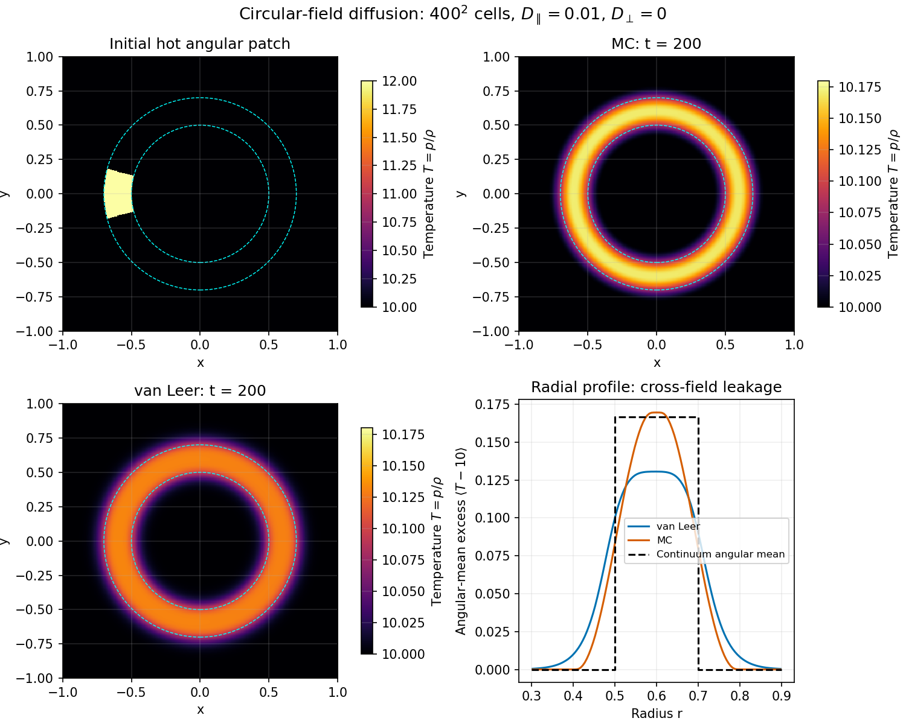
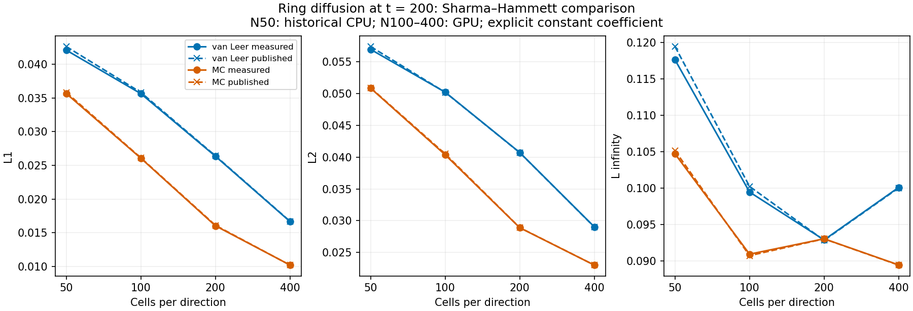
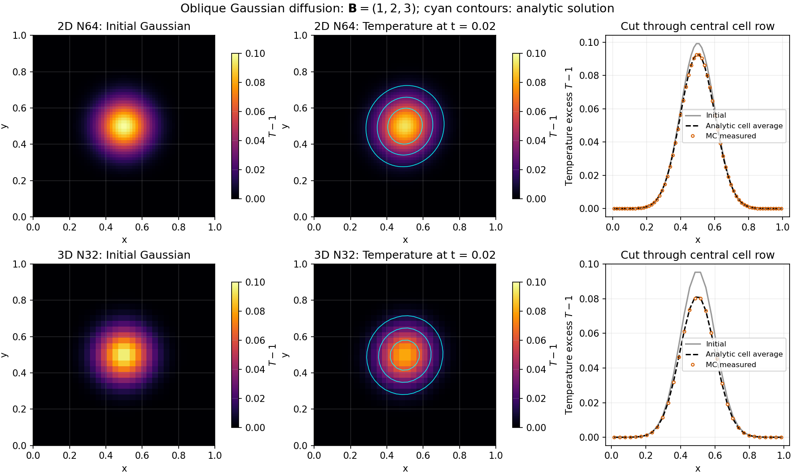
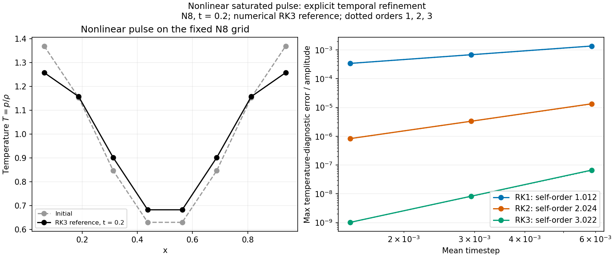
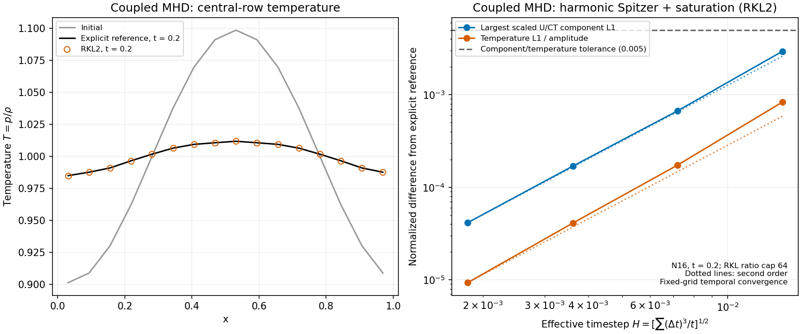
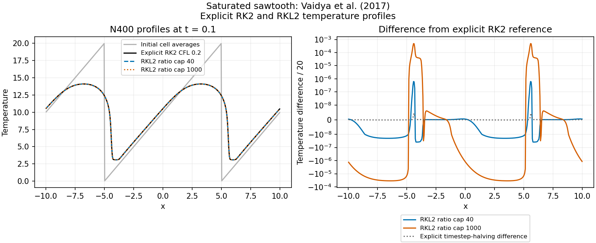
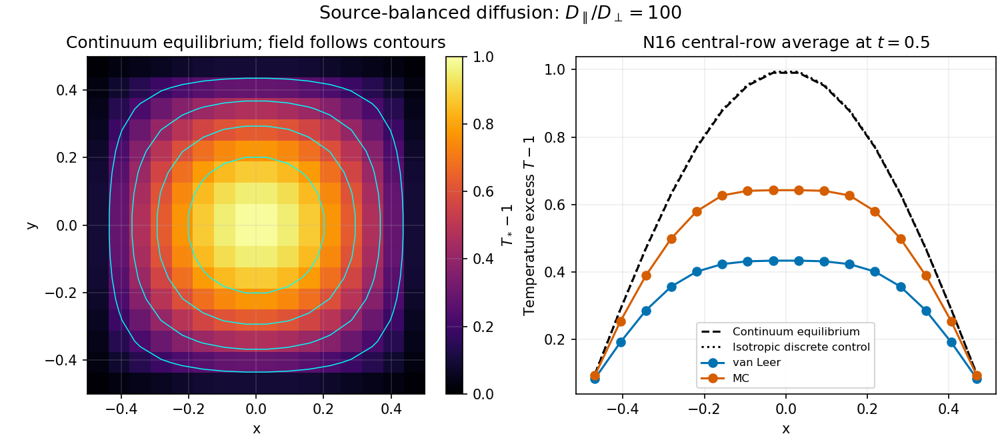
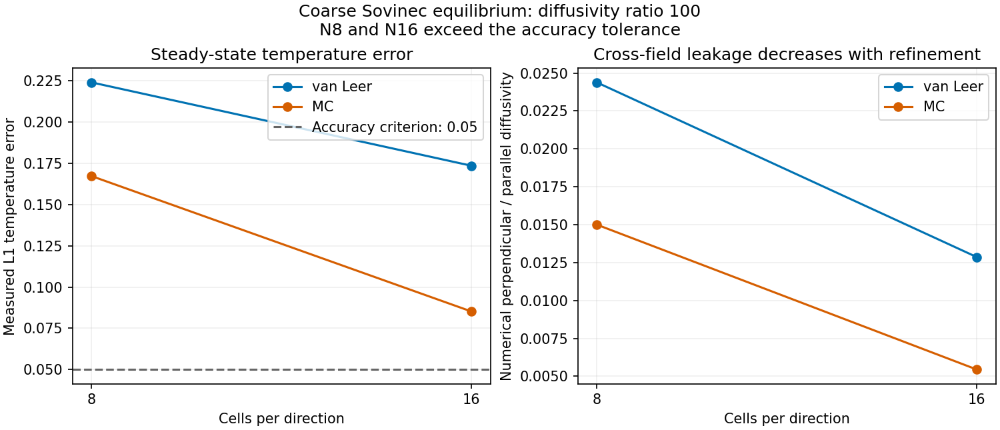

# Thermal conduction

AthenaK supports isotropic and magnetic-field-aligned conduction, Spitzer
conductivity, Cowie–McKee saturation, and RKL2 super-time-stepping (STS) for
Newtonian ideal-gas Hydro/MHD. This guide covers configuration, numerical
methods, implementation locations and scientific references.

See the [verification figures](#numerical-verification) for benchmark comparisons
and convergence studies. The [validation report](feature-validation/conduction/README.md)
includes numerical results, source locations and data for reproducing the figures.

## Constant-coefficient conduction

The code-temperature variable is `T = p/rho`. The conductive energy flux is

```text
q = -rho * alpha_iso * grad(T)
    -rho * alpha_aniso * bhat * dot(bhat, grad(T)).
```

In primitive arrays, `w(IEN)` stores internal-energy density, not pressure:
`p = (gamma - 1) * w(IEN)`. The conductive increment updates conserved total
energy; it does not directly update density, momentum or magnetic field.

`alpha_aniso` adds parallel transport: the parallel coefficient is
`alpha_iso + alpha_aniso`, while the perpendicular coefficient is `alpha_iso`.
At uniform density the temperature diffusivities are
`D_parallel = (gamma - 1)*(alpha_iso + alpha_aniso)` and
`D_perp = (gamma - 1)*alpha_iso`, because
`e_thermal = rho*T/(gamma - 1)`. These coefficients are in code units, not cgs conductivity;
they do not require a `<units>` block.

Example for MHD:

```text
<mhd>
alpha_iso = 0.0
alpha_aniso = 0.1
alpha_spitzer = false
anisotropic_limiter = vanleer
conductivity_integrator = explicit
```

Supply the remaining mesh, fluid, time and problem settings normally.
Both coefficients must be finite and nonnegative; zero disables the
corresponding contribution. Isotropic conduction also works in Hydro.
Anisotropic conduction requires nonrelativistic MHD.

### Spatial discretization

The anisotropic flux uses the CT face-normal magnetic component and averaged
transverse cell-centered components. All three components enter normalization,
including the out-of-plane component in 2-D. Exactly zero face field gives zero
anisotropic flux; there is no weak-field cutoff.

The anisotropic face coefficient is the harmonic mean of the neighboring
densities times `alpha_aniso`. Unsaturated isotropic conduction uses arithmetic
face-density interpolation. Transverse temperature slopes use nested van-Leer
limiting by default; `anisotropic_limiter = mc` selects monotonized-central
limiting. Both limiters return zero for opposing slopes; for same-sign slopes,
van Leer uses their harmonic combination while MC bounds their centered average
by twice the smaller magnitude.

Explicit conduction contributes to the energy flux in the ordinary RK update.
Its conservative density-aware timestep bound uses
`alpha_iso + 4*ndim*alpha_aniso`, where `ndim` counts active spatial directions.
Neither limiter eliminates resolution-dependent cross-field diffusion.

## Spitzer conductivity and physical units

Spitzer conductivity can be used alone or with the constant-alpha terms:

```text
<mhd>
alpha_spitzer = true
spitzer_kappa0_code = 0.1
spitzer_geometry = field_aligned
conductivity_integrator = explicit
<time>
integrator = rk2
```

Supply exactly one finite, nonnegative coefficient:
`spitzer_kappa0_code` or `spitzer_kappa0_cgs`. The cgs option requires explicit,
valid physical units and is converted using the units module's physical scales:

```text
K0_code = K0_cgs * T_unit^(7/2) / (P_unit * V_unit * L_unit)
K(T) = K0_code * T^(5/2),  T = p/rho.
```

The cgs coefficient multiplies `T_kelvin^(5/2)`; it is not the conductivity
evaluated at a reference temperature. The code uses a supplied prefactor; it
does not calculate a varying Coulomb logarithm or ionization dependence.
No low-temperature Parker branch or implicit conductivity ceiling is applied.
Conversion overflow or underflow of a positive coefficient is rejected.
Restarts retain the original coefficient
convention rather than serializing conflicting code and cgs inputs.

`spitzer_geometry` is `isotropic` or `field_aligned`. MHD must specify it;
Hydro defaults to isotropic and rejects field alignment. Spitzer-specific
parameters without `alpha_spitzer=true` are rejected.

At each face, the conductivity is the harmonic mean

```text
K_face = 2*K_left*K_right / (K_left + K_right).
```

A scaled evaluation avoids intermediate overflow. Field-aligned transport uses
this coefficient with the CT-based projection of the temperature gradient and
limited transverse temperature slopes, following the limited-asymmetric
construction of
[Sharma & Hammett (2007)](https://w3.pppl.gov/~hammett/gyrofluid/papers/2007/aniso.pdf).
The coefficient multiplying the gradient is averaged—not temperature or
diffusivity separately.

A genuinely zero endpoint conductivity produces zero harmonic face
conductivity. Positive-temperature conductivity underflow is rejected rather
than treated as this cold-face limit. Large temperature contrasts require
spatial-refinement checks.

## Physical saturation

`conduction_saturation = cowie_mckee` enables saturation in `<hydro>` or
`<mhd>`. It can limit constant-alpha conduction, Spitzer conduction, or their
sum. `saturation_phi` must be finite and nonnegative and defaults to 0.3.
The default `conduction_saturation = none` leaves the classical flux unchanged;
supplying `saturation_phi` in that mode is rejected.

The code reconstructs the complete classical conductive vector `C` and applies

```text
F = C * q_sat / (q_sat + |C|)
q_sat = 5 * phi * P_donor^(3/2) / sqrt(rho_face).
```

`rho_face` is the arithmetic face density. `P_donor` is the cell-centered
pressure on the sending side of the normal heat flux, not a reconstructed
Riemann pressure. This uses the isothermal sound-speed convention with no
extra gamma factor. The closure is evaluated in code units; `phi` is
dimensionless. Zero phi suppresses the flux but does not bypass state checks.

Only the conductive increment is limited. Fluid energy flux is unchanged.
Saturation acts on the summed vector, not independently on its components or
individual conduction terms. Thus out-of-plane magnetic components matter in
2-D, and even isotropic saturation needs transverse slopes and edge ghosts to
evaluate the vector norm.

## Time integration

### Explicit stepping

Nonlinear explicit conduction supports Newtonian SSP RK1/RK2/RK3 and requires
finite `0 < cfl_number <= 1`. Its timestep combines the constant-alpha rate
with a global-temperature-cap Spitzer rate.
Saturation adds donor-pressure-response and outgoing thermal-energy-drain
bounds. These bounds include the consumed ghost stencil and are recomputed at
every SSP stage.

The mesh CFL factor is applied once when selecting the next timestep. Stage
checks compare the constituent forward-Euler interval against the current
CFL-free conduction bound; they do not change the committed timestep.
Exceeding that bound is fatal: explicit stepping has no automatic retry.

Raw conserved-state checks precede the normal EOS conversion. States requiring
density, pressure, temperature or entropy floors are rejected, with failures
coordinated across MPI ranks. Other modules retain their own state checks;
the conduction drain bound alone cannot ensure positivity in coupled MHD.

### RKL2 super-time-stepping

Select STS for the conduction process using

```text
<mhd>
alpha_iso = 0.0
alpha_aniso = 0.1
conductivity_integrator = sts
<time>
integrator = rk2
sts_integrator = rkl2
sts_max_dt_ratio = 16
```

The same selectors work for isotropic or combined transport and for nonlinear
Spitzer/saturated conduction. At least one conductivity must be positive.

Conduction takes pre/post half-sweeps around the fluid update. The RKL2
controller selects an odd stage count `s >= 3` satisfying

```text
dt_sweep / dt_exp <= (s*s + s - 2)/4.
```

For nonlinear conduction, conductivity, limiters and saturation are recomputed
at every RKL stage. Both split halves refresh primitives from the current
conserved state. Trial stages must remain inside the trial-start thermal
envelope, allowing temperature-scaled roundoff, without EOS floors. A rejected
trial restores conserved and primitive fluid arrays and halves the interval
after communication completes. At most 32 halvings are allowed per segment.
Rollback covers fluid U/W, not the CT field or arbitrary problem state.
Invalid initial states and constitutive/rate representability errors are fatal.

Regridding occurs at completed cycles, not within a retry. Subsequent sweeps
refresh the state and timestep bounds and resize the primitive-state backup.
Restarts use standard completed-cycle checkpoints, with no additional
conduction-specific binary layout.

The donor-pressure bound limits the outer timestep and trial interval without
STS acceleration. Stage counts use the unsuppressed diffusion budget.
`sts_max_dt_ratio` is an upper limit, not a promised acceleration factor or an
accuracy controller. Internal RKL stages are not generally maximum-principle
preserving. Resolve sharp fronts and check timestep refinement rather than
choosing the ratio from stability alone.

## Restrictions and numerical limitations

- Nonlinear Spitzer/saturated STS requires one fluid and conduction as the sole
  STS process. Custom user-boundary callbacks and cyclic zoom are rejected.
  Refined meshes must use conserved-variable prolongation.
- Thermal boundary fluxes depend on the ghost-state prescription. A fluid
  boundary label alone does not establish insulation or a prescribed heat flux.
- SMR/AMR is supported through the existing flux-correction and mesh-transfer
  machinery, but conservation does not establish accuracy for arbitrary
  refinement layouts, density contrasts or coupled flows. Check spatial and
  temporal convergence for the intended problem.
- On a composite mesh, volume-weighted cell-centered magnetic field is not
  generally an exact CT invariant. Use native plane-integrated normal magnetic
  flux when checking magnetic-flux conservation.
- CPU/GPU results need not be bitwise identical. Device agreement and
  continuum accuracy are separate checks; set comparison tolerances using
  the physical scale and accuracy required for the problem.
- Extreme-range constitutive calculations are not supported without bounds:
  unrepresentable positive conductivity, heat-capacity or timestep-rate
  intermediates are rejected instead of silently disabling transport.
- `q_limit` is not a physical saturation control. It must be finite and at
  least the legacy disabled sentinel `3.40282e38`. Use
  `conduction_saturation` and `saturation_phi` for physical saturation.

## Implementation map

| Source | Functions and responsibilities |
| --- | --- |
| [conduction.hpp](../src/diffusion/conduction.hpp), [conduction.cpp](../src/diffusion/conduction.cpp) | `Conduction::Conduction` reads and validates inputs; `AddHeatFluxes` dispatches the combined saturated flux or separate classical terms; `AddHeatFluxIso/Aniso` implement constant-coefficient fluxes. `NewTimeStep`, `SpitzerTimeStep`, `CheckExplicitStage` and `InspectRawState` supply timestep and state checks. |
| [conduction.cpp](../src/diffusion/conduction.cpp) | File-local `HarmonicMeanPositive`, `SpitzerConductivity`, `SpitzerLimited4` and `SaturateHeatFlux` provide device-callable constitutive arithmetic; `SpitzerCoefficientCode` converts Units scales. `AddHeatFluxSpitzer` constructs harmonic temperature-dependent face fluxes. The private `SaturatedFace` helper builds and caps the summed vector; `AddHeatFluxSaturated` adds its normal component to energy flux; `SaturationTimeStep` computes donor-response and thermal-drain restrictions. |
| [sts_rkl2.cpp](../src/diffusion/sts_rkl2.cpp) | `parabolic::ComputeRKL2StageCount` and `ComputeRKL2Coefficients` select the stage count and recurrence coefficients. |
| [driver.cpp](../src/driver/driver.cpp), [driver.hpp](../src/driver/driver.hpp) | `Driver::ValidateSTSConfiguration` checks supported combinations; `ExecuteSTSSweep` schedules half-sweeps and nonlinear retries. It calls `Conduction::BeginSTSTrial/RestoreSTSTrial`, defined in `conduction.cpp`, to snapshot and restore fluid U/W. |
| [hydro_newdt.cpp](../src/hydro/hydro_newdt.cpp), [mhd_newdt.cpp](../src/mhd/mhd_newdt.cpp) | `Hydro::NewTimeStep` and `MHD::RecomputeTimeStepFromCurrentState` include the unaccelerated saturation donor bound in the fluid timestep. |
| [hydro_sts.cpp](../src/hydro/hydro_sts.cpp), [mhd_sts.cpp](../src/mhd/mhd_sts.cpp), [hydro_tasks.cpp](../src/hydro/hydro_tasks.cpp), [mhd_tasks.cpp](../src/mhd/mhd_tasks.cpp) | `STSFluxes`, `Hydro::STSUpdate`, `MHD::STSUpdateU`, `STSCheckState` and `ConToPrim` integrate fluxes, recurrence, raw-state checks and boundary exchanges. Active state is checked before restriction/EOS conversion; consumed halos are checked after prolongation and physical BCs. |

Trial failures are coordinated across MPI ranks, and posted communication
completes before an attempt is abandoned or retried. The conduction recurrence
updates only energy. Refined-mesh boundary exchanges also prolongate CT fields,
so face fields can change during those exchanges.

## Numerical verification

The examples below show the physical temperature evolution before quantifying
its error. The [validation report](feature-validation/conduction/README.md)
derives the analytic references, states the actual setups and assumptions,
and records convergence, refinement, restart and CPU/GPU/MPI comparisons.
The studies span successive implementations; the early constant-coefficient
measurements predate the final nonlinear implementation.

### Anisotropic ring: comparison with Sharma & Hammett



The [Sharma–Hammett §7.1 setup](https://w3.pppl.gov/~hammett/gyrofluid/papers/2007/aniso.pdf)
places a temperature-12 patch in a temperature-10 medium, with heat flowing
along circular field lines. Here `gamma=2`, `rho=1`, `alpha_aniso=0.01` and
`alpha_iso=0`, so the parallel temperature diffusivity is 0.01.
Angular modes decay as `exp(-0.01*n*n*t/(r*r))`; the long-time annular
temperature is `10+1/6`. The measured N400 maps at `t=200` show radial numerical
leakage, stronger with van Leer than MC. Initial and final maps use different
temperature scales. The radial reference is the continuum angular mean.



N50/100/200/400 norms follow the published long-time-reference comparison.
They measure absolute temperature errors over the full square domain:
the mean absolute error, root-mean-square error, and maximum absolute error.
All cells have equal area; no temperature-amplitude normalization is applied.
At N400 their differences from the tabulated numerical errors are below 0.23%
for van Leer and 0.12% for MC. These percentages measure reproduction of the
paper's errors, rather than continuum accuracy. Van-Leer L-infinity increases
from N200 to N400; the ambiguous published N100 perpendicular-diffusivity entry
is excluded. The sequence combines historical N50 CPU and N100–400 GPU builds.

### Gaussian spreading: an analytic tensor solution



For fixed density and field, Gaussian covariance grows as
`Sigma(t)=Sigma(0)+2*D*t`, while conserved heat fixes the decreasing peak.
The periodic-cell-average analytic solution is compared with actual MC fields
at `t=0.02`, with `B=(1,2,3)`, `gamma=2`, `alpha_iso=0.001` and
`alpha_aniso=0.099`. The initial excess has amplitude 0.1 and width 0.1.
The 2D N64 and 3D N32 relative excess-temperature L1 errors are
`5.88537e-4` and `6.50841e-3`; the 3D panels show the `z=0.484375` cell plane.
The 2D projected diffusivity ratio is 36.36, compared with the full 3D ratio 100.

### Explicit and RKL2 temporal convergence



The periodic stationary-fluid pulse begins at `T=1+0.4*cos(2*pi*x)` with
`gamma=5/3`, `rho=1`, `K0=0.1`, `phi=0.03` and N8 cells. At `t=0.2` its
maximum has cooled and minimum warmed. RK1/RK2/RK3 self-orders are
1.01222/2.02432/3.02180. Errors use double-precision temperature diagnostics
against a time-refined same-grid RK3 solution, normalized by amplitude 0.4.
This isolates temporal accuracy from spatial error.



The coupled periodic N16 MHD pulse starts with
`T=1+0.1*cos(2*pi*(x+y))`, `rho=1`, `B=(1,0.5,0.25)`, and zero velocity.
Field-aligned Spitzer conduction and saturation (`K0=0.1`, `phi=0.03`) evolve
alongside pressure forces through `t=0.2`, so temperature, density and field
all respond. The reference is a time-refined explicit run on the same grid.
Eleven conserved-fluid/CT component norms are checked separately from temperature.
Finest combined-field orders are 1.99617/2.03556 and temperature
orders are 2.09397/2.14279, consistent with second order. The timestep measure is
`H=sqrt(sum(dt^3)/elapsed_time)`; explicit-reference halving differences remain
below 1% of the finest RKL error.

### Saturation: Vaidya et al. sawtooth setup



The initial sawtooth spans temperature 0–20 on the periodic interval
`[-10,10]`, with fixed `rho=1`, `gamma=2`, conductivity 40 and `phi=0.3`.
Temperature profiles use the isotropic 1D setup in
[Vaidya et al., section 4.1.2](https://arxiv.org/html/1702.05487v2#S4.SS1.SSS2)
and compare RKL2 with explicit RK2 CFL 0.2 on the same grid. At N400 and `t=0.1`,
normalized L1/L-infinity differences are
`1.84469e-8/6.26363e-7` for the ratio-40 cap and
`2.31719e-5/4.80778e-4` for the ratio-1000 cap, below the 0.002/0.02 criteria.
Differences are normalized by the initial range 20. Ratio caps are distinct
from achieved acceleration and from the paper's parabolic Courant number.

### Coarse-resolution accuracy



In the Sovinec test, field lines follow the contours of
`T*=1+cos(pi*x)*cos(pi*y)`. Heating balances perpendicular conduction, while
parallel conduction vanishes analytically. At parallel/perpendicular ratio 100,
the coarse numerical temperature peaks are too low because of cross-field
leakage. The matched isotropic control closely follows the analytic equilibrium.



The N8/N16 ratio-100 Sovinec equilibria become stationary but fail their
volume-averaged absolute-temperature L1 criterion of 0.05. Six static N32 3D refinement CPU/GPU energy
comparisons also fail the `5e-12` agreement criterion, with a maximum relative
discrepancy of `5.4542320335866934e-9`. Accuracy, conservation and CPU/GPU
agreement are assessed separately.

Regenerate all eight figures from the bundled numerical data with
`python docs/feature-validation/conduction/plot_results.py`
(NumPy and Matplotlib required).

## Validation resources

The existing diffusion and STS regression tests remain part of the normal test
suite. Extended conduction benchmarks, analytic oracles, refinement studies,
and CPU/GPU/MPI comparison runners are maintained on the
[`feature/anisotropic-conduction` branch](https://github.com/rajsekhar33/athenak-RM/tree/feature/anisotropic-conduction/tst/transport).
They are development/validation tools, not required to build or use conduction.

## References

- **Sharma & Hammett (2007)**, *Preserving monotonicity in anisotropic diffusion*,
  JCP 227, 123–142. [Paper](https://w3.pppl.gov/~hammett/gyrofluid/papers/2007/aniso.pdf),
  [DOI](https://doi.org/10.1016/j.jcp.2007.07.026).
  Harmonic face coefficients and limited-asymmetric transverse gradients.
- **Spitzer & Harm (1953)**, *Transport Phenomena in a Completely Ionized Gas*,
  Physical Review 89, 977–981. [DOI](https://doi.org/10.1103/PhysRev.89.977).
  Collisional temperature-dependent conductivity.
- **Cowie & McKee (1977)**, *The evaporation of spherical clouds in a hot gas.
  I. Classical and saturated mass loss rates*, ApJ 211, 135–146.
  [DOI](https://doi.org/10.1086/154911). Physical saturated-flux scale.
- **Meyer, Balsara & Aslam (2012)**, *A second-order accurate Super TimeStepping
  formulation for anisotropic thermal conduction*, MNRAS 422, 2102–2115.
  [Article](https://academic.oup.com/mnras/article/422/3/2102/1042639),
  [2013 erratum](https://academic.oup.com/mnras/article/428/2/1855/1000287).
  Early RKL formulation, with the printed corrections taken into account.
- **Meyer, Balsara & Aslam (2014)**, *A stabilized Runge–Kutta–Legendre method
  for explicit super-time-stepping of parabolic and mixed equations*,
  JCP 257, 594–626. [DOI](https://doi.org/10.1016/j.jcp.2013.08.021).
  RKL stability polynomial and recurrence.
- **Vaidya et al. (2017)**, *Scalable explicit implementation of anisotropic
  diffusion with Runge–Kutta–Legendre super-time-stepping*,
  MNRAS 472, 3147–3160. [Paper](https://arxiv.org/html/1702.05487v2).
  RKL conduction and the smooth saturation interpolation/isothermal convention
  used above.
