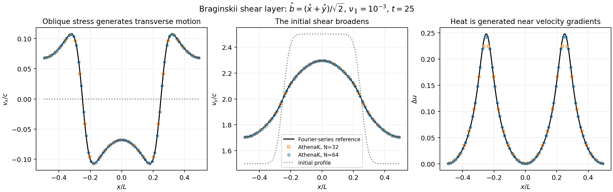

# Viscosity

Newtonian Hydro and MHD support constant isotropic kinematic shear viscosity.
Uniform-grid Newtonian MHD also supports leading parallel Braginskii viscosity
with ideal or isothermal equations of state. Set `nu_iso` and/or `nu_aniso`
in the fluid block, in code units of length squared per time.
For a dimensional coefficient, use
`nu_code = nu_cgs * time_cgs / length_cgs^2`; the input is not converted
automatically. The corresponding dynamic coefficients are `rho * nu_iso`
and `rho * nu_aniso`.

[Physical verification](#physical-verification) covers damping, heating and RKL2
convergence. The [validation report](feature-validation/viscosity/README.md)
provides test setups, measured errors and data for reproducing the figures.

Ideal-gas Hydro/MHD additionally support constant **dynamic** fourth-order
hyperviscosity, `mu_hyper4`, on uniform meshes with periodic or outflow
boundaries. Its code units are
`density * length^4 / time`; convert a dimensional coefficient with
`mu4_code = mu4_cgs * time_cgs / (density_cgs * length_cgs^4)`.
The local kinematic coefficient is `mu_hyper4 / rho`, not a constant input.

## Configuration

Explicit integration is the default:

```ini
<hydro>
nu_iso = 0.01
viscosity_integrator = explicit
```

For RKL2 super-time-stepping (STS), use:

```ini
<hydro>
nu_iso = 0.01
viscosity_integrator = sts

<time>
integrator = rk2
sts_integrator = rkl2
sts_max_dt_ratio = 1
```

Use `<mhd>` instead for MHD. For parallel Braginskii viscosity, for example:

```ini
<mhd>
nu_iso = 0
nu_aniso = 0.01
viscosity_integrator = explicit
```

Set `viscosity_integrator = sts` and use the same `<time>` settings above for
RKL2. All viscosity coefficients share `viscosity_integrator`;
STS requires at least one positive coefficient. Malformed, negative or
nonfinite coefficients are rejected.
Nonzero `nu_aniso` requires MHD without SMR/AMR, in either integration mode.
There is no temperature-dependent viscosity, gyroviscosity or mirror/firehose
pressure-anisotropy clipping.

For fourth-order hyperviscosity, add the following to the fluid block:

```ini
<hydro>
eos = ideal
nu_iso = 0
mu_hyper4 = 0.0001
viscosity_integrator = explicit
```

Use `<mhd>` for MHD; `viscosity_integrator = sts` uses the RKL2 settings above.
`mu_hyper4` defaults to zero and may be combined with the supported ordinary
viscosities. Nonzero hyperviscosity requires periodic or outflow boundaries in
every active direction, no SMR/AMR and at least two ghost cells.
FOFC can be enabled with `viscosity_integrator = sts`; explicit
hyperviscosity requires `fofc = false`.
At physical outflow faces, the hyperviscous momentum and energy fluxes are zero.
Adjacent interior faces use the extrapolated fluid ghosts. Advective,
conductive and ordinary-viscous boundary treatments are unchanged.
It is not available with an isothermal EOS or relativistic physics.

The positive `sts_max_dt_ratio` caps the full cycle relative to the combined
CFL-scaled STS diffusion bound; `-1` removes that cap. Check timestep convergence
before increasing it: large cycles can lose accuracy and change the timing of
adaptive refinement.

## Spatial operator and time integration

`Viscosity::AddViscousFluxIso` in `src/diffusion/viscosity.cpp` evaluates
the Newtonian shear stress
`tau_ij = rho*nu_iso*(dv_i/dx_j + dv_j/dx_i - 2/3*delta_ij*div(v))`.
It uses arithmetic face density and centered gradients. The conservative
momentum flux receives `-tau_ij`; ideal-gas total energy receives the stress
work using the arithmetic face velocity. Isothermal fluids have no evolved
energy equation. The same spatial flux is used in explicit and STS modes.

`Viscosity::AddViscousFluxAniso` evaluates the parallel Braginskii stress:

```text
b = B / |B|
S = b_i*b_j*dv_i/dx_j - div(v)/3
Delta_p = 3*rho*nu_aniso*S
tau_ij = Delta_p*(b_i*b_j - delta_ij/3)
```

Here `Delta_p = p_perpendicular - p_parallel`; papers using `Pi` in the
momentum flux write `Pi = -tau`. The implementation uses centered normal and
transverse velocity derivatives without a slope limiter, following the
Cartesian centered approach described by
[Kempf, Rincon & Clerc, Appendix B](https://arxiv.org/html/2306.12460v2#A2).
At each face, density and velocity are arithmetic averages, normal B is the
current CT face field, and transverse B is averaged from adjacent cell-centered
fields. The momentum flux receives `-tau`; ideal-gas total energy receives
the matching conservative work flux `-v_face dot tau`. Explicit and RKL2 use the same
operator with current-stage fields. Braginskii damping, heating and RKL2
benchmarks are also described by
[Berlok, Pakmor & Pfrommer (2020)](https://arxiv.org/abs/1911.05694).
Those benchmarks use a moving mesh; AthenaK uses the Cartesian face-flux
discretization above.

The continuum heating rate is `3*rho*nu_aniso*S^2`, but the centered discrete
operator does not guarantee local thermal positivity for arbitrary states.
At exactly zero reconstructed face B, the code sets the anisotropic stress
to zero. Unmagnetized viscosity requires a separate isotropic coefficient.

### Fourth-order stress and ideal-gas energy

`Viscosity::AddViscousFluxHyper4` uses centered face strains and their discrete
Laplacian. In continuum notation, with repeated indices summed:

```text
S_ij = (d_j v_i + d_i v_j)/2 - delta_ij div(v)/3
tau4_ij = -2 mu4 Laplacian(S_ij)
H_ijk = 2 mu4 d_k S_ij
J_j = H_abj S_ab
F_momentum(i),j = -tau4_ij
F_energy,j = -v_i tau4_ij - J_j
```

The general-order constant-dynamic hyperstress is described by
[Haugen & Brandenburg (2004), equations 2--5](https://arxiv.org/html/astro-ph/0402301v2#S2).
Their simulations use sixth-order hyperviscosity and an isothermal EOS;
AthenaK uses the fourth-order specialization with ideal-gas energy evolution.
Higher-stress mechanical work in an ideal-gas total-energy balance has a
continuum precedent in
[Necas, Novotny & Silhavy (1989), equation 2.12 and Example 2.21](https://dml.cz/bitstream/handle/10338.dmlcz/106776/CommentatMathUnivCarol_030-1989-3_14.pdf).
These references supply the continuum formulation. The finite-volume stencil
is evaluated in the [verification tests](#physical-verification).

For constant `mu4`, the extra mechanical-work term is
`J = mu4 grad(S:S)`. Including it yields the continuum heat production
`Q4 = 2 mu4 sum_ijk (d_k S_ij)^2`; using only `-v dot tau4` would give a
different local thermal-energy equation. The term describes mechanical work.
The code evaluates the momentum and complete energy contributions as shared
face fluxes using current-stage primitive velocities, without a new evolved
field. The stencil uses two primitive ghost cells in each active direction.
Viscosity itself does not update the CT magnetic faces.

In the continuum at uniform density, transverse Fourier velocity modes decay at
`(mu4/rho)*|k|^4`; the longitudinal viscous rate is `4/3` times larger.
Sound and magnetosonic waves require the coupled fluid dispersion relation,
not this isolated velocity-decay law. The finite-volume stencil has its own
modified-wavenumber response. Periodic global kinetic dissipation is a spatial
operator property, not a finite-step RKL2 guarantee; positive continuum heating
does not establish multidimensional cellwise thermal positivity for the
discrete update.

### Timestep selection and RKL2

`Viscosity::NewTimeStep` supplies `1/(rate_iso + rate_aniso + rate_hyper4)`,
minimized over blocks, where the sums and dimension count include only active
directions:

```text
rate_iso   = 2*nu_iso*(sum_d dx_d^-2 + max_d(dx_d^-2)/3)
rate_aniso = (8/3)*ndim*nu_aniso*max_d(dx_d^-2)
rate_hyper4 = (32/3)*(mu_hyper4/rho_min)*(sum_d dx_d^-2)^2
```

The mesh applies the CFL factor. Adding rates accounts for simultaneous
isotropic, parallel and hyperviscosity. For hyperviscosity, `rho_min` is the
current positive active-cell minimum on the local pack; the mesh minimizes
the timestep across ranks. Density and the bound are refreshed after fluid
evolution. This bound is not a variable-density positivity guarantee.
The zero-hyperviscosity path retains the ordinary-viscosity timestep arithmetic.

The driver places an RKL2 half-sweep on either side of the fluid update.
Hydro/MHD STS tasks reuse the conservative flux and boundary exchange paths.
RKL methods and their application to viscosity are described by
[Meyer, Balsara & Aslam (2014)](https://www.sciencedirect.com/science/article/pii/S0021999113005597);
see also [Vaidya et al. (2017)](https://arxiv.org/abs/1702.05487)
for anisotropic-diffusion STS.

STS uses the same stress discretization with the following safeguards:

- `Viscosity::InspectRawState` checks finite density, momentum and, where
  applicable, positive internal energy and the configured EOS floors before
  EOS conversion. MHD checks use current CT faces.
- `Driver::ExecuteViscositySTSSweep` restores rejected trials and halves their
  intervals collectively across ranks. Boundary exchanges finish before retry.
  Invalid starting states or exhausted retry limits terminate with an error.
- `Driver::ExecutePreSTSSweep` refreshes fluid, source, user and explicit-
  diffusion bounds after viscous heating. If needed, it restores the cycle
  start and repeats the first half-sweep at a smaller cycle length.
  Source application and work callbacks are not executed inside these retries.

The checks enforce admissible states but do not estimate truncation error or
guarantee dissipation at arbitrary density contrast. Stiff fourth-order modes
require timestep-convergence checks of both velocity and thermal energy.

## Refinement and callbacks

The refinement support below is for isotropic viscosity only. Parallel
Braginskii viscosity and fourth-order hyperviscosity currently reject both
static and adaptive refinement. Hyperviscosity supports periodic and outflow
boundaries only; the callback contracts below do not extend that set.

For Newtonian ideal Hydro with viscosity STS and conserved prolongation,
`HydroProlongTheta` contracts inadmissible reconstructed siblings toward their
parent using a common factor. Both ghost interpolation and active AMR refinement
use it. Sibling conserved means are preserved; already admissible reconstructions
are unchanged. Invalid parent data are rejected rather than repaired with floors.
This safeguard is not an MHD/CT prolongation repair.

User boundaries and user timestep setters require explicit code enrollment via
`user_bcs_retry_safe` and `user_dt_retry_safe` in `ProblemGenerator`.
A boundary callback may only deterministically update snapshotted ghost fields;
a timestep callback may only deterministically recompute `dtnew`.
Neither may have persistent side effects. Enrollment is set in the problem
generator code; time accuracy still depends on the boundary implementation.

Viscosity STS rejects primitive prolongation, cyclic zoom, simultaneous Hydro/MHD
owners, and co-selected STS resistivity. General STS restrictions also exclude
relativity, radiation, ion-neutral physics, shearing boxes and orbital advection.
Nonlinear conduction must be the only STS process, so cannot share an STS sweep
with viscosity. See [thermal_conduction.md](thermal_conduction.md) for conduction's
own restrictions.

## Focused hyperviscosity regression

The test-only `tests/hyperviscosity_probe` problem generator and
`tst/functional/hyperviscosity.py` provide a small single-rank regression.
Configure a double-precision build with
`-DPROBLEM=tests/hyperviscosity_probe`, then run:

```sh
python tst/functional/hyperviscosity.py --selfcheck
python tst/functional/hyperviscosity.py --binary /path/to/athena --output /path/to/new/results
```

NumPy is required. The tests check the one-dimensional tensor symbol and
complete energy-work flux, coefficient-off behavior, circular-shear decay
and generated heat with explicit/RKL2 integration, and selected input guards.
The reference solution uses the discrete spatial operator and time-integrator
polynomial to check their implementation.
Use the same script with a GPU executable and `--gpu` for that backend.
This custom problem build is not suitable for the standard regression suite,
which requires `-DPROBLEM=built_in_pgens`.

## Physical verification

The [feature validation report](feature-validation/viscosity/README.md) gives
the physical setups, reference solutions, measured errors and complete
implementation trace. The figures below use archived native profiles, not
curves inferred from error summaries. All quantities are in code units;
$u$ denotes internal-energy density.

### Newtonian viscosity: a shear loses kinetic energy and heats the gas

For isolated transverse shear $v_z=A\cos(kx)$ in constant-density gas,
the amplitude decays as $e^{-\nu k^2t}$ and kinetic energy as
$e^{-2\nu k^2t}$. The lost kinetic energy must appear as thermal energy.
The plotted RK2 test uses $L=\rho=1$, $k=2\pi/L$, $A=0.3$, $\nu=0.1$,
N32 and initial $u=10^{-8}$.


The measured decay rate differs from the continuum value by 0.3214%;
the actual centered-grid/RK2 prediction matches the amplitude to
$1.76\times10^{-15}$. The kinetic-loss/heat-gain mismatch is
$1.73\times10^{-18}$.

Separate RKL2 tests compare with the time-dependent solution of the same
discrete spatial operator. They recover accurate diffusion at resolved
timesteps; stability alone does not ensure accuracy. In a cold active-AMR
case, reducing the ratio cap from 16 to 4 to 1 lowers the energy-profile error
from 2.598% to 1.050% to 0.352%. This comparison includes changes in
refinement timing; common post-remap restart controls have much smaller errors.
The report shows both comparisons and their normalizations.

### Braginskii viscosity: an oblique field couples velocity components

The shear-layer solution in
[Berlok et al. (2020), §4.2 and Appendix C](https://arxiv.org/html/1911.05694)
starts with only $v_y(x)$ and an oblique magnetic direction
$b=(1,1,0)/\sqrt2$. Parallel viscosity smooths the layer, generates $v_x$
and deposits heat near its gradients. This isolated-operator test keeps the
field fixed, with $L=\rho=c=1$, $\nu_\parallel=10^{-3}$ and $t=25L/c$.



Native profiles approach the Fourier-series solution at second order:
N32→N64→N128 thermal-gain errors are 1.4430%→0.3602%→0.09235%.
The reference is compared after conserved-variable cell averaging.

Full MHD wave tests separately include pressure and magnetic restoring forces.
Rotated fast/slow wave errors decrease with resolution, while linear Alfvén
polarization tests the Braginskii null mode. Mixed
$\nu_{\rm iso}=0.02$, $\nu_\parallel=0.05$ RKL2 runs give temporal orders
1.991 and 1.980. The report distinguishes these coupled tests from isolated
RK2 heating and records the unresolved/coarse-resolution cases.

### Hyperviscosity: preferential damping of short wavelengths

The continuum fourth-order stress gives isolated transverse velocity decay
$\nu_4k^4$, where $\nu_4=\mu_4/\rho$.
A propagating wave has a different coupled eigenvalue: for the underdamped
sound and aligned Alfvén cases, amplitude decay rates are
$2\nu_4k^4/3$ and $\nu_4k^4/2$, respectively. Their quadratic energies
decay twice as fast. These tests use $\rho=p=L=1$, $\gamma=5/3$,
$\mu_4=10^{-4}$, perturbation amplitude $10^{-5}$ and $t=0.1$.


Doubling $k=2\pi m/L$ should multiply the amplitude-decay rate by 16.
The measured ratios are 15.9611 for sound and 15.9311 for Alfvén waves.
Fundamental-wave added-damping errors decrease from approximately 0.9–1.5%
at N32 to 0.19–0.26% at N64. Separate matched zero-hyperviscosity runs
account for the fluid solver's intrinsic dissipation.

### Hyperviscous heating: the location of energy deposition matters

Circular transverse shear has spatially uniform kinetic energy and an exact
uniform-heating solution. A two-harmonic shear,
$v_y=0.8[\sin(2\pi x)-0.2\sin(4\pi x)]$, is more demanding: nonuniform
heating drives pressure, density and longitudinal-velocity changes.
For $\rho=p=L=1$, $\gamma=5/3$, $\mu_4=10^{-4}$ and $t=0.02$,
the measured profiles are compared with an independently refined integration
of the coupled continuum equations.


Heating-field error decreases from 0.403% at N64 to 0.122% at N128.
The comparison without higher-stress work flux $J$ changes the reference
heating by 122.5%, even though periodic total energy is still conserved.
Thus the test checks both the amount and spatial distribution of heat.
The weaker N128 density and longitudinal-momentum signals have measured
errors of 6.12% and 3.50%.

RKL2 must converge to that same evolution as its step decreases:


A coarse ratio-cap-128 sequence does not show second-order temporal
convergence. Smaller steps recover thermal orders 1.889 and 1.916;
ratio cap 8 gives 1.945. These accuracy checks are distinct from a successful
linear-stability test. The report also includes multidimensional evolution,
variable-density, mixed-stress, conservation and restart comparisons.
